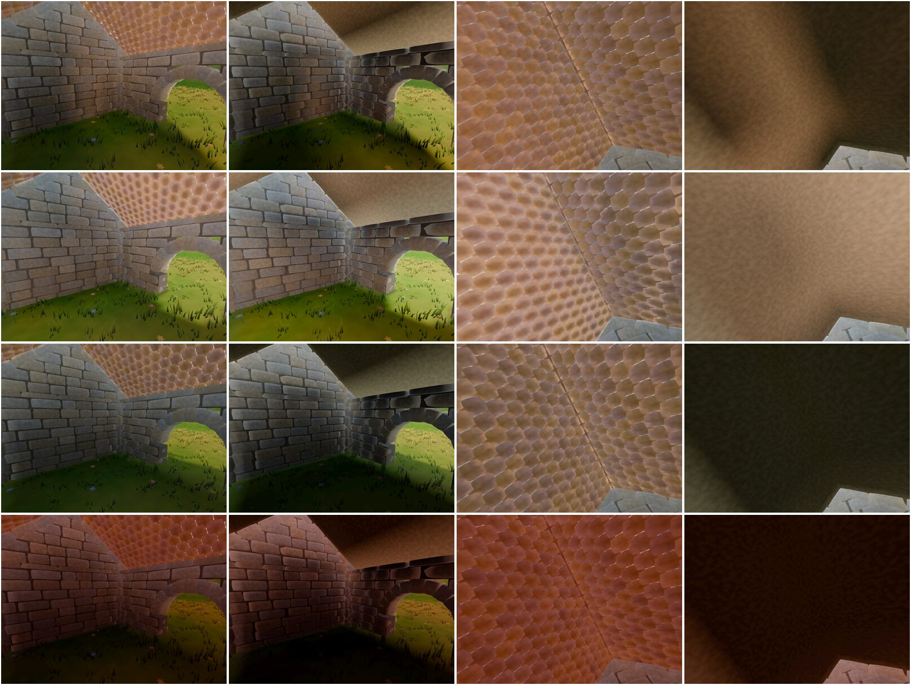
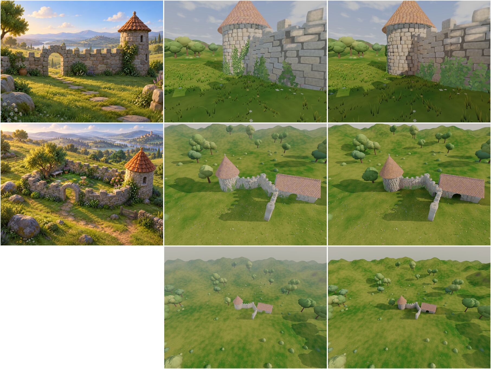

# Nestcombe design

Nestcombe is a cozy building toy for VR, inspired by Tiny Glade: no goals, no
failure, just a meadow and tools that turn rough strokes into stone walls, paths,
houses and gardens that look hand-made. You draw in the space around you, stand in
what you built at life size, or teleport into the air and float above it like a
diorama.

It is a clean-room game. Every asset is generated by code in this repository or
authored for it; nothing comes from Tiny Glade's files, and nothing here is derived
from inspecting them. The "how the original does it" column below summarises what
its developers have said publicly (sources at the end), so we know what feel we are
aiming at; our implementation is our own.

## Requirements

- Standalone on the Steam Frame, from Steam as an Android depot run by Lepton (see
  "Steam Frame route") or as the arm64 Linux export from a library shortcut, and on
  Quest 2 and later as a sideloaded APK (`scripts/android.sh quest`). Every release
  (`scripts/release.sh`) carries every build.
- One graphics configuration for every headset: a ladder from full quality down
  that each headset walks by its own GPU time, settling on the prettiest step it
  can hold (see "Automatic quality"). No per-device quality tiers, no settings
  menu.
- Hold the headset's refresh rate at all times, whatever is built. A frame that
  misses vsync in VR is felt, not seen; every feature is measured at worst-case
  density before it lands (see "Frame budget").
- Original assets, generated procedurally wherever possible; avatar motion uses
  licensed human-made recordings (`LICENSE-CMU-WAVE`), never invented animation.
- One input mapping that works on any OpenXR controller with a stick, trigger,
  grip and two face buttons.
- No text, with one exception: the player's name in the session picker (the visit
  tool's figures, docs/multiplayer.md "Finding each other"). Nothing else gets text
  under this exception.

  Directive (verbatim): "in the multiplayer menu... I don't expect this to be solved now, but it was difficult to determine which... session to join... just by the avatar. I think eventually we'll need to break my rule about having no text. And we'll need to... I guess for Steam works, we'll need to display the... user profile... next to their avatar and their name"

## Engine and target

**Decision: Godot 4.6 (Mobile renderer, OpenXR), running standalone on the Frame.**

Two options were considered:

| Option | What it costs | Evidence |
| --- | --- | --- |
| A. Standalone on the Frame (Snapdragon-class SoC, Adreno GPU) | A mobile GPU budget: forward/tiled rendering, no screen-space GI, careful overdraw | Measured: see "Frame measurements" below. Godot's official aarch64 Linux build runs on the Frame's SteamOS and drives SteamVR's OpenXR runtime directly |
| B. Rendered on a desktop PC, streamed to the Frame | A desktop GPU budget, but every frame crosses Wi-Fi: encode, transmit, decode, reproject | Desktop-to-Frame streaming sessions measured on our setup show inconsistent delivered frame rates and stalls; that path is being reworked separately. A game that must hold refresh cannot depend on it today |

Standalone wins on the requirement that matters most, a steady refresh rate, and
it removes a PC from the loop. The look is designed for the mobile budget
(below). If streaming becomes reliable, the same Godot project can switch to the
Forward+ renderer on a PC with no code change, which would unlock heavier lighting
as an optional tier.

Godot rather than a custom Rust/Vulkan engine: OpenXR, multiview stereo,
instancing, shadows and fog come built in, the official binary runs on aarch64
Linux, and GDScript reloads without a compile step. Generators are plain data code
(`WallLayout` builds stone transforms, nodes only render them), so a hot generator
can move to a GDExtension later without touching the rest.

### Steam Frame route

**Decision: the Frame gets Nestcombe from Steam as an Android depot,
`scripts/android.sh lepton`, run by the Frame's Lepton container.** It is the only
Frame route Steamworks documents (a depot with its OS set to Android and a top-level
`.apk`); its depot settings name no ARM Linux option. The APK uses the OpenXR vendors
plugin's Khronos flavor, so no Meta SDK material is in it (docs/package-notices.md).
The arm64 Linux export stays for direct installs.

Both builds were measured on the Frame from one revision, one stress tour
(`demo/stress.json`), unworn, at 1728×1728 per eye and 72 Hz. Both ran on the same
Turnip Adreno 750 driver and SteamVR OpenXR 2.18.2, in the order native, Lepton,
native. GPU time is per frame, the median of each phase's seconds, from Godot's
viewport GPU timer in every column.

| | Native arm64, run 1 | Native arm64, run 2 | Lepton APK |
| --- | --- | --- | --- |
| Phases holding 72 Hz, of 39 | 18 | 17 | 21 |
| GPU ms, flora/aerial | 10.83 | 10.82 | 7.43 |
| GPU ms, r15/aerial (walls) | 18.36 | 20.14 | 15.38 |
| GPU ms, hills/aerial | 29.26 | 34.78 | 25.42 |
| Lepton ÷ native GPU time, median over phases | | | 0.84 (vs run 1), 0.77 (vs run 2) |

The APK ran between the two native runs and beat both, so drift over the session
does not explain the gap; the native runs themselves differ by up to 19% on the
heaviest phases. Its cause was not measured. Both builds rendered at the same size, through the same driver and
runtime, with only the fossilize Vulkan layer loaded. Over budget, the APK and
the second native run dropped to whole fractions of the refresh rate (36 or 24 fps),
and the first native run to its GPU-bound rate (31 to 67 fps); either way frames are missed. Launched from a
Steam library entry through the Lepton compatibility tool, the APK opens its XR
session at 72 Hz and holds it on the opening scene: 73 fps, 4.7 ms of GPU time, no late frames.

Inside Lepton, `metrics.json` has no `gpu_ms`, because the in-game DRM reading
finds nothing there. The Lepton figures above are the viewport GPU timer, which
`Quality` steps by and which works there. Phase by phase, it agrees with the
same DRM counters read from the host (median difference 0.8%, at most 7.6%). That host reading matched the in-game one
over a native run: 457.3 s against 456.5 s.

### Frame measurements

Explicit `--metrics PATH` writes a benchmark record to that path: per second, frame-time
percentiles, frames over 1.5× the refresh period, and `gpu_ms`, the GPU time the
game process used in that second (summed `drm-engine-*` time from the kernel's
fdinfo, so it is real on the device whether or not the runtime reports any).
`info` records the render-target size, the render scale and each eye's field of
view. Ordinary play writes no session telemetry unless explicitly opted in (see
"Local play-session history" below).

`info.eye_gaze` records whether the runtime tracks the eyes for the game
(XR_EXT_eye_gaze_interaction: the Steam Frame's SteamVR does; the Quest 2 has no eye
cameras). The rig's `Gaze` node follows the `/user/eyes_ext` tracker. Nothing in play
uses it ("Detail by gaze"); `demo/gaze.json` shows a debug gaze ray and logs the gaze pose twice a
second, which reads untracked while the headset is off the head.

Off the head SteamVR puts the headset in standby and, by default
(`power.pauseCompositorOnStandby`), pauses the game: about 0.3 ms of GPU time a
frame, every frame on vsync, nothing drawn, so such a run measures nothing. With
that setting off, set live through SteamVR's settings interface rather than by a
SteamVR restart, the unworn headset renders the game through its own XR session and
compositor at full cost; `scripts/bench.sh`'s Frame mode measures that way. Its
times are the headset's render path: the runtime's render target, both eyes, the
foveation layer and the compositor. They stand in for a worn session's game GPU
time, short of what only a worn session runs: eye tracking and the passthrough
cameras, whose load on the shared SoC is not in these numbers, and a tracked gaze,
so foveation follows no eye unworn. A run with the headset worn (Godot 4.5.1 Mobile
renderer, Turnip Adreno 750, SteamVR 2.18.2, 1728×1728 per eye, 4× MSAA, one drawn
wall, before the flora stage) rendered at 27.78 ms per frame, every other 72 Hz
refresh, with about 16 ms of GPU time per frame.

A 28-minute worn session building a garden on 8c0a52a (before the 0.9 resolution step,
the governor's line and the worker-thread lays) wrote 1,662 seconds of `metrics.json`.
Worn, the viewport's GPU timer reads 0.15 ms under fdinfo's (median; correlation 0.999),
so the governor's signal holds on the head. The runtime still halved the rate whenever
the GPU time per frame neared the period, and the time followed the primitives drawn:

| Primitives a second's frames drew | Seconds | Viewport GPU per frame (median) | Seconds at half rate |
| --- | --- | --- | --- |
| under 0.6 M | 202 | 6.0 ms | 0% |
| 0.6–0.9 M | 504 | 8.3 ms | 7% |
| 0.9–1.3 M | 759 | 13.6 ms | 58% |
| 1.3–2 M | 115 | 15.6 ms | 74% |
| 2–2.5 M (the finished garden) | 81 | 23.1 ms | 99% |

Over the session 637 seconds ran at half rate and 987 at 72 Hz; the quality ladder at its
bottom step did not bring the finished garden under the period. Holding the refresh rate
at a finished garden's density is open work. The first of each run of late frames is logged
as it happens (`metrics: late frame`), with the time the frame before it took in
scripts and on the GPU, between the script steps around it.

The runtime's recommended render target is 1728×1728 per eye on a 2160×2160 panel,
and Valve's foveation layer (`VK_LAYER_VALVE_fdm_injection`) lowers shading density
outside the gaze in every frame. `--render-scale` sets the render target relative
to the runtime's recommendation.

`demo/headset.json` unworn with the standby pause off, rendering (about 8 ms of
GPU time per frame), first three phases:

| Phase | Seconds | Frame time p99 | Frames over 1.5× the refresh period |
| --- | --- | --- | --- |
| Meadow idle | 18 | 14.29 ms | 0 after the session's first second |
| Drawing a wall (live rebuild) | 18 | 14.29 ms | 0 |
| Floating 6 m up, air teleport and a capture | 47 | 14.29 ms | 0 |

A 142 ms frame once seen at the air teleport was the script's capture just before
it, which encoded its PNG on the main thread; captures now save on a worker
thread, as the camera's photos do.

A painted stroke grows its plants over the frames after its command, within 1.5 ms of
script a frame. Grown in the frame its command applied in, the flora phase's 4 s grass
stroke (about 850 plants) took 24 ms of main-thread script on the Frame and one late frame
at every release; a full stroke of 4000 would take about 110 ms. Its spots are still laid out
as the command applies: 7.4 ms for a full stroke of 4000 on the Frame, with no late frame. The flora phase (flowers,
grass, two trees, ivy on the wall), unworn with the standby pause off, and the measured
phases of `demo/grass.json`:

| Run | Flora phase: late frames, frame time p99 | `grass.json` bench-eye, bench-kneel: late frames |
| --- | --- | --- |
| Before (d9f8ec7), two runs | 1 (22 ms), 1 (28 ms) | 0, 0 |
| After | 0, 13.89 ms | 0, 0 |

A command that takes more than 4 ms to apply is logged (`world: applying path took 11.8 ms`):
the late-frame line's script time leaves out what a demo script's driver runs, and it showed 3 ms
for the frame the stroke cost 24 ms in.

Building lays nothing on the main thread. A wall settling after a command, a roof being
pulled and a wall top changing are laid on a worker thread while the stones standing stay in
view; the garden's copy of a wall in hand takes the stones the player's preview already laid
when they were laid from the same inputs. Each edit now costs 1 to 3 ms of main-thread script
(20 to 30 ms before, headless). The houses phase's edits (a tower, a house, two roofs reshaped,
a wall top changed), each followed by 10 s, with the ladder held at its first step, then at
full 3D resolution:

| Build | Frames over 1.5× the refresh period |
| --- | --- |
| Before (8de66b6) | 72 (tower 1, roofs 37 and 33, top 1) |
| After, four runs | 0 each |

Governed, the late frames left in the houses phase come from GPU time, not the edits. The
tower, the house and their ivy take full quality to 11.5 to 11.8 ms a frame on the governor's
timer for two to three seconds while the house is still being carried. That timer reads about
0.3 ms under the fdinfo time, so this sits at the runtime's 0.88 line (12.2 ms) but not over
the governor's old line at 0.85 (11.8 ms), and the runtime halved the rate before the governor
stepped down. The line is now 0.80 of the period:

| Line | Late frames in the houses phase |
| --- | --- |
| 0.85 (e988801), the phase up to its capture | 37, 3, 98: the runtime at every other refresh for up to 4 s |
| 0.80, the phase up to its capture | 1, 1, 1 |
| 0.80, the whole of `demo/headset.json` | 34, 1 |

Every one of those at 0.80 followed the ladder's step to 0.9 resolution itself, which the
governor took before the runtime's line: switching to 0.9 cost a 25 to 72 ms frame now and
then, and once that frame took the runtime to every other refresh for half a second (the 34).
The Frame now renders at 0.9 from launch, and only the ladder's last step, below every other,
changes the resolution (see "Which knobs matter" and "Holding 72 Hz on the Frame").

`demo/headset.json` on 5a0292a against the same build held at 0.9 from launch, three runs each,
late frames (over 1.5× the refresh period) and GPU time per frame (fdinfo):

| Phase | Stepping down to 0.9 | Held at 0.9 |
| --- | --- | --- |
| Houses | 34, 2, 34; 9.65 ms | 0, 0, 0; 9.6 to 9.7 ms |
| Erase | 0, 0, 0 | 0, 0, 0 |
An earlier pair of runs with the line at 0.82 gave 1 and 75 late frames; they were not split
by cause.
`scripts/bench.sh` with `NESTCOMBE_SCENE=demo/headset.json` runs this check on the Frame; its
`late` column counts every frame of a phase.

### Quest 2 measurements

The Quest 2 (XR2 Gen 1, Adreno 650) is the weakest headset and sets the one
graphics configuration: 13.9 ms per frame at its 72 Hz. Its runtime prints a line
a second to logcat (`VrApi`): `FPS=` delivered/refresh and `App=`, the game's GPU
time per frame. With the proximity sensor held closed
(`adb shell am broadcast -a com.oculus.vrpowermanager.prox_close`) the headset
renders the game off the head, so those numbers are real; `--script` and the other
game arguments reach it through `launch.args` in its external files folder, one a
line, since Godot drops a launch intent's arguments on an exported activity. Off the head, with no floor known, the tracked head sits at ground level, so
a script lifts the view with `place`'s `lift`. Godot 4.5.1 Mobile renderer, 4×
MSAA, the runtime's default render size, median of 20 seconds after two walls are
drawn.

How the configuration was found, with the eye at ground level looking at the
walls:

| Configuration | GPU per frame | Frames per second |
| --- | --- | --- |
| As first built, the Frame's settings | 32.1 ms | 29 |
| Glow off | 22.6 ms | 42 |
| Grass clump mesh indexed (63 to 35 vertices) | 18.2 ms | 51 |
| The meadow's plants baked into 16 m cells the camera culls | 16.8 ms | 56 |
| Grass drawn to 28 m, shrinking into the ground from 20 m | 13.4 ms | 70 |
| Flower and leaf meshes indexed | 13.1 ms | 71 |
| Grass drawn to 24 m | 12.4 ms | 72 |

Single changes from the first row, for scale: shadows off saved 2.6 ms, fog off
1.4 ms, MSAA off 6.3 ms, render scale 0.8 (with glow off) 1.6 ms; foveation level 3
applied (`Fov=3`) and saved nothing. The GPU is bound by grass vertices and by
glow's extra passes, not by pixels.

The configuration as it stands:

| View | GPU per frame | Frames per second |
| --- | --- | --- |
| Standing (1.65 m) at the walls | 11.8 ms | 72 |
| Floating 8.5 m above them, looking down over the meadow | 15.9 ms | 58 |

Floating misses. What it costs there: the grass 3.2 ms, trees and bushes 2.1 ms,
shadows 2.0 ms, flowers 1.0 ms; one shadow split instead of two, or 30 m of shadow
instead of 45 m, saved nothing.

The animals on the stress scene (`bench.sh OUT --android APK`, the ladder at its top, median of each
phase; frames are over the budget's 12.5 ms everywhere at the top, the bare meadow standing included at
26.5 ms):

| Phase | GPU per frame | Draw calls | Primitives |
| --- | --- | --- | --- |
| `meadow/ground` | 26.5 ms | 114 | 369,126 |
| `sheep/ground` | 41.7 ms | 310 | 1,107,236 |
| `deer/ground` | 31.1 ms | 157 | 944,983 |
| `fox/ground` | 31.1 ms | 162 | 949,479 |

The deer and fox views look over the meadow's edge at the trees, which take the rest of their time.
What the animals themselves cost, on the meadow alone, the same view with them shown and then hidden,
twice each (GPU ms a frame):

| View | Shown | Hidden | Difference |
| --- | --- | --- | --- |
| Deer, first | 32.25 | 32.50 | -0.25 |
| Deer, second | 33.80 | 33.83 | -0.03 |
| Fox, first | 31.50 | 31.33 | +0.17 |
| Fox, second | 33.22 | 32.67 | +0.55 |

They cost 2 to 3 draw calls and 2,000 to 6,000 primitives in view, within the run's half-millisecond
noise, so nothing about them is made cheaper.

The fish's feeding frenzy, from one stress-scene run with the 0.7 swapchain
(`perf/quest-2/stress/20261019T153539Z-16f670e.json`): `fish-frenzy/ground` looks down on the pond at
radius 14 a second after three handfuls land on it, with its fish feeding, and `deer/ground`, the next phase,
draws nearly the same frame with the pond calm:

| Phase | GPU per frame | Frame p50 | Draw calls | Primitives |
| --- | --- | --- | --- | --- |
| `ponds/ground` | 25.37 ms | 28.06 ms | 189 | 789,916 |
| `sheep/ground` | 30.31 ms | 32.83 ms | 212 | 809,936 |
| `fish-frenzy/ground` | 25.38 ms | 27.78 ms | 177 | 758,434 |
| `deer/ground` | 25.18 ms | 27.72 ms | 177 | 758,184 |

The frenzy reads +0.01 ms against `ponds/ground`, -4.93 ms against `sheep/ground` and +0.20 ms against
the calm `deer/ground` view, inside the 0.6 ms spread of the pond phases with nothing added
(`ponds`, `ducks`, `conures` on the ground: 25.37 to 25.98 ms). The record before it
(`20261019T071201Z-6f3dc2d.json`, the full-size swapchain) read the same order: 41.82 ms against 44.81 ms
and 44.87 ms. The frenzy costs nothing measurable, so `Fish.tick` is left as it is.

## Frame budget

Directive (verbatim): "The-the only reason I could see for adding a resource to this
game... is to represent... frame budget. Cause I don't want the game getting bogged
down when someone makes some big build. I don't want it to be possible to make a
build that... bogs down the frame rate"

Directive (verbatim): "...through the whole course of this game, we'll need a heavy
focus on... making it run fast, because it's in VR. That's important"

So speed is a standing focus: every feature holds the refresh rate at worst-case
density, and no build the player can make may bring the frame rate down.

- `game/src/budget.gd` holds the budget: the refresh rate of the weakest headset
  and the share of each frame the game's GPU work may take. Nothing else states it.
- `demo/stress.json` is the worst case: the bare meadow, then every flora pool full,
  a 27 m wall drawn live, walls 2 m apart (the closest `WallPlan` lets them stand)
  over discs of 10 to 25 m radius at 4.5 m tall, 9 m walls, a village of houses
  two storeys high, every other one turned a quarter, each crossed by a wing, tiled and then thatched, eight ponds, and the most ducks there can be at them (`bench.sh`
  fixes the seed) and the most sheep at four fences between them (seen too from the ground by a fence), the deer and the fox each seen from a person's height, with every butterfly there can be
  over the full flower pool and the most conures there can be among the full pool of planted trees,
  every firefly there can be over the ponds at dusk, and a hill pulled up live under 973 m of walls,
  each seen from the air and standing among them, then both hands pushed into the walls beside the player, then the camera held up to it and a photo taken each second, then the selfie camera held out at the player, whose own avatar it draws.
- `scripts/bench.sh OUT_DIR` plays it and prints, per phase, frame time, draw
  calls, primitives and GPU time; on a Quest it holds each phase to the budget and
  fails when one goes over. A new feature adds itself to the stress scene.
  `NESTCOMBE_PLAYERS=8 NESTCOMBE_WAVE=1` fills the session with flat-screen
  companions playing the recorded wave throughout the tour, including its final
  `avatars/wave` view.
- Each run records its phases under `perf/HEADSET/SCENE/`, named by the build measured; `scripts/trend.py` prints the
  latest run of each beside the one before and the best, marking a rise of a tenth. It only reports.

What makes building cheap:

- Settled walls are drawn by `Masonry` per 8 m ground chunk: one MultiMesh per
  kind of piece per chunk, each piece in the chunk under it, so a chunk is culled
  and limited by distance by where its pieces stand, however long their wall. A
  wall being drawn or pulled draws by a `Masonry` of its own, in the same chunks with
  the same coarse far stones, until it settles into the glade's.
- A chunk wholly beyond the near distance of the quality step draws its stones
  and roof tiles with `Stones.far_mesh`, the same lumps at the corners alone: 12
  triangles to the full stone's 108 and the full tile's 48. Ivy chunks past ivy's reach are not drawn at all.
- Stones and roof tiles cast no shadow themselves; a box of 8 vertices per stone
  does. Mortar, seen only in the gaps, is a plain box. A stone's faces share the
  vertices along their borders.
- A wall's live preview is laid on a worker thread from a copy of its inputs, so a
  long stroke costs the main thread nothing while it grows.
- A vine lays one three-leaf sprig a step rather than three leaves; sprigs shrink
  away over the last 15 m of ivy's reach.
- Ground moving under walls changes neither their data nor where paths cross them,
  so a stroke only lays their stones again on a worker thread, and a wall settles
  from the preview laid on the ground as it settled. A replaced layout's stones are
  freed by the wall's next worker task: dropping thousands of them took 3 to 5 ms
  a wall. Pulling a hill up under eight of 973 m of walls, headless (CPU only),
  had frames of 22 to 58 ms at the 99th percentile and two of 117 and 133 ms as
  it settled; now no frame of the stroke or its settling passes 7.1 ms.

Measured on the Steam Frame in its XR session unworn (`bench.sh OUT SSH_HOST BUNDLE`,
see "Frame measurements"), with the GPU clock's floor held at its top (903 MHz) for the
run so builds compare: the game's GPU time per frame (fdinfo) and the frame time, median
of each phase, the quality ladder held at its top. Before is the stress scene on the
build before the wall changes below, after is the build with them; milliseconds:

| Phase | View | Before: GPU, frame | After: GPU, frame |
| --- | --- | --- | --- |
| Meadow | from the air | 8.3, 13.9 | 8.3, 13.9 |
|  | standing | 5.8, 13.9 | 5.9, 13.9 |
| Every flora pool full | from the air | 10.0, 13.9 | 10.0, 13.9 |
|  | standing | 9.1, 13.9 | 9.2, 13.9 |
| Every butterfly | from the air | 9.9, 13.9 | 10.0, 13.9 |
|  | standing | 9.1, 13.9 | 9.2, 13.9 |
| A 27 m wall drawn live | while drawn | 11.0, 13.9 | 10.9, 13.9 |
| Walls on a 10 m disc | from the air | 15.7, 27.8 | 14.5, 27.8 |
|  | standing | 18.2, 27.8 | 18.4, 27.8 |
| 15 m | from the air | 18.4, 27.8 | 16.0, 27.8 |
|  | standing | 20.9, 27.8 | 21.2, 27.8 |
| 20 m | from the air | 23.6, 27.8 | 19.2, 27.8 |
|  | standing | 28.6, 41.7 | 24.9, 27.9 |
| 25 m | from the air | 34.3, 41.7 | 23.6, 27.8 |
|  | standing | 32.0, 41.7 | 31.9, 41.7 |
| 9 m walls on a 15 m disc | from the air | 23.1, 27.8 | 17.9, 27.8 |
|  | standing | 23.7, 28.3 | 28.2, 41.7 |
| Village | from the air | 30.2, 41.7 | 20.6, 27.8 |
|  | standing | 28.9, 41.7 | 23.3, 27.8 |
| Plaster houses | from the air | 22.9, 27.8 | 20.9, 27.8 |
|  | standing | 23.9, 27.8 | 23.3, 27.8 |
| Plaster village | from the air | 17.4, 27.8 | 17.1, 27.8 |
|  | standing | 9.3, 13.9 | 9.3, 13.9 |
| Ponds | from the air | 10.0, 13.9 | 10.0, 13.9 |
|  | standing | 8.8, 13.9 | 8.8, 13.9 |
| Ducks | from the air | 10.0, 13.9 | 10.0, 13.9 |
|  | standing | 8.8, 13.9 | 8.8, 13.9 |
| Conures | from the air | 10.0, 13.9 | 10.1, 13.9 |
|  | standing | 8.8, 13.9 | 8.8, 13.9 |
| Sheep | standing | 9.5, 13.9 | 9.5, 13.9 |
| Dusk falling | from the air | 10.2, 13.9 | 10.2, 13.9 |
| Fireflies | from the air | 9.4, 13.9 | 9.4, 13.9 |
|  | standing | 8.2, 13.9 | 8.2, 13.9 |
| A path stroke | while pulled | 36.3, 41.7 | 25.5, 27.8 |
| Hills | while pulled | 33.3, 41.7 | 29.4, 41.7 |
|  | from the air | 34.9, 41.7 | 23.8, 27.8 |
|  | standing | 32.2, 41.7 | 31.6, 31.7 |
| Camera held up | standing | 35.4, 41.7 | 32.5, 41.7 |
|  | a photo a second | 32.4, 41.7 | 31.2, 41.7 |
| A garden as built in play | from the air | 18.8, 27.8 | 17.7, 27.8 |
|  | standing | 15.3, 27.8 | 15.0, 27.8 |

Two traps in measuring this. A scripted view used to last a second in the headset: the
rig's hover spring pulled it back to its rest height, so every phase "from the air" was
measured from the unworn headset's own pose on the ground; views now hold. And GPU time
read at half rate is not the scene's cost (see "Holding 72 Hz on the Frame" below): rows at
a frame time of 27.8 ms or more compare only roughly.

Where the time went among walls on a 25 m disc, measured by hiding each part in turn
within one run at the ladder's top, before the wall changes, from the unworn headset's own
pose: on the ground, facing a wall a few metres off:

- Stones: their triangles. Every pixel the same, 3 segments a face to 2 saved 4.6 ms and
  to 1 (12 triangles) saved 10.2 ms; sharing the vertices along the faces' borders (56
  instead of 96, the same surface) saved nothing measurable. The cost follows the
  triangles each stone runs, not its vertices or its pixels.
- Ivy: 5 to 9 ms, its far leaves shrunk to nothing but
  still drawn, because a whole wall's ivy sat in the one chunk under the wall's centre.
- The sun's shadows of the walls: about 3.6 ms; the shadow boxes alone 0.7 ms once they
  were boxes of 8 vertices.
- Flora, terrain and the meadow's shadows: the rest, 9 to 14 ms.

So settled pieces now go to the chunk under each, far chunks draw 12-triangle stones,
ivy chunks past ivy's reach are not drawn, and both distances are on the quality ladder
("Automatic quality"). From the air the walls cost about a third less; standing among
them, where the stones are near, about the same.

At the ladder's bottom step, a garden as built in play (`demo/stress.json`'s garden
phase: about 200 m of walls, two houses, forty planted trees, hills), every part hidden in
turn at 72 Hz, from the air: walls 2.5 ms, the sun's shadows 2.0 ms, terrain 1.6 ms,
trees 0.6 ms, ivy 0.2 ms; a 3D resolution of 0.7 instead of 0.9 saved 2.4 ms. Standing:
walls 0.8 ms, shadows 1.3 ms, terrain 0.5 ms.

What is left grows with what is built, so building needs a bound: "Build budget" below.

Measured on a Quest 2 (`NESTCOMBE_SCENE=demo/costs.json bench.sh OUT --android APK` on
ecef026: in the headset with its proximity sensor held closed, the runtime's `App=` GPU time
per frame, median of each phase, CPU and GPU held at level 4, 525 MHz, the ladder at its
bottom step, no other process rendering). GPU milliseconds a frame against a 12.5 ms budget;
every phase ran at half rate, 36 fps:

| Phase | From the air | Standing |
| --- | --- | --- |
| Bare meadow, its own flora cleared | 18.7 | 17.5 |
| Meadow | 21.2 | 20.2 |
| Grass pool full | 21.3 | 22.9 |
| Flower pool full | 19.6 | 20.8 |
| Tree pool full | 23.7 | 21.4 |
| Walls, 10 m disc | 22.8 | 28.1 |
| Walls, 15 m disc | 26.6 | 29.3 |
| Walls, 20 m disc | 32.8 | 31.3 |
| Plaster walls, 15 m disc | 22.1 | 25.6 |
| Fences, 15 m disc | 20.3 | 20.1 |
| Eight ponds | 20.8 | 18.0 |
| Village, 12 m disc | 28.1 | 20.5 |
| Lanterns on the 10 m disc's walls | 23.3 | 31.1 |

The meadow alone, from the air (22 m up) and standing, at the ladder's top and bottom
steps (`App=` ms):

| Build | Top, air | Top, standing | Bottom, air | Bottom, standing |
| --- | --- | --- | --- | --- |
| 48029e0 | 27.7 | 22.7 | 21.0 | 18.1 |
| fdb33cb | 41.1 | 27.1 | 28.7 | 23.8 |
| ecef026 | 33.4 | 23.8 | 20.9 | 20.1 |

An earlier table here read the meadow at 14.2 and 12.0 ms on 48029e0 at the top step. That
build still reads so on the Quest 2 (14.1 and 12.7) while the Meta plugin's dynamic
resolution runs: the runtime's `SF=` fell to 0.50 and the render region with it. With it
off, as 737a292 left it (see "Automatic quality"), the same build reads 27.7 and 22.7 at
`SF=1.00`, so the old table measured half the pixels, not a faster scene.

Between 48029e0 and fdb33cb two commits added cost at full resolution: d353166's sparse
far grass to 60 m (9 ms from the air at the top step only, the ladder's to give up) and 14753cc, whose
fragment shader branched into `ground_normal` for live humps and paid it on every ground
fragment (7.5 ms from the air, 3.5 standing, at every step; ecef026 reads that slope per
vertex). The scene renders as one 4x MSAA 1440x1584 surface and its render stage now
dominates (17 ms of it at the bottom step from the air, 1.7 ms binning), so on the Quest 2
it is fragments, not vertices, that hold 60 fps out of reach: the bare meadow alone needs
about a third less GPU time, which the measurement at `SF=0.50` says fewer pixels buy.

The walls' cost is vertex work on the GPU. Frame time follows the GPU time, the
live wall preview holds 72 Hz on the CPU (below), and draw calls stay near 150 at
every size. Dropping the stones' levels of detail (primitives at 973 m from 4.4 M to
7.1 M) cost nothing; a trial build with a plain 12-triangle box per stone (24 vertices
instead of 96) had about the primitives the levels of detail had and roughly halved
what the walls cost over the flora (measured with the headset's shell rendering
beside the game, so those runs' own times read high): what costs is the vertices each
stone instance runs, so the stone mesh is the lever.

The live wall preview, measured with the view turned to the sky so the GPU sits
idle: every second of two 5 s strokes ran 72 frames with none late, the 99th
percentile 14.3 ms as with no stroke at all.

### Holding 72 Hz on the Frame

Through the ladder the stress scene held 72 Hz on the Frame in all but ten of its phases:
9 m walls standing, the village, the path and hill strokes, the hills from the air, the camera
and a garden from the air sat at every other refresh at the ladder's bottom step for the whole
of each phase. Three causes, measured on
the Frame unworn with its standby pause off, the governor walking the ladder and each phase held
20 s:

- The runtime's half rate holds itself. Once at every other refresh, the GPU timer reads
  high by the runtime's own work in between: 9 m walls standing at the bottom step read
  11.2 ms at 72 Hz entered calm and 14.0 ms held at half rate, the same step and the same
  1.9 M primitives. The runtime let a scene back only once it read under about 11 ms (a
  path stroke sat at half rate reading 11.2 to 11.6 ms, and left it once it read 7.9), and the governor's
  line is 11.1 ms, so it sat there without stepping. Turning SteamVR's motion smoothing off
  mid-run took 2 ms off that reading and left the half rate as it was. Now the runtime
  holding the game at every other refresh counts as over budget whatever the timer reads,
  as long as the timer is above 0.6 of the budget, below which the CPU held the frame.
- The governor waited for each step to arrive before judging the next, and flowers
  receding from 60 to 20 m take five seconds: a path stroke walked from step 4 to the bottom
  over 16 s at half rate. Frames over budget now step on while a step is under way, short of a
  step that pops.
- A wall under a moving hill drew itself whole in full stones until it settled: the hill
  stroke doubled the primitives drawn (0.97 to 2.17 M) at the bottom step. It now draws by
  its own chunks, far ones in coarse stones.

What the bottom step still costs, every part hidden in turn after the scene had returned to
72 Hz (GPU ms a frame, fdinfo):

| Phase, bottom step | All | No sun shadows | 3D resolution 0.7 | No walls | No flora |
| --- | --- | --- | --- | --- | --- |
| 9 m walls standing | 11.2 | 10.1 | 9.3 | 8.0 | 9.5 |
| Village standing | 11.4 | 10.3 | 9.4 | 7.9 | 9.4 |
| Village from the air | at half rate | 12.2 | at half rate | 7.8 | at half rate |
| A path stroke | 11.4 | 9.8 | 9.3 | 8.6 | 7.6 |
| Hills from the air | 11.4 | 9.8 | 9.3 | 8.6 | 7.7 |
| Camera held up | 12.0 | 10.3 | 9.9 | 8.8 | 9.8 |
| A garden from the air | at half rate | 10.2 | 9.4 | 9.6 | 7.1 |

Hiding the terrain and holding shadows to 64 m instead of 256 m each saved nothing. So the
ladder gained two steps below the old bottom: the sun's shadows off, then the 3D resolution
at 0.78 of the headset's own (0.70 on the Frame). Both show at once across the whole view, so
a step up out of either waits the governor's longest calm (64 s), and one undone is not taken
again that session. Ending the ladder above a step that saved nothing was tried and cut: the
village appeared in the same second the resolution step landed, read as a step that cost 1.6 ms,
and held the governor two steps up for the rest of the run. On the Quest 2 the bottom step's bare
meadow took 16.5 ms of App GPU time from the air and 14.2 standing at full swapchain size, so
the Quest 2 draws a smaller swapchain for the whole session (below). Without the resolution step the village from the air stayed
at every other refresh at the shadows-off step (14.7 ms). Every step up out of them in a
governed run of the stress scene cost no late frame (the longest 18.8 ms). A garden within the
build budget never reaches them on the Frame: its `Budget.COSTS` are fitted at step 8, the last
with the sun's shadows and the full resolution (`Budget.fit_step`).

Every phase of the stress scene on the Frame: GPU ms a frame (fdinfo, the median of the
phase's seconds after its first, or of its last 15 s where governed) and frames a second over
the whole phase, edits landing in its first second included; governed, the steps held in its
last 15 s in brackets. Full detail holds the ladder at its top (6 s a phase); governed lets the
ladder walk (20 s a phase). Before is the build this work started from; after is this work,
with the ground's steepness read once a fragment (a separate change landed in between):

| Phase | Full detail, before | Full detail, after | Governed, before | Governed, after |
| --- | --- | --- | --- | --- |
| `meadow/aerial` | 9.6, 73 Hz | 9.2, 73 Hz | 9.5, 73 Hz (0) | 9.6, 72 Hz (0) |
| `meadow/ground` | 6.8, 67 Hz | 6.6, 68 Hz | 6.7, 71 Hz (0) | 6.6, 71 Hz (0) |
| `meadow/edge` | 8.0, 72 Hz | 7.7, 73 Hz | 8.0, 73 Hz (0) | 8.1, 72 Hz (0) |
| `paths/ground` | 8.1, 72 Hz | 7.8, 73 Hz | 8.1, 73 Hz (0) | 8.1, 72 Hz (0) |
| `flora/aerial` | 11.4, 73 Hz | 11.1, 72 Hz | 10.9, 73 Hz (0-1) | 11.0, 72 Hz (1-2) |
| `flora/ground` | 9.1, 73 Hz | 8.9, 72 Hz | 9.1, 73 Hz (0) | 8.8, 73 Hz (1-2) |
| `butterflies/aerial` | 11.4, 73 Hz | 11.1, 72 Hz | 10.9, 73 Hz (1) | 10.8, 73 Hz (2) |
| `butterflies/ground` | 9.1, 73 Hz | 8.9, 73 Hz | 9.1, 73 Hz (0-1) | 8.8, 72 Hz (1-2) |
| `drawing` | 10.8, 72 Hz | 10.5, 73 Hz | 10.7, 72 Hz (0) | 11.0, 72 Hz (1) |
| `r10/aerial` | 15.1, 36 Hz | 14.8, 36 Hz | 10.6, 65 Hz (4) | 8.6, 70 Hz (7-8) |
| `r10/ground` | 10.3, 65 Hz | 10.1, 66 Hz | 10.0, 73 Hz (4) | 8.6, 73 Hz (7) |
| `r15/aerial` | 15.9, 36 Hz | 15.7, 37 Hz | 10.1, 69 Hz (6) | 9.2, 73 Hz (7) |
| `r15/ground` | 14.5, 36 Hz | 14.3, 36 Hz | 11.2, 73 Hz (7) | 10.2, 73 Hz (7) |
| `r20/aerial` | 17.6, 36 Hz | 17.3, 36 Hz | 10.2, 72 Hz (6-7) | 8.6, 72 Hz (9) |
| `r20/ground` | 15.8, 36 Hz | 16.3, 37 Hz | 10.7, 73 Hz (8) | 8.5, 72 Hz (9) |
| `r25/aerial` | 20.6, 36 Hz | 20.3, 36 Hz | 10.9, 73 Hz (8) | 7.8, 73 Hz (10) |
| `r25/ground` | 17.2, 36 Hz | 17.1, 37 Hz | 11.2, 73 Hz (8) | 7.3, 73 Hz (10) |
| `r15-tall/aerial` | 16.5, 36 Hz | 16.2, 36 Hz | 9.6, 73 Hz (6-7) | 6.6, 73 Hz (9-10) |
| `r15-tall/ground` | 16.2, 36 Hz | 15.7, 36 Hz | 14.0, 38 Hz (8) | 9.3, 73 Hz (9) |
| `village/aerial` | 21.1, 37 Hz | 20.7, 37 Hz | 16.8, 38 Hz (8) | 11.5, 72 Hz (10) |
| `village/ground` | 16.4, 36 Hz | 16.3, 36 Hz | 14.3, 37 Hz (8) | 8.2, 71 Hz (10) |
| `village-boards/aerial` | 21.0, 37 Hz | 20.7, 37 Hz | 16.9, 36 Hz (8) | 11.5, 73 Hz (10) |
| `village-boards/ground` | 16.6, 35 Hz | 16.4, 35 Hz | 11.4, 52 Hz (8) | 8.0, 72 Hz (10) |
| `village-steps/aerial` | 20.1, 37 Hz | 19.9, 36 Hz | 15.9, 38 Hz (8) | 10.5, 72 Hz (10) |
| `village-steps/ground` | 16.4, 44 Hz | 16.3, 33 Hz | 10.3, 70 Hz (7-8) | 6.3, 71 Hz (10) |
| `plaster/aerial` | 18.5, 38 Hz | 18.3, 38 Hz | 10.7, 73 Hz (7) | 6.8, 72 Hz (10) |
| `plaster/ground` | 14.5, 37 Hz | 14.3, 35 Hz | 8.8, 72 Hz (6-7) | 7.3, 72 Hz (9-10) |
| `plaster-village/aerial` | 17.8, 36 Hz | 17.4, 40 Hz | 11.1, 73 Hz (7) | 10.1, 73 Hz (9) |
| `plaster-village/ground` | 9.5, 72 Hz | 9.0, 70 Hz | 8.5, 73 Hz (6-7) | 6.5, 73 Hz (9) |
| `ponds/aerial` | 11.4, 73 Hz | 11.2, 73 Hz | 9.1, 73 Hz (6) | 8.1, 72 Hz (6-9) |
| `ponds/ground` | 9.2, 72 Hz | 9.0, 72 Hz | 8.8, 73 Hz (6) | 7.6, 72 Hz (2-5) |
| `ducks/aerial` | 11.5, 73 Hz | 11.3, 72 Hz | 11.1, 73 Hz (0-1) | 10.5, 72 Hz (0) |
| `ducks/ground` | 9.2, 72 Hz | 9.1, 73 Hz | 9.2, 73 Hz (0-1) | 7.8, 73 Hz (0) |
| `conures/aerial` | 11.5, 72 Hz | 11.3, 72 Hz | 11.1, 72 Hz (1) | 10.5, 72 Hz (0) |
| `conures/ground` | 9.2, 72 Hz | 9.2, 73 Hz | 9.2, 73 Hz (0-1) | 7.9, 72 Hz (0) |
| `sheep/ground` | 9.5, 72 Hz | 9.3, 72 Hz | 9.4, 73 Hz (0) | 8.4, 73 Hz (0) |
| `daylight/aerial` | 14.7, 52 Hz | 11.7, 73 Hz | 10.8, 48 Hz (2) | 10.7, 73 Hz (0) |
| `fireflies/aerial` | 14.2, 36 Hz | 14.0, 36 Hz | 10.5, 73 Hz (2) | 10.4, 73 Hz (0) |
| `fireflies/ground` | 9.1, 68 Hz | 9.0, 66 Hz | 9.0, 73 Hz (2) | 7.8, 73 Hz (0) |
| `paths/stroke` | 21.0, 36 Hz | 20.9, 36 Hz | 14.3, 36 Hz (8) | 8.1, 64 Hz (10) |
| `hills/stroke` | 24.3, 32 Hz | 20.0, 36 Hz | 14.3, 36 Hz (8) | 8.1, 72 Hz (10) |
| `hills/aerial` | 20.5, 37 Hz | 20.2, 36 Hz | 14.3, 37 Hz (8) | 10.0, 73 Hz (9-10) |
| `hills/ground` | 17.6, 37 Hz | 17.2, 36 Hz | 10.8, 70 Hz (7-8) | 8.7, 73 Hz (9) |
| `hands/walls` | 16.8, 36 Hz | 17.2, 36 Hz | 10.7, 73 Hz (8) | 8.6, 72 Hz (9) |
| `camera/ground` | 17.9, 35 Hz | 18.9, 34 Hz | 12.5, 38 Hz (8) | 7.7, 71 Hz (10) |
| `camera/shutter` | 17.2, 36 Hz | 18.1, 37 Hz | 11.6, 64 Hz (7-8) | 9.1, 73 Hz (9-10) |
| `camera/selfie` | 17.8, 37 Hz | 18.6, 37 Hz | 11.7, 64 Hz (7-8) | 9.2, 73 Hz (7-9) |
| `garden/aerial` | 19.2, 36 Hz | 19.0, 36 Hz | 14.9, 36 Hz (8) | 10.2, 72 Hz (9) |
| `garden/ground` | 10.9, 64 Hz | 10.8, 66 Hz | 9.2, 70 Hz (8) | 7.8, 73 Hz (9) |
| `lanterns/ground` | 10.4, 73 Hz | 10.5, 72 Hz | 8.8, 73 Hz (8) | 7.6, 73 Hz (9) |
| `lanterns/aerial` | 19.1, 43 Hz | 18.7, 41 Hz | 11.5, 73 Hz (8) | 9.7, 73 Hz (9) |
| `stairs/aerial` | 8.2, 72 Hz | 8.0, 73 Hz | 7.0, 73 Hz (8) | 6.9, 73 Hz (8) |
| `stairs/ground` | 7.2, 73 Hz | 7.0, 73 Hz | 6.5, 73 Hz (7-8) | 6.4, 72 Hz (5-8) |

A path stroke over the walls still loses frames for a few seconds with the GPU at 8 ms a
frame at the bottom step: the main thread spends 12 to 19 ms a frame laying the path, as it
did before this work, which no quality step reaches.

A visited garden past the build budget, as one came in a played co-op session (4.1 to
4.7 times the room, 23,000 stones, 130,000 to 150,000 sprigs of ivy): `demo/visited-host.json`
builds it unbounded on a headless host on the Frame itself, `demo/visited.json` joins it in
the headset (`--host-port` the host's `--port`), lets its ivy grow and stands looking across
it, the governor free, the tool wheel shut and then held open. Unworn, each phase 20 s shut and
15 s open, twice:

| Build | Shut: GPU ms, late, step | Wheel open: GPU ms, late, step |
|---|---|---|
| Before the wheel lost its own light | 11.0, 0, 7; 6.7, 0, 10 | 7.7 (13.8 max), 58, 7 to 10; 7.8, 0, 10 |
| After | 9.2, 1, 9; 10.1, 1, 8 | 9.9, 1, 9; 10.8, 1, 8 |

Before, opening the wheel lost 58 frames and drove the ladder to its bottom, with no sun
shadows and a 0.78 3D scale. After, the wheel costs 0.7 ms and the garden holds 72 Hz at
steps 8 to 9. With the ladder pinned instead, this garden reads 14.0 to 15.5 ms at steps 0
to 6 with the wheel shut, half rate: a garden this far past the budget holds the rate only
because the governor steps down for it.

## Build budget

Directive (verbatim): "I'd like an indicator somewhere. Uh, I think probably on the- on
the little hands, on the little controllers, that displays a bar, and that bar should
represent, how much of the frame budget, you've consumed by placing objects. I want to
make it not possible to place so many objects that the game- starts stuttering, and I
wanna make it obvious to the user that there is a limit there"

- What a garden holds counts in units (`Budget.UNITS`): square metres of stone wall,
  plaster wall, fence and path face, and of a tiled or flat roof and a thatched one laid along their slopes out to their eaves; fittings that add a mesh (lanterns, flags,
  chimneys); painted grass blades and flowers; trees and bushes standing; ponds. The
  meadow's own plants are part of the base and count nothing; one of its trees grown
  counts only its growth. `World` keeps the count as every command applies, so deleting
  frees exactly what placing took, and undo, wipes and a garden loaded or joined count
  alike on every machine.
- `Budget.COSTS` prices each unit per headset, in the governor's signal (the viewport's
  GPU time) at its `Budget.fit_step`, with the meadow's time, its own plants standing, as the
  base: on the Frame step 8, the ladder's last with the sun's shadows and the full 3D resolution, so a full
  garden is held there, anything above it is spare, and the two steps below it are for what
  lies past the budget; on the Quest 2 the bottom step, the only one its bare meadow holds
  72 Hz at. The room for builds is the headset's `budget_ms` less that base.
- A garden is held to every headset it is shown on: its own, and each visitor's, which
  each player tells the others as they meet. The host turns down any command that would
  take the garden past the room on one of them, and each player's own game turns it down
  before sending. Taking things away always goes through, even in a garden already
  over. Undo is held to it too.
- On each controller, a bar on the back of its top shows the share the garden takes on
  the most loaded headset: moss green, warming to amber near full. What the hand's tool
  is showing joins it as a paler stretch, and the whole bar pulses red while that would
  not fit; letting go then turns it down with the same two soft knocks as any refused
  action. A paint stroke stops laying plants at the budget and knocks once. Visitors see
  the host garden's bar.
- `demo/costs.json`, played by `NESTCOMBE_SCENE=demo/costs.json scripts/bench.sh OUT ...`
  and fitted by `scripts/costs.py OUT`, measures each kind of build alone over the bare
  meadow at the headset's `Budget.fit_step`, from the air and standing. Each phase of walls, a
  village or paths is laid by a `sized` step: while either view reads over the governor's line,
  the meadow is bared and the builds laid again over the share of their area that would bring
  it under (walls farther apart, the village on a smaller disc, paths shorter), so one script
  is measured at the refresh rate on every headset. It opens on 30 s of the bare meadow unmeasured: a
  Quest's shell draws a tip beside a freshly launched game for its first 30 s, at the cost of the
  game's GPU time. A unit's cost is the highest any
  view gives; a view whose frames fell below the refresh rate is left out, its GPU time not the scene's.
  Hills and painted stone ground measured within noise of the bare meadow, so terrain
  counts nothing. Lantern light is baked (`Lamps`); a lantern counts by its meshes.
- A roof counts the area along its slopes: its plan out to the eaves times `RoofLayout.stretch`, the slope's length
  over its run for a gable, the cone's surface over its disc for a tower, 1 for a flat deck. Tiles and straw courses
  are laid a fixed distance apart along the slope, so they grow with that area, not the plan. The Frame's `roof_m2`
  and `thatch_m2` are fitted by slope. The Quest 2's were fitted per square metre of plan, on the costs scene's
  village alone, whose houses are all one shape (4.9 by 3.08 m, rise 1.29 m, straight slopes; stretch 1.22022), and
  divided by that stretch, which is the cost the same run gives counted by slope, until it is measured again.
- `demo/stress.json`, `demo/ladder.json`, `demo/tour.json` and `demo/costs.json` build past
  the budget on purpose (`{"op": "budget", "bounded": false}`), to measure what lies
  beyond it.

On the Steam Frame (`NESTCOMBE_SCENE=demo/costs.json bench.sh OUT SSH_HOST BUNDLE UNWORN...`, unworn,
the ladder held at step 8; [record](../perf/frame/costs/20261020T213034Z-b717f4b.json)), viewport GPU
milliseconds a frame, from the air and standing, every phase at 72 Hz, over the bare meadow's
7.33 and 6.56 ms (7.32 at dusk). The base is the meadow with its own plants, 8.94 ms from the
air, plus 0.39 ms of the wildlife builds draw (flowers 0.01, trees 0.05, fences 0.06, ponds
0.27): 9.33 ms, so the room is 11.1 ms (the governor's line) less 9.33, 1.77 ms:

| Phase | Units | From the air | Standing | Fitted cost |
| --- | --- | --- | --- | --- |
| Grass pool full | 12,000 blades | 7.96 | 8.69 | 0.177 µs a blade |
| Flower pool full | 4,000 flowers | 7.74 | 7.42 | 0.215 µs a flower |
| Tree pool full | 64 trees | 8.15 | 7.87 | 20.5 µs a tree |
| Bush pool full | 256 bushes | 7.74 | 6.79 | 1.60 µs a bush |
| Walls, 10 m disc | 553 m² | 8.58 | 10.38 | 6.90 µs a m² |
| Walls, 15 m disc | 1,122 m² | 9.51 | 10.57 | |
| Walls, 20 m disc | 1,197 m² | 10.49 | 10.29 | |
| Plaster walls, 15 m disc | 1,562 m² | 8.25 | 9.69 | 2.01 µs a m² |
| Fences, 15 m disc | 416 m² | 7.78 | 7.88 | 3.17 µs a m² |
| Ponds | 7 | 7.46 | 6.67 | 19.5 µs a pond |
| Village | 215 m² of wall, 158 m² of roof | 9.07 | 9.10 | 6.65 µs a m² of roof |
| Village floored | 598 m² of wall, 158 m² of roof, 151 m² of floor | 9.64 | 9.50 | nothing: under its walls and roofs |
| Village thatched | 215 m² of wall, 158 m² of thatch | 9.09 | 8.60 | 3.48 µs a m² of thatch |
| Lanterns | 58 on 454 m² of wall | 8.43 | 10.60 | 15.6 µs a lantern |
| Easels | 4 | 7.96 | 8.69 | 532 µs an easel |
| Boulders | 78 | 8.03 | 7.06 | 9.07 µs a boulder |
| Moss, not measured | | | | 3.44 µs a patch, sixteen flowers' worth (`Budget.MOSS_FLOWERS`) |
| Paths | | 7.40 | 6.33 | nothing |
| The meadow's own flowers, trees and bushes | 3,200, 46, 60 | 8.94 | 7.44 | the base |
| Hills | | 7.34 | 6.59 | nothing |
| Stone ground | | 7.51 | 6.42 | nothing |

The walls, village and paths are laid by `sized` steps, so their units are what the run laid,
not the script's full discs: the 15 and 20 m discs were thinned to stay under the line.
Walls cost most per square metre standing among the first ones: each wall near the eye
is drawn in full, while those further off draw 12-triangle stones. So the fit takes the
10 m disc standing, and a wide garden fills its bar faster than it fills the frame.

The meadow's own scenery is the base, measured whole, not counted at the pool-full prices:
its plants stand spread across the whole meadow, where a pool-full phase packs as many
into a 20 m disc. Counted, its 3,200 flowers, 46 trees and 60 bushes charge the Frame 1.73 ms
against the 1.62 measured, and the Quest 2, once refitted at 0.68 µs a flower and 70.7 µs a tree
(81105e0), 5.42 ms against the 2.09 measured: 141.5% of the room before anything was built,
so every build was turned down on a Quest.

A garden filled to the budget through the tools (`demo/full.json`: six trees, a flower
stroke, a path, a pond, a house and walls until they were turned down; 100%), played on
the Frame with the ladder free: standing in the garden, among its walls and by the house,
every second ran 72 to 73 frames at 7.7 to 8.5 ms (step 2), one late frame in 36 s. From
the air it held 72 Hz at 10.3 to 10.8 ms at steps 1 and 2, then the governor stepped up
to the top and the runtime held the game at every other refresh for six seconds before it
stepped back down: the ladder's own probe for room, not the content, which held at step 2.

What walls cost the Quest 2 (`NESTCOMBE_SCENE=demo/costs.json bench.sh OUT --android APK`,
the ladder at its bottom step): GPU milliseconds a frame over the bare meadow of the same run,
whose own time read 19 to 27 ms here, so only the differences count. Before is 16 m masonry
chunks, after is 8 m; the bar charges every headset the Frame's 6.07 µs a m²:

| Walls 2 m apart, 4.5 m tall | Units | Bar charges | Standing, before | Standing, after | From the air, before | From the air, after |
| --- | --- | --- | --- | --- | --- | --- |
| 10 m disc | 714 m² | 4.33 | 9.69 | 6.59 | 3.32 | 3.76 |
| 15 m disc | 1,562 m² | 9.48 | 15.15 | 9.67 | 6.42 | 7.16 |
| 20 m disc | 2,837 m² | 17.23 | 16.51 | 9.34 | 12.00 | 12.37 |

On main with the ground shading fix (684440f), both chunk sizes in one build and one run,
twice over (A B A B), over a bare meadow of 18.2 to 19.6 ms:

| Walls 2 m apart, 4.5 m tall | Standing, 16 m | Standing, 8 m | From the air, 16 m | From the air, 8 m |
| --- | --- | --- | --- | --- |
| 10 m disc | 14.6, 12.8 | 12.7, 13.3 | 4.7, 4.5 | 5.0, 4.9 |
| 15 m disc | 17.9, 18.6 | 14.7, 13.6 | 8.4, 8.3 | 9.3, 9.1 |

Standing among the 15 m disc's walls 8 m chunks save about 4 ms; from the air their extra
draw calls (198 to 234) cost about 0.6 ms.

The same build and scene on the Quest 3, whose bare meadow held 72 Hz at 8.6 to 9.3 ms
([record](../perf/quest-3/wall-cost-short/20261018T203359Z-31703e7.json)):

| Walls 2 m apart, 4.5 m tall | Standing, 16 m | Standing, 8 m | From the air, 16 m | From the air, 8 m |
| --- | --- | --- | --- | --- |
| 10 m disc | 4.1, 4.2 | 4.0, 4.3 | 1.1, 1.1 | 1.4, 1.3 |
| 15 m disc | 7.4, 7.3 | 5.0, 4.0 | 2.1, 2.0 | 2.5, 2.5 |

There 8 m chunks save 2.3 to 3.4 ms standing among the 15 m disc's walls and nothing among
the 10 m disc's; from the air they cost 0.2 to 0.5 ms.

**Decision: pieces cut by distance (stones, timber, ivy) stand in 8 m chunks, and so do their
near and far meshes; past the near distance a whole 16 m chunk draws the far meshes of the 8 m
ones under it in their place; everything drawn at every distance (mortar, tiles, coats, shadow
boxes) stands in 16 m chunks.** `Masonry` makes each 16 m far instance the `visibility_parent`
of its 8 m chunks' near and far instances, so the renderer draws either the one or the others,
never both and never neither. Standing among walls a garden pays 8 m chunks' full stones;
from the air, 16 m chunks' draw calls. The extra draw calls of 8 m chunks were what cost from
the air: their primitives matched 16 m chunks' to under 1%.

Measured on the Quest 3, the ladder at its bottom step, every variant in one build and one
run, twice over (A B C, C B A), GPU milliseconds over each pass's own bare meadow (9.8 to
11.1 ms). First 8 m chunks for pieces cut by distance only, their far meshes too
([record](../perf/quest-3/chunks/20261019T044920Z-b8ce193.json)):

| Walls 2 m apart, 4.5 m tall | Standing, 16 m | Standing, 8 m | Standing, 8 m cut pieces | From the air, 16 m | From the air, 8 m | From the air, 8 m cut pieces |
| --- | --- | --- | --- | --- | --- | --- |
| 15 m disc | 7.8, 7.8 | 5.3, 5.1 | 5.3, 5.2 | 4.1, 4.0 | 4.6, 4.5 | 4.3, 4.3 |
| 20 m disc | 10.2, 10.3 | 6.5, 6.4 | 6.5, 6.3 | 7.7, 7.6 | 8.5, 8.3 | 8.2, 7.9 |

Then the far meshes by 16 m chunks, as decided
([record](../perf/quest-3/chunks2/20261019T050450Z-359736d.json); draw calls from the air over
the 20 m disc 202 to 204 against 16 m chunks' 202 to 203 and 8 m chunks' 262 to 264):

| Walls 2 m apart, 4.5 m tall | Standing, 16 m | Standing, 8 m | Standing, decided | From the air, 16 m | From the air, 8 m | From the air, decided |
| --- | --- | --- | --- | --- | --- | --- |
| 15 m disc | 7.8, 7.5 | 5.9, 5.5 | 5.3, 5.1 | 3.9, 4.8 | 4.3, 5.0 | 4.2, 4.2 |
| 20 m disc | 10.0, 10.2 | 6.5, 6.3 | 7.3, 6.2 | 8.1, 7.6 | 8.6, 8.3 | 7.8, 7.9 |

Among the 20 m disc's walls, the densest measured, standing costs 3 to 4 ms less than with
16 m chunks, as much as with 8 m chunks, and from the air no more than with 16 m chunks.

Standing, a wall's cost no longer grows with the garden past the chunks around the eye, so
a linear price per m² undercharges the first walls and overcharges a wide garden. Over the
15 m disc standing, each kind of piece hidden in turn (paired runs, 8 m chunks): ivy 5.3 to
6.5 ms, full stones 1.7 to 2.5 ms, mortar about 1 ms, the stones' shadow boxes 0.1 ms.

Ivy there costs by the triangle it rasterises, not by its area, instances or MSAA. Over the
same scene without ivy, each variant paired in one run (medians of three rounds): ivy 6.8 to
8.0 ms; its vertices alone, every leaf collapsed to a point, 0.7 to 1.7 ms, and as much again
with one triangle a sprig, so instances cost nothing; leaves at 0.4 their size still 7.0 ms;
ivy without MSAA still 5.9 ms; unlit ivy 3.7 ms less; sprigs past its reach dropped 1 ms less;
vertex lighting, Lambert diffuse and no specular nothing. A leaf drawn as two triangles, one
per lobe folded along the midrib, instead of four around a raised vein: ivy 6.8 to 4.3 ms
and 8.0 to 5.4 ms, the leaves' outline and fold unchanged ([before, after](ivy-triangles.jpg)).
Earlier, sharing each lobe's vertices saved 0.4 ms, dropping its backlight nothing, and
drawing one side 1.4 ms at the cost of the leaves vanishing from behind. From the air the stones cost about 8 ms over few primitives,
and one detail-texture read instead of three saved nothing.

On the Quest 2 (`bench.sh OUT --android APK`, the bottom step, 0.7 swapchain, 2x MSAA), viewport
GPU milliseconds a frame over the bare meadow's 6.92 and 6.71, every view at 72 frames a second;
each `sized` phase was laid over the share of its area shown, the first that read under the line or the
fourth tried. With the wildlife the base, the meadow's own plants standing, is 9.10 ms and the room 2.0 ms:

| Phase | Area laid | Units | From the air | Standing | Fitted cost |
| --- | --- | --- | --- | --- | --- |
| Grass pool full | | 12,000 blades | 10.10 | 12.10 | 0.45 µs a blade |
| Flower pool full | | 4,000 flowers | 8.22 | 9.43 | 0.68 µs a flower |
| Tree pool full | | 64 trees | 11.45 | 9.63 | 70.7 µs a tree |
| Walls, 10 m disc | 0.12 | 260 m² | 9.80 | 11.67 | 19.1 µs a m² |
| Walls, 15 m disc | 0.11 | 476 m² | 10.83 | 12.08 | |
| Walls, 20 m disc | 0.05 | 614 m² | 11.53 | 11.57 | |
| Plaster walls, 15 m disc | 0.20 | 688 m² | 8.74 | 11.16 | 6.5 µs a m² |
| Fences, 15 m disc | 1 | 416 m² | 8.29 | 8.52 | 4.3 µs a m² |
| Six ponds | | 6 | 7.46 | 7.05 | 89.8 µs a pond |
| Village | 0.66 | 43 m² of wall, 26 m² of roof | 8.70 | 8.31 | 37.2 µs a m² of roof |
| Thatched village | 0.51 | 43 m² of wall, 26 m² of thatch | 9.36 | 8.03 | 62.7 µs a m² of thatch |
| Lanterns on the 10 m disc's walls | 0.10 | 28 | 9.72 | 11.62 | 21.3 µs a lantern |
| The meadow's own flowers, trees and bushes | | 3,200, 46, 60 | 9.01 | 8.17 | the base, 9.10 ms with the wildlife |
| Four easels, a stroke on each | | 4 | 7.93 | 11.08 | 1.1 ms an easel |

Walls cost little more spread wide than close: standing in a field of them the nearest rows
fill the view however far apart they stand, so the sparsest field gives the dearest square
metre. Roof tiles past the ladder's near distance are plain boxes, as far stones are: drawn whole, five tiled houses
took 14.0 ms from the air against 9.3 with them plain and 9.4 with no tiles at all (bare 6.3), and a house's roof
fitted 92.6 µs a m². Thatch costs more than tiles from the air: five thatched houses read 11.4 ms.

Four easels, each with a stroke on its canvas, are the `easels` phase of `demo/costs.json`. On the Frame a later run
fitted them alone (`perf/frame/costs/`), its bare meadow 7.62 ms from the air and 5.67 standing: the easels read 8.05
and 7.91 ms, 0.62 ms an easel.

## Automatic quality

Directive (verbatim):
> I expect since [Nestcombe] can measure frame times it could dynamically choose graphics settings to keep players safer from stutter. Limitations/quirks I think:
> - delta in the setting would need to not *cause* a frame pause
> - not sure which settings are worth making dynamic
> - multiple settings to tweak but only one signal
>
> My motivation for these thoughts are not wanting myself or my players to need to think about or tweak settings, but still see things as pretty as possible but still experience buttery framerate.

**Decision: the one graphics configuration is a ladder of steps, walked by the GPU time of
every frame.** `Quality` (`game/src/quality.gd`) first draws the meadow's sparse far grass to 60,
48, 36 or 30 m before holding it at 24 m, then settled stones in full only to 8 m instead of 16 m
and ivy to 25 m instead of 35 m; below those, flowers to 20 m instead of 60 m, then foliage from
coarser blobs, and stones in full to 4 m and ivy to 12 m; last, where nothing else held the
refresh rate, the sun's shadows off and then the 3D resolution at 0.78 of the headset's own
(see "Holding 72 Hz on the Frame"). A governor reads each
frame's GPU time and steps down the ladder at once when frames run over the refresh period or
their average over its line, and back up only after a calm spell with room for what the step
saved. The runtime holding the game at every other refresh counts as over budget, and frames
over budget step on while a step is still arriving. Every headset starts at the top and settles on
the prettiest step it holds at its own refresh rate. There are no per-headset presets and no
settings menu.

### Which knobs matter

Measured on the Quest 2 (72 Hz, GPU at its top clock) with each candidate held on its own,
from 22 m up over the bare meadow, where the full-quality game misses refresh. GPU time is
the runtime's `App=` time per frame, the median of 7 seconds:

| Knob, held at | GPU per frame | Frames per second |
| --- | --- | --- |
| Full quality | 14.0 ms | 67 |
| Grass drawn to 13 m instead of 24 m | 12.2 ms | 72 |
| Render resolution 0.5 of each eye's width and height (the OpenXR render region) | 14.0 ms | 67 |
| Render resolution 0.7 | 13.9 ms | 67 |
| Fixed foveation level 3 (`XR_FB_foveation`) | 13.9 ms | 67 |
| Sun shadows to 20 m instead of 45 m | 13.8 ms | 68 |
| Mesh LOD threshold 4 px instead of 1 | 14.0 ms | 67 |

Standing in the meadow, or floating 8.5 m above it, every knob measured within the
half-millisecond noise. The GPU is bound by vertices, not pixels (see "Flora on the Quest 2"
below for why the render region does not help), so grass reach is the only one of these that
buys time; the others would cost looks for nothing and are not on the ladder. A knob joins it
only with a measured saving. Grass reach changes at no frame cost:
`Flora.grass_reach` hides whole 8 m grass cells beyond it and sets one shader uniform over
whose second half the surviving clumps sink into the ground one at a time, and it moves toward
each new step at 8 m a second, so the meadow thins rather than ends. Ruled out for any later knob
because they reallocate or recompile mid-play: MSAA level, shadow atlas size, toggling
shadows or glow (pipeline variants), the render-target multiplier (Godot frees and
recreates the swapchain when it changes) and `Viewport.scaling_3d_scale` (see "Which knobs
matter" below for the frame it cost on the Frame).

On the Steam Frame the pixels are the cost. The houses phase of `demo/headset.json` (a tower
and a house with two roofs 3 to 10 m from a floating eye) took the game's GPU time from 8.3 ms
a frame to about 12.3 ms of the 13.89 ms period, and the runtime then drops the game to every
other refresh, where it reads 15.5 ms. Held at each knob, unworn with the standby pause off,
GPU time per frame (fdinfo), median of each phase:

| Knob, held at | Before the houses | Houses |
| --- | --- | --- |
| Full quality | 8.4 ms | 15.5 ms, 36 fps |
| Stones and tiles unshaded | 8.2 ms | 10.7 ms |
| Stones and tiles receiving no sun shadow | 8.2 ms | 11.0 ms |
| Stones and roof tiles as 12-triangle boxes | 8.2 ms | 11.3 ms |
| 3D resolution 0.9 (`Viewport.scaling_3d_scale`) | 8.0 ms | 9.5 ms |
| 3D resolution 0.8 | 7.0 ms | 8.5 ms |
| 3D resolution 0.8, grass to 13 m | 6.4 ms | 8.0 ms |
| 3D resolution 0.8, the ladder's bottom step | 5.7 ms | 7.3 ms |

A tenth off the 3D resolution saves more there than every reach step together, at a loss of
sharpness that is hard to see, so the Frame renders the 3D scene at 0.9 for the whole session
(`Quality.FRAME_SCALE_3D`), upscaled into the same swapchain; the ladder's last step takes it
lower, once every cheaper step has failed. It was the ladder's first step
until the step itself proved the cost: changing the scale reallocates the scene's buffers, and
stepping down to 0.9 mid-play cost a 25 to 72 ms frame now and then, which in the houses phase
of `demo/headset.json` took the runtime to every other refresh for a second in two of three
runs (31 late frames each). Switching every 3 s in place gave a late frame at three of six
switches. Held at 0.9 from launch, the phase had none. The OpenXR render region, which shrinks
the rendered rectangle inside the full-size eye texture without reallocating, saved nothing on
the Frame: the houses took 10.7 ms a frame against 9.6 ms at the 0.9 scale, and the later
phases fell to every other refresh. The Quest 2 shrinks the swapchain instead (below).

Part of what a tenth off saves on the Frame is the render path, not the pixels. At a scale of
exactly 1.0 Godot tonemaps in a subpass of the 3D pass; at any other scale, in a pass of its
own. On the Frame's Turnip driver the subpass is the dearer one: at 1.0001, which renders the
same 1728 pixels per eye the separate way, the houses phase of `demo/headset.json` took 10.4
to 10.6 ms a frame on the governor's timer against 11.5 to 11.8 ms at 1.0 (three runs each,
0 late frames at 1.0001), and compositor captures showed the meadow in both eyes. The Quest
2's driver goes the other way: the stress scene at 1.0001 took a median 2.75 ms more App time
a phase than at 1.0, every one of its 34 phases between 1.4 and 3.2 ms more. So a full-resolution
scale on the Frame is 1.0001, never 1.0, and the Quest 2 stays at exactly 1.0.

The Meta plugin's separate dynamic-resolution controller is disabled: its explicit render
region can exceed the framebuffer once the 3D scale shrinks it, making both eyes
black while timing reports an apparent improvement. The benchmark rejects this framebuffer
error. Resolution changes must be checked against rendered eye images as well as timings.

The Quest 2 asks its runtime for a swapchain 0.7 of its own size a side
(`Quality.QUEST_2_RENDER_SCALE`, OpenXR's render target size multiplier), held for the
session: 1008x1108 an eye instead of 1440x1584. Its scene is bound by fragments, and a smaller
swapchain is drawn in the same single pass, where a 3D scale off 1.0 adds the tonemap pass this
driver pays for; the compositor stretches it to the display. Measured on a Quest 2 with the
bare meadow at the ladder's bottom step, `App=` ms a frame and the frame time's median:

| Swapchain | From the air | Standing | Frame p50, from the air |
| --- | --- | --- | --- |
| 1.0 | 16.5 | 14.2 | 21.2 ms (every other refresh) |
| 0.8 | 13.3 | 10.6 | 15.6 ms |
| 0.75 | 12.2 | 10.0 | 14.3 ms, 71 late frames |
| 0.7 | 11.2 | 9.3 | 13.9 ms, 12 late frames |
| 1.0 with a 3D scale of 0.8 | 13.6 | 11.2 | 17.0 ms |

0.7 is the largest that holds 72 Hz. At the top step the bare meadow takes 19.4 ms from the air
(28.1 at full size) and every flora pool full 40.4 at the top and 17.8 at the bottom, so the
governor still walks the ladder. The render region is not used, so the eyes cannot go black as
they did under the plugin's controller; the game's view captures at each eye's pixel count show
grass blades softer at 0.7 and the scene otherwise unchanged.

For the session the Quest 2 also draws 2x MSAA instead of 4x and takes no reflected light from
the sky (`Quality.QUEST_2`), and the ground reads the light builds give back once a vertex, the
probes lying a grid cell apart as its vertices do. At the ladder's bottom the bare meadow went
from 12.3 ms from the air and 10.5 standing to 6.9 and 6.7 in the governor's signal, so a garden
has 3.8 ms of room under the 11.1 ms line (`Budget.QUEST_2_COSTS`) where it had none. Found by hiding each part of the bare
meadow in turn, each against the unchanged meadow measured between (`bench.sh --android`, step
10): the ground's mesh took 8.7 ms from the air and 4.1 standing, the meadow's plants 1.0 and
3.7, the sun's light 1.1 and 2.0, the mountains, the sun's disc, the hands and the book nothing
measurable. Settings switched while running, from the air and standing:

| Change | From the air | Standing |
| --- | --- | --- |
| 4x MSAA to 2x | -2.5 ms | -2.5 ms |
| MSAA off | -3.5 ms | -2.2 ms |
| No reflected sky light | -0.7 ms | -1.9 ms |
| Ambient light a flat colour instead of the sky's | -0.2 ms | -0.4 to -1.4 ms |
| Fog off | -0.2 ms | -0.2 ms |
| With 2x MSAA and no reflections: the ground a flat colour | -1.5 ms | -0.8 ms |
| ... the ground's paint and pond reads skipped | -0.6 ms | -0.3 ms |
| ... its bounce and lantern reads skipped | -0.35 ms | -0.2 ms |
| ... its detail noise skipped | 0 | 0 |

Nearly every surface is rough, so the sky's reflections only lifted them a little toward its blue:
the view captures show the meadow a shade more saturated and edges a little harder at 2x, and
otherwise the same ([before, after](quest-2-session.jpg)). Ambient light stays the sky's and MSAA
stays on, where the look would change more for the time.

Each step, measured the same way (`demo/ladder.json`), with the flora changes in "Flora on
the Quest 2" below:

| Step | Grass, flowers, blobs | Bare meadow from the air | Every flora pool full, from the air | Every flora pool full, standing |
| --- | --- | --- | --- | --- |
| 0 | 24 m, 60 m, fine | 12.8 ms, 71 fps | 18.5 ms, 51 fps | 17.9 ms, 52 fps |
| 1 | 20 m | 11.9 ms, 72 fps | 17.6 ms, 53 fps | 17.3 ms, 54 fps |
| 2 | 16 m | 11.8 ms, 72 fps | 16.9 ms, 55 fps | 16.7 ms, 56 fps |
| 3 | 13 m | 12.0 ms, 72 fps | 15.5 ms, 60 fps | 15.5 ms, 60 fps |
| 4 | 10 m | 11.8 ms, 72 fps | 15.2 ms, 61 fps | 14.9 ms, 62 fps |
| 5 | 10 m, 20 m | 12.0 ms, 72 fps | 14.1 ms, 65 fps | 14.5 ms, 64 fps |
| 6 | 10 m, 20 m, coarse | 12.2 ms, 72 fps | 12.0 ms, 72 fps | 12.8 ms, 72 fps |

Before them the ladder was steps 0 to 4 alone.

From the air the grass beyond 16 m is a few pixels a blade, so the settled steps are hard to
tell apart from the top. On the Quest 2 dense walls were beyond what the ladder reached: at
973 m of walls it took 42 ms a frame and no knob moved it by more than noise.

On the Steam Frame, the stress scene played governed holds 72 Hz in every phase: see
"Holding 72 Hz on the Frame" for what it took and the table.

### Detail by gaze

Directive (verbatim): "I am curious about foviated LOD."

Gaze-driven detail is not built: what it can buy on the Frame is under a millisecond.
Gaze reaches the game on the Frame, natively and under Lepton (`info.eye_gaze` true in
both), and not on the Quest 2 (false). Measured on the Frame with the stress scene,
unworn, the ladder held at full quality and the "gaze" held at the view's centre, each
column one run; two runs of the unchanged build agree to within 0.1 ms on most phases
(median difference 0.00 ms):

| Outside 30° of the gaze | GPU ms a frame saved, median over phases | Least, most |
| --- | --- | --- |
| Nothing instanced drawn: grass, flowers, ivy, trees, bushes, stones, the meadow's cells outside the cone not submitted | 2.0 | 1.0, 7.5 |
| Grass, flowers and ivy not drawn, meadow cells outside the cone not submitted | 1.4 | 0.5, 4.3 |
| Grass thinned to its survivors and flowers and ivy shrunk away, fading in from 30° to 45° | 0.3 | 0.0, 1.6 |

Only the first row clears a millisecond everywhere, and it takes the walls and trees
beside the player out of their peripheral view, which shows. The last row is the one
a player could not see, and on the heaviest phases (walls on a 25 m disc, the village,
the hills from the air) it saves 0.0 to 0.3 ms. Peripheral shading is already the
runtime's foveation layer's; what remains is vertices that are in view whichever way
the eye turns.

### Distant grass and flowers

Past their meshes' reach flowers draw as one camera-facing triangle each, in their
petal colour, and grass as the ground's own colour. `Flora.Pool` derives the far
flowers from the same placement, colour and custom attributes as the near ones;
painting, recycling, mowing, undo and ghost clearing write both, and the far layer is
one batch per pool. `FloraCover` keeps, for each ground vertex, a clump standing in the
square around it, as the factor its tint and shade make of the ground's grass colour;
`terrain.gdshader` reads it once a vertex and multiplies it into the meadow colours
the vertex hands its fragments, as far in as the clumps there have sunk away by
`grass.gdshader`'s LOD band and survivors. Mown, hidden and recycled clumps reach it
within a quarter second; a reset or a filled disc repaints it whole. Full-detail
photos omit both and draw the original meshes.

Measured on the Quest 2 against the bare meadow from the air (6.91 ms with no far
layer, the same run toggling it off and on, or five samples of a phase a build):

| Far grass | Bare meadow | Full grass pool |
| --- | --- | --- |
| Triangle per clump, lit | 8.89 ms | 13.87 ms, misses 72 Hz |
| Triangle per clump, unshaded | 8.06 ms | 13.15 ms |
| Clump, rank and colour painted per fragment | 9.32 ms | 14.16 ms |
| Colour factor read per fragment | 7.25 ms | 12.06 ms, misses 72 Hz |
| Colour factor read per vertex | 7.05 ms | 11.57 ms |

22,000 meadow clump triangles cost 1.9 ms and the 3,200 flower triangles 0.1; with
the far grass shader's output pinned to a point its vertices alone cost 0.5 ms. The
ground's fragments bound the Quest 2, so anything they do costs: the factor read once
a fragment cost 0.2 ms bare and 0.4 under the full pool. A vertex is a metre apart, so
the distant meadow takes each clump's tint a metre across rather than in its own
patch. Writing the grass's sink as a shared include function cost the full pool a
further 0.25 ms (11.57 against 11.29 ms with every far layer off), so `grass.gdshader`
computes it inline.

`demo/flora-cost.json` interleaves the far layer off and on in the same scene;
`flora_far` is a measurement command, not a player setting. `demo/flora-lod.json`
fills the painted grass and flower pools and views the field from far away, at
grass height and nearby.

### Flora on the Quest 2

Every flora pool full, from the air and standing among it (`demo/tour.json`'s flora
phases), missed 72 Hz at every grass step: 16.6 and 15.5 ms at the bottom. Measured on the
device before changing anything, by `App=` time with each part of the scene hidden in turn
and by the Quest's own GPU profiler (`ovrgpuprofiler`):

- The GPU is the limit (`GPU%=1.00` in the runtime's line, the CPU under 15% busy).
- One frame, read with the profiler's render-stage trace: the shadow map's passes take
  1.6 ms; the scene renders in one 4× MSAA 1440×1584 surface split into 135 bins of
  96×176 pixels, taking 4.1 ms to bin (every submitted vertex runs once there, whatever
  the shader later does with it), 9.3 ms to render the bins and 1.5 ms to store them. The
  OpenXR render region leaves that surface and its bins as they are, which is why render
  resolution moved nothing.
- Per frame, at the bottom grass step, hiding each part saved: painted grass 1.9 ms from
  the air and 1.8 ms standing, the flowers (painted and the meadow's) 2.6 and 1.5 ms, the
  planted trees 2.6 and 1.8 ms, every tree's shadow 1.5 and 1.0 ms.
- Halving the grass vertex shader's arithmetic saved nothing; lighting it per vertex saved
  1 ms at full quality and nothing at the bottom; drawing it unlit saved 4.3 ms. Draw calls
  are not the cost: 32 or 48 m cells instead of 16 m halved them and saved nothing.

So the cost is vertices (binning) and the raster of thin slivers, not shading arithmetic
or draws. What now runs at every step, each measured against the build without it on the
same device in the same session:

| Change | From the air | Standing |
| --- | --- | --- |
| Far grass drawn as 3 widened blades of 7 (row 12 of the grass table below) | 0.6 ms (bare meadow 1.1 ms) | 1.3 ms |
| Foliage blobs from a twice-split icosphere (162 vertices) instead of a 20 × 10 latitude-longitude sphere (252) | 1.2 ms | 0.9 ms |

The ladder's two new steps, measured at the bottom grass step, where the rest is spent:

| Step | From the air | Standing |
| --- | --- | --- |
| Flowers to 20 m instead of 60 m | 1.4 ms | 0.2 ms |
| Then blobs from a once-split icosphere (42 vertices) | 1.9 ms | 1.1 ms |

Flowers come first: beyond 20 m they are a few pixels, while coarse blobs show on every
tree. A flower's reach works as grass reach does: the meadow's flower cells beyond it are
not drawn and flowers shrink to their roots over its last 4 m; painted flowers and a
stroke's ghost shrink alike. Both reaches move at 8 m a second. The blob detail changes by
swapping the mesh the foliage's MultiMeshes draw, kept for both details from the start:
switching it back and forth six times over 12 s, from the air, left the slowest frame of
each second at 14.8 to 16.7 ms, as in the seconds around the switches: switching causes no stall.

Measured and left out: 16 m chunks for painted plants, so the camera and grass reach could
cull them (1.5 to 2.2 ms slower at full quality, and at the bottom 0.8 ms faster from the
air but 1.4 ms slower standing); drawing both blob details in one mesh and dropping one per vertex by distance
(0.7 ms, where the twice-split icosphere alone saves 1.2: dropped vertices are still binned);
lighting flowers or leaves per vertex, shrinking flower stalks beyond 8 m, and sun shadows
to 25 m (each within noise); grass lit per vertex (near blades lose the rounded shading
of row 3 of the grass table). MSAA, which sets the bin size, stays at 4×:
fewer samples would buy time at the cost of edges.

Measuring this, two traps. Godot's Android override of `soft_shadow_filter_quality`, which
`project.godot` leaves at its default, gives the Quest hard shadows, so a probe that sets the
filter quality at run time measures a different game. And the headset's system shell keeps
rendering beside the game while a Store or Library panel is open, or, unworn, while the
Guardian's dialog is up, taking GPU time the game's own `App=` line does not show.
`bench.sh --android` closes the panels, restarts the shell and holds the Guardian paused
before each run, and fails if another process renders during a measured phase.

### Crowns

A crown is lit and shaded as one soft mass, at no measured cost
([before, then each step in turn](crowns.jpg)):

- Each foliage blob keeps its sphere's normals, so light wraps the blob and its lumps show
  only in its outline (`Meshes.blob`).
- Normals then lean out from the trunk (`CROWN_ROUND` in `plant.gdshaderinc`), so the faces
  between a crown's blobs light as its outside does.
- A blob's underside takes a cool tint (`CROWN_SHADE`), so the shade under a crown reads cool.
- Each blob sways as one in the wind every plant shares, by its height above the ground
  (`CROWN_GIVE`), so the crown sways rather than ripples.
- The blobs cast no shadow. Each standing tree or bush casts its shade through one
  once-split icosphere fitted to the box around its blobs (`Flora.crown_shade`), drawn only
  into the shadow map. The ground keeps the crown's shade ([before, after](crown-shade.jpg)),
  blobs no longer shade one another in patches, and the shade stays the same shape when the
  ladder changes blob detail.
- That blob casts from a lump's depth (`Meshes.BLOB_LUMP`) behind its sunlit surface, along
  the sun's rays. Its lumps are not the drawn blobs' lumps, and cast where they stand they laid
  hatching and stair-steps a shadow-map texel wide across the crown's lit side, changing as the
  head moved. Moved along the rays, the shade on the ground keeps its shape. On the Steam Frame
  (fixed head, wind stilled, shadows-off control) this removed the stair-steps and about 40% of
  the shadow-made hatching on a side-lit crown; fainter hatching remains in the crown's shaded
  half. GPU time a frame: 7.69 ms both before and after close under a crown, 6.79 then 6.87 ms
  looking over the meadow.

GPU time a frame on the Quest 2 (`demo/crowns-bench.json`: the meadow and the tree pool
filled to 20 m, ladder pinned; two passes of each build in one session, mean of the two),
each build adding one step to the last:

| Build | Bottom step, from the air | Bottom step, standing | Top step, standing |
| --- | --- | --- | --- |
| Before | 41.9 ms | 29.0 ms | 33.2 ms |
| Sphere normals and sway | 41.2 | 28.7 | 32.8 |
| Cool undersides | 41.1 | 28.7 | 33.0 |
| Normals out from the trunk | 41.5 | 28.9 | 32.8 |
| One shadow caster a crown | 41.2 | 28.6 | 32.1 |

Runs of one build differed by up to 0.5 ms, so the shading steps cost nothing measurable.
The shade casters cut what the shadow pass draws: 117 draws instead of 150 and 291k
primitives instead of 350k from the air at the bottom step, 467k instead of 703k standing
at the top, about 1 ms there.

### One signal, many knobs

The signal is the GPU time of the frame the viewport just rendered
(`RenderingServer.viewport_get_measured_render_time_gpu`, GPU timestamps around the
viewport's passes): the same on every headset and blind to CPU hitches, which no graphics
knob would cure. On the Quest 2 it reads about 1 ms above the runtime's `App=` time, and
frames hold 72 Hz until it reaches the whole refresh period. On the Steam Frame it reads about
0.3 ms under the fdinfo time, and the runtime drops the game to every other refresh once that
nears 0.88 of the period, staying there for seconds after the frames have room again, so the
line is 0.80 of the period, under 0.88 by that gap and the average's lag behind a build. The
rate is read from the runtime every frame, since it reports the shell's rate for the first
frames of a session. Any later knob takes its place on the same ladder, cheapest loss per
millisecond first, so one signal still maps to one position.

The governor (`Quality.Governor`) is Valve's adaptive quality with slower recovery:

- Down fast: two consecutive frames over 105% of the period step down one; frames a
  quarter over step down two. Six frames then pass unjudged while the timer catches up,
  and none is judged until grass and flowers have reached their new step.
- Down before frames run late: the frame time averaged over one second over the line steps
  down one. The average starts again after each step, and the first second after it only
  measures what the step saved.
- Up slowly: two seconds with the frame time, averaged over one second, under the line by
  what the step up costs step up one, so a step up does not take the frame time back over
  the line it left. A step's cost is the change in that average across a step between the
  two levels, either way; a step out of every other refresh reads no saving, so a
  measurement only raises it. A step not yet measured is taken to cost 0.04 of the period,
  half the gap to the Frame's cliff: taken as nothing, the full garden from the air stepped
  up from 10.8 ms over the cliff and sat at every other refresh for six seconds. Single
  frames vary by more than a step saves, so they neither make nor break a calm spell. After
  64 seconds under the line the cost is forgotten, unmeasured again: the scene has changed
  since.
- No oscillation: a step down within ten seconds of the step up that reached it doubles the
  calm needed to step up into that step again, up to 64 seconds, for the session.
- The first five seconds of rendered frames are not judged: loading's frames are not the
  scene's cost.

Valve's The Lab drops two levels on a single frame over 90% of the refresh period and climbs
one after three frames under 70%, but its levels only change resolution, which does not
show frame to frame. A step of grass reach does show, so climbing waits for seconds rather
than frames.

`--quality N` and the driver's `quality` op hold the ladder at step N, for measuring. Each
second of `metrics.json` records the lowest step the ladder took (`step`), the viewport's
GPU time per frame (`viewport_gpu_ms`) and the refresh period (`budget_ms`).

### On the Quest 2

`demo/tour.json` walks the meadow from the ground and the air, then every flora pool full
and walls 2 m apart over a 10 m disc. Played governed on the Quest 2 (runtime `FPS=` and
`App=` per second, the GPU at its top clock), with the ladder of grass reach alone and with
the ladder and flora as they now stand:

| Phase | Grass reach alone | Now |
| --- | --- | --- |
| Meadow, standing | 72 fps, 12.0 ms (step 0) | 72 fps, 11.9 ms (step 0) |
| Meadow, from the air | 72 fps, 12.8 ms at step 3 | 72 fps, 12.7 ms at step 0 |
| Every flora pool full, from the air | 56 fps, 16.6 ms at step 4 | 72 fps, 12.1 ms at step 6 |
| Every flora pool full, standing | 60 fps, 15.5 ms at step 4 | 72 fps, 12.6 ms at step 6 |
| Walls over a 10 m disc, from the air | 38 fps, 24.9 ms at step 4 | 48 fps, 19.5 ms at step 6 |

Over the whole tour 2,536 frames missed before and 1,257 now. Held at each step (the table
above), full flora holds 72 Hz only at the bottom, so on the Quest 2 it settles there.

The play area on the Quest 2 resolves to LOCAL space when no boundary is set, as when the
headset lies unworn after a restart; `metrics.json` records it (`info.play_area`) with the
head's height each second (`head_m`).

Worn on the Steam Frame the viewport's GPU timer reads 0.15 ms under the kernel's fdinfo
time for the game process (see "Frame measurements").

Sources: Alex Vlachos, "Advanced VR Rendering Performance", GDC 2016
(https://gdcvault.com/play/1023522/Advanced-VR-) and the adaptive quality code it describes
in Valve's The Lab Renderer (https://github.com/ValveSoftware/the_lab_renderer,
`ValveCamera.cs`); Unity's `XRSettings.renderViewportScale`, which renders into part of the
eye texture so resolution can change without reallocating it
(https://docs.unity3d.com/ScriptReference/XR.XRSettings-eyeTextureResolutionScale.html);
Meta's dynamic resolution, which scales the rendered viewport between a minimum and maximum
by GPU utilisation (https://developers.meta.com/horizon/documentation/unity/dynamic-resolution-unity/).

## Look on a mobile budget

The original's look rests on soft global illumination, warm sun, painterly
colour and dense, touchable detail. On a mobile GPU in stereo at the headset's refresh rate we get it by:

- **Light:** one warm directional sun with soft two-split shadows; sky ambient
  from a hand-tuned sky shader (zenith-to-horizon gradient, sun glow, painted noise
  clouds); a probe volume of the light the builds give back (see "Bounce light"
  below) on top of baked per-instance occlusion (lower courses darker); wrap-lambert
  diffuse for soft terminators; foliage backlight for the glowing-leaf look.
- **Atmosphere:** depth fog with aerial perspective and sun scatter, tinted towards
  the sky, so distant hills fade and the near meadow stays saturated.
- **Horizon:** two rings of stone-faced mountains, 300 to 2100 m out, with foothills from the
  meadow's edge to their feet (`Mountains`), drawn as one mesh in two surfaces, unshaded, lit
  from the hour's light, casting no shadow. The ranges are one indexed surface of about 5k
  triangles, its normals smoothed across every fold gentler than `Mountains.CREASE` so the slopes
  shade softly while ridges and crags keep their edge, hazed in its own shader. They are real
  geometry far enough off that both eyes and every step through the garden see them as distant.
  The ridges dip where the sun crosses them low, so it rises and sets through a pass. The
  foothills (about 2.8k flat-shaded triangles, `hills.gdshader`) start just under the meadow's
  rim and roll up to 26 m before meeting the first range's foot, in meadow greens with darker
  wooded patches, under the garden's own fog so the seam sits in the same air. They replaced a
  flat plain that read as a line with a wall behind it. Of the three edges tried, measured on a
  Quest 2 from the garden's centre (`perf/quest-2/edge/`, GPU ms a frame against the plain):
  foothills +0.1 standing and +0.2 floating; a beach into a lake within noise of that but still a
  flat sheet ending at the wall; a two-row treeline of 316 trees +2.4 at either height, with the
  plain still showing over it. The eyes' far clip (`Rig.FAR`) and the sun's disc stand beyond them.
- **Sun shadows:** one stabilized orthogonal map reaches 256 m, covering the garden
  without a fade or cascade boundary inside it. Godot's Mobile renderer selects
  cascades and fades shadows by view depth: a fixed distant tree used to lose its
  shade when looked at directly, then regain it at the periphery. Removing those
  transitions keeps its shade under head rotation. The map uses the existing
  4096 atlas; the blur is 0.2 to retain edges at the larger reach. See
  [the rendered yaw check](shadows.md).
- **Floating viewpoints:** fog follows the eye's height above the ground
  (`Look.fog_at_height`). It begins and ends farther out from above, so the garden
  is not greyed by air a standing eye would not look through. Shadows keep the same
  map settings while the head moves or turns.
- **Eye adaptation:** exposure follows the sky the eye sees, read on the CPU from the probe volume
  (`Bounce.sky_at`, `Look.adapt`): under a roof it rises toward 1.8 times the garden's over about 0.7 s,
  so a house's inside comes up out of the dark once entered and its doorway glows, and it falls back
  on the way out. One texel read a frame and no GPU pass.
- **Grading:** AgX tonemapping, mild saturation and contrast lift. No glow: its
  extra passes cost the Quest 2 9 ms of its 13.9 (see "Quest 2 measurements").
- **Detail:** everything repeated is a MultiMesh: stones, grass clumps, flowers,
  foliage. Stones are rounded, lumpy boxes with per-stone colour, so walls read as
  individual pieces. Grass is geometry (no alpha test) to stay cheap on tiled GPUs;
  see "Grass" below.

### Bounce light

A low-resolution probe volume stands in for global illumination (`Bounce`). The
play area, 160 m square, has one probe per metre in 12 layers a metre apart that
follow the ground, shared with shaders as a 160×160×12 RGBA8 3D texture
(`bounce_volume`, `bounce.gdshaderinc`). Alpha is how much sky a probe sees past
the builds around it. It scales ambient light only (`AO`), so in shade the feet of
walls, inner corners and the inside of a house darken over about a metre, while
sunlit ground keeps its sun. RGB is sunlight thrown back by the sunlit stone faces
a probe sees, added as emission: the surface's own colour times the sun's colour
and strength (`bounce_light`). A shaded face across from a sunlit one warms up.

The builds are read as a height field: per one-metre column, the bottom and top
of the stones and roof tiles over it and their mean colour, taken from the pieces
each build places (`Masonry`, kinds marked `occludes`). Walls, towers and houses
stand straight up, so a probe's view becomes, in each of 8 directions walked 6
columns out, the bands of elevation the columns hide. A build standing on another
can overhang it, as a tower on a wall does; the air under the overhang keeps its
sky rather than reading as solid stone down to the ground, which had left the
shaded foot of such a wall black. A face counts as sunlit when a walk of 12 columns
toward the sun passes the builds in between at the face's mid-height, over or
under them. A column hanging over a probe, a roof over a floor, is seen as its
whole box, so a roof's columns close into one, and the probe's own column counts
where it hangs over it: inside a house the probes see almost no sky except through
its doorways, and the floor by a door sees more than the back of the room. What
hangs shows a probe only its shaded underside. When a build settles,
changes or goes, when the sun moves, or when the ground is reshaped, the probes
that could see the change are solved again on a worker thread, and the main
thread only uploads the finished layers. On the desktop the densest stress scene
(973 m of walls, about 40,000 stones) solves in under 0.7 s. While the sun is dragged the bounce follows a solve behind
it. Walls still being drawn or pulled are left out until they settle.

Probes up among a roof's tiles cannot tell its inside from its outside, so plaster
reads lower: the lime torching under a pitched roof's tiles takes the probe on the
floor below it, and a plaster gable's face the air a metre before it, no higher
than 1.5 m over the ground. The torching is one face thick and faces down, so it
casts shadows from both faces; cast from its front only, the sun would come
through the gaps between the tiles.

Its cost on the Quest 2, from `scripts/bench.sh --android` on the stress scene with
and without this pass (the ladder held at the top, 23 phases from the meadow
through the ducks): a median of 1.3 ms more GPU time a frame. The open meadow
costs 0.2 ms more standing and 1.0 ms more from the air, so shadows stretched for
the air are a suspect, as is the stone shader reading the ground's height again
in every vertex; the epic tracks finding and cutting it.

Every lit surface built or grown on the ground reads it: stone, roof tiles and
plaster, the ground, grass, flowers and trees. Each finds its texel in its vertex
shader and samples once per fragment; the ground and grass take the lowest layer
without reading the ground's height again. Tested headless in
`tests/test_bounce.gd`; `demo/interior.json` renders the inside of a house with
an arched door at four hours, and `demo/lighting.json` renders a tower, walls with an arch
and a house from the ground, from 9 m up and from 25 m up, in late afternoon
light.

The mood target (left) is a generated painting of the light wanted, made for
this comparison. Without the probe volume and the height-following shadows and
fog (middle) and with them (right; ivy grows differently each run): the inside
of the house through its arch and the corner where wall meets tower go dark, the
wall's foot darkens, and from 25 m up the garden is no longer greyed by fog while
the hills beyond still fade. Still short of the target: its warmer, golden
late-afternoon light and blue distant haze belong to the time-of-day colours
(`Daylight`), not to this pass.

### Lantern light

Directive (verbatim): "I am inside of a house right now, and it's dark. So I added lights. But those lights did not illuminate the ground inside of the house, as I would have expected"

Lantern light is baked into a second volume on the bounce probes (`Lamps`, `lamp_volume`): per probe, the
light of every lantern within 9 m, fading with distance as Godot fades an omni light. Shaders add it with the
bounce (`given_back` in `bounce.gdshaderinc`), so it costs one more read of a small texture where they already
read one, and nothing more however many lanterns hang. A worker solves it again when a lantern is hung or taken
or the ground moves. A house or tower is a room to it: the air inside its walls' inner faces and under its roof.
A lantern in a room lights only that room, and one outside lights no room, nor what stands behind one, so roofs and
outer walls stay dark. Each window and doorway shines outward and down with the light the room has at it, fading over 3 m
and brightest straight out from a point half a metre before its face, so it lights the ground below more than the
wall around it and never the eaves; a doorway lets out a fifth. Surfaces read the volume a metre out (`lamp_coord`), so a face of the shell
reads the air on its own side, and a pane of glass also shows the light a metre behind it.

A lit window's pane and outward spill share `Lamps.WINDOW_GLOW`. The pane is opaque glass, not a view
into the room: it emits the light sampled behind it, so a lit house remains recognizable beside an outdoor
lantern's flame. The multiplier changes neither the room's light nor a doorway's spill, and adds no light,
mesh or texture read. `demo/window-glow.json` compares the unlit and lit room, nearby outdoor lanterns,
and the house from across the meadow. For a subtler build, add `subtle_windows` to the export preset's
`custom_features`: it halves that same strength for both the pane and the spill. The default is the stronger
variant. Neither variant brightens a house without an interior lantern.
The paired Quest 2 run in `perf/window-glow/quest-2.json` measures a median GPU difference of +0.09 ms
across nine views (11–13 runtime samples per phase per build), ranging from -0.78 to +1.02 ms.
Both builds exceed the frame budget in this scene; these paired differences include unisolated variation,
and establish neither zero cost nor a fix for that existing budget excess.

Holding the light in rooms cost the Frame nothing measurable (stress scene, GPU ms a frame, before and after):
9.43 and 9.46 with lanterns hung standing, 19.18 and 19.20 from the air, 9.39 and 9.40 on the bare meadow.

Godot's own omni lights were the first try and are gone. Three of them, moved to the lanterns nearest the head,
reached only 4.5 m, so a lantern hung 3 m up a tall house's wall left its floor dark; given 9 m, they cost the
Quest 2 milliseconds of GPU time a frame for every surface they touched. Measured on the Quest 2 (`bench.sh`,
the stress scene's garden walls with 9 lanterns hung, then 123, against none, GPU ms a frame, quality step 0):

| Light | Ground, none | Ground, lit | Aerial, none | Aerial, lit |
| --- | --- | --- | --- | --- |
| 3 omni lights, 4.5 m | 52.9 | 71.1 | 70.4 | 84.6 |
| 3 omni lights, 9 m | 48.8 | 74.5 | 65.9 | 93.2 |
| Baked (`Lamps`), 9 lanterns | 50.0 | 50.2 | 67.5 | 67.3 |
| Baked (`Lamps`), 123 lanterns | 49.0 | 49.6 | 67.7 | 68.8 |

Lanterns hung with their light switched off measured 48.8 and 48.9 standing, 66.4 and 66.7 from the air: the
rest of each delta above is the light. The stress scene's `lanterns` phases hang them along every wall.

On the Frame (same scene, 94 lanterns, GPU ms a frame) the volume read per pixel cost the meadow 3 ms standing
(10.7 to 14.2) while lanterns hung with the volume left empty cost 0.6; grass now reads its light once a
vertex, and with it the meadow drew 9.6 standing with or without lanterns, 17.7 and 17.9 from the air.

Report (verbatim): "I just took a picture of some ivy at night that is not lit properly. Despite there being a lantern right next to it, the ivy is dark."

Report (verbatim): "Check to make sure that wildlife is properly lit too. This conure looks kind of dark, despite being in the light of a lantern."

A shader that never reads the volume takes no lantern light at all. Ivy, the animals, flags and canvases did
not, so at night they stood black beside lit stone. They now read it once a vertex (`given_at`), as grass does: a
leaf, an animal, a flag or a canvas is too small for the light to vary across it. `tests/test_shaders.py` holds every shaded spatial
shader to reading it; water, which mirrors the sky, is the one exception. `demo/ivy-lantern.json` hangs lanterns
on a wall at night and looks at its ivy, at a wall out of their reach, and at the conure, ducks and sheep fed
beside them.

Ivy pays most for it, being thousands of sprigs of a dozen and more vertices on every wall: `given_at` reads the
ground twice and both volumes at each vertex. A sprig instead reads them once at its root, facing out of the wall,
over the ground height under its wall that its bake carries in the colour's alpha (`given_over`), and a sprig
shrunk away past its reach reads nothing. Measured on the Quest 2 (`bench.sh`, the stress scene, GPU ms a frame,
quality step 0), against the same build without any of these reads; "ivy lit by a constant" keeps ivy's fragment
work and reads nothing, so what it adds is the cost of using the light rather than of reading it:

| Phase | No reads (2 runs) | Read once a vertex (2 runs) | Ivy lit by a constant | Ivy read once a sprig |
| --- | --- | --- | --- | --- |
| r10/ground | 38.3 | 40.3 | 37.7 | 38.7 |
| r15/ground | 40.3 | 44.1 | 42.1 | 41.9 |
| r20/ground | 43.8 | 48.2 | 46.0 | 45.9 |
| r25/ground | 49.6 | 51.6 | 48.8 | 52.7 |
| r15-tall/ground | 47.1 | 50.2 | 45.5 | 48.1 |
| plaster/ground | 41.5 | 45.7 | 41.4 | 42.6 |
| hands/walls | 45.6 | 47.1 | 44.3 | 44.7 |
| Mean of these | 43.7 | 46.7 | 43.7 | 44.9 |
| meadow/ground | 28.6 | 28.7 | 28.8 | 28.2 |

Reading at the root alone, still through `given_at`, left the walls where reading once a vertex had them (r15 44.7,
r20 48.9, plaster 45.0): a vertex's four reads cost the same whether or not its neighbours share the texels, and it
is the two ground reads that go. The animals, flags and canvases read once a vertex still; no phase that holds them
rose beyond the 2.5 ms the same build varies by between runs. No phase was within budget before the change, so none
went over by it.

### Grass

What games known for their grass do, ranked by how much each adds to the look
for what it costs. Costs are for tiled Adreno GPUs in stereo, the Quest 2's the
tightest: grass there is mostly vertex work (0.77 M indexed vertices for the
meadow's own grass, up to 0.42 M more painted, before culling), so per-vertex
arithmetic is the currency and anything that
breaks early depth (`discard`, alpha test) is ruled out. Each grass value is
defined once: tunables as uniforms in `grass.gdshader` and, for the wind every plant shares,
`wind.gdshaderinc`; placement in
`FloraLayout`.

| # | Technique | What it adds | Cost on the Frame | Here |
| --- | --- | --- | --- | --- |
| 1 | Root-to-tip gradient with root occlusion (Ghost of Tsushima) | Depth: blades read as a lit canopy over a shaded base instead of flat green | A mix per fragment | Replaced: a blade's gradient starts at the ground's own tone (`canopy`), not the dark root, because the meadow is thin: through gaps between clumps each dark base read as a dark tuft on the lighter ground. Blades now rise out of the ground and brighten toward their tips |
| 2 | Clumping (Ghost of Tsushima: Voronoi clumps share height, facing, lean and tint) | Tufts and bare gaps instead of an even carpet | None per frame: computed on the CPU when a plant is placed (`FloraLayout.clump`) | Done |
| 3 | Rounded normals (Ghost of Tsushima: edge normals tilt outward) | A flat blade shades as if curved across its width | None: baked into the clump mesh | Done |
| 4 | Opaque geometry blades, no alpha cards | Stable edges under head motion; alpha-tested cards shimmer in a headset, and standalone-headset developers report alpha to coverage as too expensive for grass | Vertices instead of overdraw; keeps the tiler's early depth | Kept |
| 5 | Wind as a travelling wave (Ghost of Tsushima, Breath of the Wild) | Gusts visible as bands rolling across the meadow, tips brightening as they bend | A few sines per vertex, no texture fetch | Done (`wind.gdshaderinc`): flowers sway in the same field, a perched butterfly with its flower |
| 6 | Per-clump colour variation | Warm and cool tufts break up large areas | A mix and a multiply per fragment from per-instance data | Done (`warm_clump`, `cool_clump`) |
| 7 | Backlit translucency | Blades glow when you look toward the sun | One lighting term per fragment | Retuned: stronger, tinted by the blade (`backlight`) |
| 8 | Distance convergence (inferred from Tsushima's clump-normal blend for specular aliasing) | Far blades fade toward their mid-tone with normals toward up, so sub-pixel slivers do not flicker as the head moves | One distance per vertex | Done (`far_begin`, `far_end`: tips fully at their mid-tone from 20 m) |
| 9 | Grass parts around the hands | The meadow responds to touch: reaching into it pushes blades aside and down | Two distance tests per vertex; two uniforms set per frame | Done (`hand_radius`) |
| 10 | Per-blade Bezier curves with more segments | Smooth arcs instead of a straight blade | Vertex count grows with segments | Dropped: a blade is one triangle (row 16) |
| 11 | View-space thickening (Tsushima: widen blades seen edge-on) | No vanishing slivers; less thin-geometry aliasing | A few vertex operations, but needs each blade's facing per vertex | Not yet |
| 12 | Distance LOD: fewer, wider, sparser clumps far away | The meadow reads to its far edge at less cost than a 24 m full-detail reach | From 8 m out, over 4 m (`Flora.GRASS_LOD_BEGIN`, `GRASS_LOD_BAND`), a clump keeps 3 of its 7 blades, widened to cover the same ground, and three clumps in four sink into the ground, each at its own distance by its rank (`FloraLayout.thin_rank`); the survivors spread twice as wide and stand a quarter taller to hold the cover. The meadow's grass is baked into 8 m cells, each also holding its survivors alone in a mesh of only their kept blades: a cell wholly past 12 m draws that instead, so far clumps bin 9 vertices rather than 21 and the sunk three quarters bin none. Nothing pops: by the distance a cell switches, what it stops drawing has already sunk away | Done |
| 13 | Draw reach and ground | Survivors sink away one at a time from half of `Flora.grass_reach` (60 m at full quality, less down the ladder) out to it, so the meadow thins into the ground instead of ending at a ring of growing blades. The ground takes its colour from the blades' own palette (`meadow.gdshaderinc`, set from `Meadow.GRASS`) at the tone far blades converge on, and its lush and dry patches from the same field as the blades' (`FloraLayout.dryness`, baked into the terrain mesh), so where the blades thin the ground carries on the meadow they were | Cells wholly out of reach are not drawn | Done |
| 14 | Colour patches in a few flat tones | The meadow reads as broad lush, mid and straw patches with soft edges rather than one smooth wash, on the blades and the ground alike | Two saturated ramps on the dryness the blades and ground already share (`patched` in `meadow.gdshaderinc`): per vertex on blades, per fragment on the ground; computing it per vertex on the ground blurred the patches away | Done |
| 15 | Accent tufts | One clump in twenty, the warmest-tinted, stands 1.6 times as tall with fresher green tips, breaking up the carpet | A step and a mix per vertex from per-instance data already there | Done |
| 16 | One triangle a blade | A blade is a straight tapering spike, leaning and bending whole in the wind, instead of a three-triangle blade bent at its middle | A clump is 7 triangles and 21 vertices instead of 21 and 35. `demo/grass-cost.json` (blades hidden and shown in turn, pinned at full quality, 15 one-second samples each way) put the meadow's blades at 3.60, 3.95 and 3.40 ms on the Quest 2 from a standing, a downward and a kneeling eye, and at 2.69, 3.46 and 2.62 ms after | Done |

Directive (verbatim): "I don't... love how the grass pops into being. Depending on how far I am from it... I mean, I do love the nice frame rates, but... I wish I could see distant grass and distant shadows"

Rows 12 and 13 answer it. GPU time per frame (`bench.sh`, median of each phase) for the meadow and
every flora pool full, from 22 m up and standing, before (the 24 m full-density reach shrinking
over its last 8 m, in 16 m cells) and after, at the same ladder positions:

| Phase | Quest 2 before | Quest 2 after | Frame before | Frame after |
| --- | --- | --- | --- | --- |
| Meadow from the air, 24 m (top step before) | 29.9 ms | 26.1 ms | 8.4 ms | 8.1 ms |
| Meadow standing, 24 m | 26.0 ms | 22.1 ms | 5.9 ms | 5.4 ms |
| Flora from the air, 24 m | 42.1 ms | 37.0 ms | 10.0 ms | 9.8 ms |
| Flora standing, 24 m | 40.7 ms | 34.3 ms | 9.3 ms | 8.7 ms |
| Meadow from the air, bottom step | 22.1 ms | 21.0 ms | 6.5 ms | 6.7 ms |
| Flora from the air, bottom step | 27.7 ms | 26.7 ms | 7.5 ms | 7.7 ms |
| Flora standing, bottom step | 29.9 ms | 30.1 ms | 6.4 ms | 6.5 ms |
| Meadow from the air, 60 m (the new top step) | | 32.6 ms | | 8.8 ms |
| Flora from the air, 60 m | | 46.2 ms | | 10.5 ms |

The Frame held 72 Hz in every phase of both. Far reach costs the Quest 2 from the air, where the
whole meadow is in view: 28.8 ms at 24 m to 40.2 ms at 60 m with 4 m cells, for 6% more
primitives. Some of that is draws (8 m cells took the 60 m view to 36.7 ms, 16 m cells saved no
more) and the rest the raster of far slivers; the survivors' widening cost nothing measurable.
So reach above 24 m is the top of the ladder, taken only with room in the frame.

Rows 14 and 15 cost the ground a little per fragment, paid back by reading its steepness per vertex
(`terrain.gdshader`: the height grid's texels are its vertices, so nothing changes on screen). On
the Quest 2 (`App=` ms, the bare meadow, each round main's shaders and these swapped in one run,
five rounds), against main: at the ladder's bottom step standing 20.67, +0.03 ms (standard error
0.08), from the air 26.75, -0.01 ms (0.17); at its top step standing 28.15, +0.16 ms (0.10), from
the air 47.68, +0.14 ms (0.10). Without that steepness move the bottom step standing was +0.14 ms
(0.05). On the Steam Frame (`frame-unworn`, the kernel's GPU time a frame, the same
pairing): bottom step standing 4.31, +0.02 ms (0.004), from the air 5.42, -0.00 ms (0.004); top
step standing 6.92, -0.02 ms (0.003), from the air 10.19, -0.02 ms (0.002); 72 Hz throughout. Tried over the new look in two runs (arm order reversed in the second), GPU ms
a frame over it, mean of the two, and left out:

| Tried | Bottom, standing | Bottom, air | Top, standing | Top, air | Why not |
| --- | --- | --- | --- | --- | --- |
| Cloud shadows: a drifting noise field dimming the meadow | +0.15 | 0.0 | +0.25 | +0.15 | Only shaders that read it darken, so walls, trees and flowers stay sunlit inside the shade; done for every lit shader it is a lighting change, not a grass one |
| Wind stepped at 8 frames a second, each clump at its own phase | 0.0 | -0.1 | 0.0 | 0.0 | Reads as dropped frames in a headset |
| Banded (toon) diffuse with smoothed bands | +0.1 | 0.0 | +0.25 | +0.15 | Darkens the blades and drops the backlight; nothing else in the scene is banded |
| Alpha-tested blade sprites | +0.75 | +0.35 | +2.65 | +5.05 | Breaks early depth, as row 4 says |
| Parting by 16 movers instead of two hands | +2.3 | +2.05 | +2.85 | +3.8 | Every vertex runs the loop at binning |
| Tips widened toward the camera with the wind | +0.1 | -0.1 | +0.15 | +0.2 | A fix for a camera without perspective |
| Light sampled at each clump's root | +0.05 | 0.0 | -0.05 | 0.0 | No visible change under the sun |
| Gusts as two crossed waves at diverging angles | 0.0 | -0.1 | +0.1 | -0.2 | The cross-wave of row 5 already breaks the bands |

Ruled out on this target: alpha-tested or dithered fades (break early depth on
the tiler), screen-space or impostor grass shadows, and specular on blades
(Ghost of Tsushima blends blade normals toward the clump's with distance
specifically to tame specular aliasing). Wind stays low-frequency and
world-anchored, so it moves the grass rather than the ground. Tiny Glade's public
talks cover its walls and lighting, not its grass.

Cost so far: on a desktop RTX 2080 at 1600×1200 the painted-meadow views of
`demo/grass.json` render in about 1.1–1.6 ms of GPU time before and after these
changes, inside run-to-run noise. Holding the Frame's refresh with them is
measured on the device (the epic's flora-on-the-headset box).

`demo/grass.json` paints a meadow, captures it from fixed cameras (with a hand
held in the grass for the last pair), and records two benchmark stretches;
`demo/wind.json` holds a view for a wind clip
(`scripts/render.sh demo/wind.json OUT --write-movie OUT/wind.avi --fixed-fps 30`).

### Anti-aliasing

Directive (verbatim): "I am seeing aliasing in the distance. Do we have anti-aliasing yet"

4× MSAA (`msaa_3d`) is on and works on the Frame: turning it off took a village over full
flora from 17.6 to 10.9 ms of GPU time a frame. What still shimmers far off was found in a
render matched to the Frame's eye (1728², 107° vertical), comparing 4× MSAA against a
16-sample reference while the view moves by a fraction of a pixel: the excess flicker is the
meadow. Hiding the grass removed 63–80% of it, the flowers most of the rest; walls, roofs,
ivy and foliage were not the source. The blades there are 2–3 px wide, so widening them
changed nothing; their bright tips and edge-on flower heads are what four samples cannot
hold still. So far grass tips settle on the blade's mid-tone by 20 m and flower heads take
the stalk's green over 10–30 m (`head_fade_begin`, `head_fade_end`): 23–29% less far
flicker, no change in GPU time on the Frame, nor on the Quest 2, where the same scene took
55.6 → 56.0, 47.3 → 47.4 and 42.2 → 42.0 ms of App= GPU time a frame on the ground, at the
edge and in the air, inside the 0.9 ms one build varies between runs.

Measured and left out, on the Frame in the same scene: FXAA over MSAA (+1 ms, and it blurs
walls and roofs) and render scale 1.25, the panel's own size (+3.7 ms). On the desktop 8×
MSAA left half of 4×'s excess flicker; its sample count is what tiled GPUs pay for per bin.

## Element inventory

Stage numbers refer to the build order at the end.

| Element | How the original does it | Our VR approach | Stage |
| --- | --- | --- | --- |
| Freehand walls | Drag on the ground; gridless, follows terrain, stroke speed sets corner sharpness; bricks laid by GPU compute | Hold trigger and sweep the pointer over the ground (from the ground or from the air). The stroke is Catmull-Rom smoothed and courses of individual stones are laid live while you draw. A stroke near a standing wall merges into it (see "Walls meeting walls") | 1 (done) |
| Wall height | Height gizmo; walls from very low to very high | Grip a wall and raise or lower your hand; height snaps to whole stone courses, so it grows and shrinks a row at a time | 1 (done) |
| Wall tops | Merlons on flat tops, can be turned off; wooden railings on half-timber | Per wall: capping slabs with merlons, plain capping, or dry-stone coping (stones on edge, tall and short in turn); the style tool on a roofless wall's top picks one | 1 (done), 4 (done) |
| Arches and gates | "Wall chemistry": a path through a tall wall makes an arch; wide gaps become arcades with pillars; doors widen into archways | A wall drawn over a tree or bush arches over it, shown live while drawing; one of 5 m or more over open ground opens an arch at the middle; the arch tool (its icon a wall with an archway through it) cuts an archway where it points on a wall, in the wall's own style (`WallLayout.ARCH_STYLES`: a round stone ring under a keystone, or on a timber-framed house a four-centred oak head on oak posts, framed by a stud either side and a rail above; the wall's level courses are cut to the arch's one outline, so they meet it with no gap), and on an arch of the wall's own (not a path's) fills it again, one undo step either way. Each opening carries a size, 1 a doorway's (`WallLayout.openings`): an arch of size k is the doorway's scaled k times, ring, voussoirs, keystone and posts, laid round by the wall's courses through the same outline, so a grand arch still reads as built. Wall chemistry, in either order (a path laid through a wall, or a wall drawn across a path): one arch where they cross, or, where the crossing runs 2.8 m or more along the wall (a wide path, or one meeting it at a slant), an arcade of arches 2.3 m apart on stone pillars. A crossing beside an arch already there joins it as an arcade, so no opening closes; undoing the path closes the arches it opened | 1 (done), 5 (done) |
| Wall ends and corners | Neater cornerstones; towers by drawing a loop | Stone piers at wall ends and at the corners of a house | 1 (done), 4 (done) |
| Paths | Dirt strokes and wall crossings | Dirt strokes wear soft-edged earth into the ground mask and open arches or gates through walls and fences | 5 (done) |
| Stone ground | Steep terrain turns rocky; dirt paths blend with the ground | The stone tool paints stone ground where it points, in the style the style tool last set (fieldstone, cobblestone, flagstone, river cobble, mossy, ashlar), fraying into the meadow stone by stone; a stroke begun on stone paints meadow back (see "Ground materials") | 7 (done) |
| Towers | A loop held down straightens into a circle | A wall drawn into a loop, round or any shape, stays a freestanding wall, roofless. A round tower is its own tool beside the house, a little tower under a cone in the ring, carried and set down as a house is: 4.5 m tall under a cone roof, 3.4 m across, spread every way at once by two hands while carried or once built (from 2.4 m across, no widest). No door until one is made, as for a house. `demo/tower.json` builds a stone tower, a plaster one and a house | 4 (done) |
| Houses | Rectangle and circle footprints, resizable and rotatable, raised on columns | Circle footprints are the round towers above. Its own tool, a little house in the ring. Its trigger takes up a square house where the hand points and carries it, turning with the hand; the other hand's grip joins to hold it by both hands, which move it by their midpoint, turn it as the pair turns and stretch the side nearest the line between them as they spread (each side from 2.4 m, with no longest or deepest). Raising the hand as it carries raises it onto a plinth. Letting go builds it. Built, it is resized where it stands: a grip on its wall pulls its height, and the other hand's grip on it too stretches its width or depth, and both hands raised together raise it (see "Resizing a house" and "Raising a house"). Stone walls with corner piers and no door, level on its lowest ground; a door comes from the windows tool low on a wall, an arch from the arch tool or from a path running in | 4 (done) |
| Combining buildings | Buildings stack and merge into one structure | Every build stands on what the hand points at: the ground, a wall's top, a flat roof, or a house's roof, which the storey built there replaces; builds that overlap join into one (see "Buildings on buildings") | 4 (done) |
| Roofs | Tile-by-tile roofs; drag to change curvature; flat, peaked, curved, gable | Gable roofs on houses, cone roofs on towers, every tile laid individually as one MultiMesh, with lime torching under the tiles so no sky shows between them from inside. From outside every joint lies over a tile (each tile runs up under the two rows above, the eave row lies on an under-course, a cone's tiles lap their neighbours), and the walls' stones stop under the slopes at any pitch. A gable end continues the wall below it: a stone house's courses carry on up under the slopes, a plaster house's plaster does, and on both a verge of stones runs up each rake over the courses' ends (European town houses of Cotswold stone or Provençal plaster). The style tool on a gable end picks that house's gable ends, and houses laid after take it: the wall carried up; boarded, upright planks under a barge board up each rake (a barn's end), painted as woodwork; or crow-stepped, the stone courses or plaster climbing past the slopes in capped steps, the roof stopping inside them. The gable ends count against the budget at the face each style lays, as wall (boards as stone wall: laid as stones are, fewer). Grip on a roof, whatever the hand holds: raise the hand for pitch, grab the roof with both hands and spread them to bow the slopes out, or squeeze them together to bow inward (`RoofLayout`). Pushed all the way down it snaps flat: a stone-flagged deck inside the walls, rimmed by the wall's top (a cap top rises into a low parapet, a crenellated one keeps its merlons), so the house or tower becomes a terrace; its top then takes a style like an open wall's. The style tool offers tile or thatch on a pitched roof and the stone deck on a flat roof; only grabbing and pulling changes between flat and pitched, a tower's cone as a house's gable (see "Thatch") | 4 (done) |
| Windows, doors | Cottage and gothic families that fuse, adapt and wear the plaster around them; doors where windows meet the ground | The windows tool's trigger on a wall opens a cottage window where it points: a dark pane in a wooden frame with glazing bars, set back under a stone lintel and over a sill, the plaster worn around it. Pointed low on the wall it opens a plank door instead. While it points, the wall stands as the press would leave it, laid by the same code. Windows on one course standing together fuse into one opening with stone mullions, doors into a double door, and a window can stand over a door. Openings keep clear of wall ends, corner piers and arches; ivy grows around them; a press on one closes that light | 6 (done) |
| Chimneys, flags, lanterns | Placed on walls and roofs; lanterns light the fog | The decorations tool's trigger places what suits where it points: a stone chimney with two clay pots on a house's roof, rising clear of the ridge; a flag on a tower's roof or a wall's top, waving; a lantern on an iron arm off a wall's face, or on a fence post. Lanterns are emissive bodies in a soft additive halo, and every one lights the ground and walls around it (see "Lantern light"). A press on one takes it away | 6 (done) |
| Fences | Same controls as walls, own tool; a path through a fence makes a wooden arch | The fence tool draws like walls (same stroke, merging and junctions) with a wooden profile: posts at most 1.6 m apart and two rails between. A path through a fence, in either order, opens a gate: two tall posts under a bent wooden arch | 6 (done) |
| Ivy | Grows over time; finds nearby walls through a spatial hash and climbs between them; avoids arches and windows | Every finished wall grows ivy over about half a minute: vines start at the foot of both faces (a house or tower under a roof or deck only its outer one: [inside before and after, outside after](ivy.jpg)), wander upward, branch, and steer around arch openings; leaves are instanced cards on the face (`IvyLayout`), kept out of windows and doors too | 3 (done), 6 (done) |
| Grass, flowers, bushes | Brush-painted vegetation, layered, painting again makes it bushier | Instanced geometry grass and flowers. Flowers and grass are two tools; the trigger of a hand holding one paints where it points; the brush widens with distance and painting a spot again thickens it. Flowers grow in clumps about 1.3 m across, each one of nine soft colours (white, butter, peach, pinks, lavender, violet, blues), so a stroke paints a few colour patches with nothing to pick | 1 (done), 3 (done) |
| Trees, bushes | Placed one at a time, random look, billboards that suggest leaves | Procedural trunks and lumpy foliage blobs in five species the style tool picks per tree; the trigger of a hand holding the tree tool plants an oak where it points. The tree's entry on the wheel opens two, trees and bushes; a bush is one blob like the meadow's own, placed through the same command, save and budget as a tree. Directive (verbatim): "Can you give us a way to place bushes, not just trees"; a grip on a tree grows or shrinks it, as a grip on a wall raises it | 1 (done), 3 (done) |
| Boulders | Not in Tiny Glade | The boulder tool's trigger sets one down where it points, each a new shape from its own seed (`BoulderLayout`): a squat ellipsoid cut by six to ten fracture planes and a flat bed, its edges worn round by a soft minimum and its faces pitted by noise, so no two are alike and none is a ball. The seed alone is stored, with where it stands and its turn, so a boulder loads and networks the same everywhere. One hand's grip carries it, turning it every way with the hand, and two size it by their span, from 0.08 to 8 times (`WallTool.Sizing`, as for trees and openings, whose one-hand gesture is growing); its far-mesh distance grows with it. Directive (verbatim): "During that grab and move, boulders position and 3D orientation both map to the boulder, not just position and 2D orientation like when placing houses." Wherever it is let go over the ground it drops straight down until some point of it meets the ground, then sinks a fifth of how far it reaches below its centre (`BoulderLayout.rest`), so it rests whichever way it is turned; pushed into the ground it stays as deep as it was let go, down to the depth that leaves 15% of its height showing, so a ray still finds it to grip, delete or restyle and a mostly buried one still reads as a stone (directive (verbatim): "Let's allow players to mostly bury a boulder. It need not snap up after placing it halfway underground."); its depth is stored with it, and a ray meeting its buried part through the ground meets nothing; it rides the ground as it is reshaped, rising on a hill pulled under it and sinking into a hollow, and undoing the ground edit sets it back; the colour tool paints it any stone swatch, and the style tool gives it any of painted stone's styles (see "Ground materials"). It draws in wall stone, near as 1280 triangles and past 30 m times its scale as 80; the delete beam, the teleport ray and a hand stop at its own surface. The budget counts a boulder by its scale squared (a metre-wide one a unit, a pebble a quarter). Its cost until `demo/costs.json`'s boulders phase runs on a headset: on the desktop renderer (`render.sh`, viewport GPU medians of two interleaved runs), 32 boulders of 78 units added 0.43 ms over the bare meadow at the dearer view, 5.5 µs a unit, where 64 trees added 1.21 ms, 18.9 µs a tree; each headset's tree cost scaled by that ratio charges a unit 20.6 µs on the Quest 2 and 6.2 µs on the Frame | 7 (done) |
| Terrain | Stroke-drawn hills with editable height and steepness; steep means rocky | Not a tool: a grip on the ground, whatever the hand holds, grabs it where it points (a pond's bed under its water too) and the hand pulls it up into a hill or pushes it into a hollow; farther ground grabs a wider hill, and taller hills widen so their flanks stay walkable. Grass, flowers, trees and walls follow the ground live; earth and then stone ground show on steep slopes | 7 (shaping done) |
| Water | Dug holes with a flat surface and normal-map waves | The pond tool fills the hollow beside the point it is aimed at up to that point's height, at most to just below its rim, with depth-tinted water, shore foam and ripples where a hand breaks it (see "Water") | 7 (water done) |
| Global illumination | Software ray-traced GI at quarter resolution, SH-encoded and denoised | Mobile budget: baked per-instance occlusion, sky ambient, and a one-metre probe volume of sky seen and sunlight bounced off sunlit stone, solved again on a worker when a build settles or the sun moves (see "Bounce light") | 2 (done) |
| Shadows | Soft sun shadows with temporal filtering, contact shadows | One stabilized shadow map across the garden; occlusion darkening at wall feet and corners from the probe volume | 1 (done), 2 (done) |
| Sky and clouds | Hand-tuned colour timelines per glade; clouds as pre-lit sprites on a cylinder | Sky shader gradient and painted noise clouds; zenith, horizon, sun glow, cloud light and fog colour follow the sun's elevation through one timeline of keys (`Daylight`) | 1 (done), 8 (done) |
| Fog | Froxel fog with density and height controls | Depth fog with aerial perspective and sun scatter, thinning as the eye lifts | 1 (done), 2 (done) |
| Post | Tilt-shift depth of field, custom tonemapper, grading, bloom | AgX tonemap and grading (done); glow cut for the Quest 2. No depth of field: in a headset your eyes focus for themselves | 1 (done) |
| Time of day | Continuous, lockable, sun-angle slider | Grip any hand on open sky to grab it and aim to turn it about the sun's arc, the sun riding on it from under the horizon at dawn, high in front at noon, to under it at dusk; the point grabbed stays under the pointer, and moving the hand without turning its aim leaves the sky be; a soft click in the hand each hour. The sun's colour and strength, sky, fog and ambient follow. Letting go turns every player's sky to it. Not an edit: undo leaves it be | 8 (done) |
| Seasons and palettes | Five glade palettes, colour wheel per element | The colour tool (a painter's palette on the controller): its trigger on a thing opens a wheel of swatches over the controller, and twisting the wrist turns it like a dial, recolouring live; letting go keeps the swatch at the top, one undo step. The style tool (a wand with a star at its tip on the controller) works the same way with a miniature of each style of what it points at (see "Styles"). On a build its stone, roof tiles, thatch, woodwork (fences, window frames, doors) or plaster (plaster walls and their gable ends) each take one of 6–8 curated swatches for that build alone (see "Colour per build"); on the meadow the wheel holds the garden's five seasons (spring, summer, late summer, autumn, winter), presets for grass, ground, foliage, ivy and how many flowers bloom. Laid parts keep their colour variation: a pick scales them onto the swatch | 8 (done) |
| Sound | Treated real recordings, granular bricks, adaptive music that thins while you build | Synthesised stone effects, spatialised at the stone that made them; a meadow bed of wind, grass and distant birds; music as layered sections whose tune recedes while you build (see "Sound") | 9 (done) |
| Undo, erase | Animated undo; eraser splits walls into ruins | One history for every tool: a tap of left X (the Frame's D-pad down) undoes a step, right A redoes one; with others, each player's own steps (done); the delete tool takes away any tree or bush its beam strikes, the meadow's own included, a whole path or stone stroke (the ground under it coming back), and mows grass and flowers, the meadow's own included, under its ring while held (done), and is the eraser on walls: held on a wall, its beam sweeps along it and that stretch breaks away into a ruin (`WallLayout.ruins`), its ends stepping down course by course to a gap at the foot, stones fallen in the gap, ivy only on what stands; arches, windows, lanterns, flags and end piers in the ruin go with it. A tap breaks a 1 m gap; a sweep that leaves less than 0.8 m standing, or one on a fence, house or tower, takes the whole of it. Directive (verbatim): "make it so I hold the delete tool to use it so I can hold it down and swipe across things": one held stroke takes everything the beam passes over, walls, trees, bushes, paths, stone and grass alike, sent as one `batch` command, so one undo step (done) | 1 (done), 10 (done) |
| Save and load | Autosave after every action, backups, cloud | The garden's snapshot (`World.snapshot`, the commands that rebuild it, the same a late joiner gets) is written to `user://garden.save` after every frame in which a command changed it, on a worker thread, beside the file and renamed over it, so a process killed mid-write leaves the last one whole (`tests/test_kill.gd`); a quit writes one still due before the sounds wind down. It is loaded at start. Only your own garden is kept, never one you are visiting. A file of another format, or one the game cannot read whole, is moved aside to `garden.save.bad` before the garden is saved again, and the log says which. Undo history is not kept. Scripted runs and tests keep nothing unless given `--garden FILE`. The main thread's share (`snapshot()` and `var_to_bytes`, best of 10) took 0.4 ms on the desktop after the stress scene's densest `stress` step (radius 25: 24 walls, 973 m, 40k stones) plus shaped ground, a paint stroke and a path: 122 kB | 10 (done) |
| Wildlife | Sheep, birds, ducks, fireflies, deer, a fox | Animals arrive on their own, drawn by what you build: ducks fly in to a pond, fish swim in it, butterflies gather over painted flowers, fireflies come out over both at dusk, conures perch on a tree or wall, sheep graze beside a fence; deer and a fox come out of the trees round the meadow (see "Wildlife") | 11 |
| Photo mode | Camera modes and filters | The camera tool: a small camera on the controller, its lens along the aim and a screen on its back showing the lens's view; the trigger takes a 3200×2400 photo at full quality, saved as a PNG under `user://photos` that records where and how it was taken (see "Photos") | 11 (done) |
| Painting | None | A big easel set up on the ground, painted with a brush held in the hand in watercolour, oil or charcoal (see "Painting") | done |
| Co-op | None | Several players build one garden and see each other as VRM avatars; every edit is a small build command the host orders; finding each other on the local network with the visit tool (see [multiplayer.md](multiplayer.md)) | co-op increment 1 (done) |

## Walls meeting walls

Report (verbatim): "I don't really... like that I can crowd... walls together pretty tight. If if... Tiny
Glade has shown that there is a solution to keeping walls from crowding together... then... I would be
interested in implementing that solution. Tightly-packed walls just don't really look very good"

What Tiny Glade's public material shows (developer patch notes and diaries on its Steam news page; no
numbers are published):

- A wall or fence being drawn can snap to an existing wall; the preview shows a solid line with a dot that
  follows the target wall's shape
  ([1.14.1a notes](https://store.steampowered.com/news/app/2198150/view/1806698490679275)).
- Holding a "disable snapping" key turns snapping off
  ([demo 1.5.4 notes](https://store.steampowered.com/news/app/2198150/view/6890025005352661540)).
- A "continue wall" gizmo exists and is offered walls to walls and fences to fences only
  ([1.8.5 notes](https://store.steampowered.com/news/app/2198150/view/6339469370197280611)).
- Walls and fences can merge: one fix names a crash "when merging two walls whose points already share same
  position" ([1.8.5 notes](https://store.steampowered.com/news/app/2198150/view/6339469370197280611)), another
  has merged fences inherit the colour of the fence merged into
  ([1.10.0b notes](https://store.steampowered.com/news/app/2198150/view/6931694080295313754)); what triggers a
  merge is not public.
- The developers hardened the game against tangled overlapping walls ("wall pasta") rather than refusing them
  ([dev update](https://store.steampowered.com/news/app/2198150/view/5125698536871949230)).
- Not public: snap distances, whether a crossing becomes a junction, any minimum gap between parallel walls.

Nestcombe's version, adapted to a pointer swept by hand, where a few centimetres of jitter are normal
(`WallPlan`, pure data; tests in `tests/test_plan.gd` and, through the driver, `tests/test_join.gd`):

- Any part of a stroke within 1.8 m (centre line to centre line) of a standing wall merges into that wall:
  the wall already stands there, so that stretch builds nothing. A merged stretch only ends once the stroke is
  2.2 m out, so a hand wavering near the edge does not flicker in and out. A stroke hugging a wall therefore
  adds nothing, and two parallel drawn walls never stand closer than a 1.2 m walkway (1.8 m less a 0.62 m
  wall); walls that meet do so only at a junction.
- A kept stretch that runs into a standing wall steeply (more than about 35° off the wall's line) is
  extended onto the wall's centre line and meets it in a junction marked by its end pier, moved aside if it
  would land in an arch. A stroke drawn away from a wall starts on it; one drawn across a wall, or past a
  wall's end, becomes two walls meeting it from either side. A stretch drifting in at a shallow angle ends
  free instead, so a wavering parallel stroke grows no spurs.
- Fences plan the same way, among walls and fences alike: a fence stroke near a wall merges into it or meets
  it at a junction, and a wall stroke near a fence does the same, so neither crowds the other. Fences never
  arch over plants.
- A finished wall arches over any tree or bush it stands on; with none, a wall of 5 m or more arches at its
  middle.
- The preview uses the same merging plan as release: merged stretches vanish, and junction piers and
  arches appear as the hand moves. Release smooths each kept span between its fixed endpoints and sharp
  corners before the command is sent. One stroke is one undo step, however many walls it built. The plan reruns only when the stroke
  moves, and each stroke point's nearest wall is found once, so a rerun costs about 0.1 ms beside 120
  standing walls and 470 plants on a desktop CPU.
- Not adopted: merging two walls into one polyline at their ends and the "continue wall" handle; junctions
  between separate walls give a similar look without rewriting a standing wall's stones. Towers and houses
  join where they overlap instead (see "Buildings on buildings").

## Buildings on buildings

Directive (verbatim): "Being able to build on buildings and combine buildings together is kinda... core to this
whole game. er- Well, it... It's core to the inspiration and it'll really make for a fun game when you can... make
buildings by combining multiple other buildings together"

Every wall, fence, tower and house is one kind of thing, a build, and two rules make them compose (`Massing`,
pure data; tests in `tests/test_build_on.gd`, and through the garden in `tests/test_world.gd`):

- A build stands on what it was aimed at. The ray of a hand holding walls, fences or the house stops at the first top it meets: a wall's top, a
  flat roof, or a pitched roof, which counts as the top of the walls under it. What is drawn there stands on that
  top, and its command carries the ids of the builds under it (`on`). A loop on builds stands level on the
  highest top under it, an open wall on the top under each of its points, and the ground where it runs off. A
  stroke begun on a top is drawn on that top's level, so a thin wall top is easy to follow, and it merges only
  with walls standing on the same build. Nothing on a top opens a door or an arch on its own.
- Builds that meet lay nothing inside each other. A build's stones, roof tiles and plaster inside a house or
  tower it overlaps, between that one's feet and its roof, are not laid; so the shared stretch of two houses'
  walls goes, the rooms become one, and their roofs meet in valleys, and a wall run into a tower ends inside its
  wall. A build standing on another takes away what of that one rises above the top it stands on under it: the
  merlons under a tower on a wall, the roof and its plaster under an upper storey (its eaves stay as a skirt).
- A build stands only on older ones, so what stands on what never loops. When a build changes or goes, every
  build it meets is laid again on a worker thread at the end of that frame, oldest first, so a storey rises with
  the house under it and comes down to the ground if that house is taken away. Builds that meet nothing lay as
  before, and two open walls never meet this way, so the stress scene's walls cost nothing more; its village
  stands two storeys high, each house crossed by a wing.

## Resizing a house

Directive (verbatim): "Eventually I'd like to be able to resize a house" / "in each dimension"

A house or tower standing in the garden is resized where it stands by holding it, as a wall is raised: no
handles, no menu, nothing drawn but the house itself changing. Each hold changes one dimension.

- Height: a grip on its wall, whatever the hand holds, raises or lowers it as it does any wall, a course
  (0.3 m) at a time within a wall's heights; the roof rides the new top.
- Width and depth: while one hand holds the house (by its wall or its roof), the other hand's grip on the same
  house joins in, and the two hands now hold it by two walls. Spreading or closing them moves those walls out or
  in along the side nearest the line between the hands, and only that side: hands across its front change its
  width, hands along its flank its depth. The nearer side wins outright, so a pair held a little askew still
  changes one dimension. A hand held still keeps its wall where it stands and the moving hand's wall follows
  that hand, so a house against a wall grows away from it. The joining grip puts back any height or roof
  pull the first hand had begun, so two hands never change the height.
- A round tower has one footprint dimension: two hands spread its diameter, and it stays round.
- The bounds are those of laying out: sides and a tower's diameter from 2.4 m. No side, height or plinth has a
  greatest: the build budget, which charges walls, plinths and roofs by the square metre they lay, is what stops a
  house growing. A roof's pitch has no greatest either: a steeper roof lays more tile along its slopes, and the
  budget charges it so (`RoofLayout.stretch`).
- Everything on the house follows: the roof covers the new walls, keeping its slope (a gable's rise scales
  with the depth under its ridge, a cone's with its radius, a flat deck stays flat); doors, windows, arches,
  lanterns, flags and chimneys keep their place in proportion along their own wall or ridge, so the light a
  lantern casts inside stays where it hangs; builds joined to the house, or standing on it, are laid again
  against its new walls, and its ivy regrows.
- Letting go of either grip sets the house as one `reshape` command (its points, the fittings' places and its
  roof), one undo step, and every player sees it as they see a raised wall.

`demo/resize.json` widens, deepens and raises a house with doors, a lantern inside and a chimney, widens a
tower beside it, and looks inside at dusk before and after; `tests/test_controls.gd` does the same in tracked
hands, and `tests/test_house.gd` checks the rule and the fittings headless.

Why two hands: holding the wall that moves is the most direct handle there is, and it is the gesture that
already stretches a house being laid out. Laying out and resizing share one rule (`WallTool.stretched`): the
side nearest the hands' line stretches by the ratio of their spread, which is why a diagonal spread no
longer grows both sides of a carried house at once. Taking a built house back up with the trigger and
carrying it was the other way to reuse the hold; it was not taken because moving a built house strands the
storeys standing on it and changes what it stands on, and resizing in place keeps both.

## Raising a house

Directive (verbatim): "If I grab a house or a building with two hands, I would like to be able to lift it up, raise it a little higher"

Directive (verbatim): "When placing a building, you should be able to raise it higher up by raising your controller up"

A house or tower on the ground can stand raised on a plinth above its lowest ground, as high as a build runs long
(`rise` on the build); the budget, which counts the plinth as stone wall, is what stops it. One rule moves it, for both holds (`WallTool.lifted`): it rises as far as the hand
rises, scaled by the reach gain as a carry is, or with two hands as far as both rise together, the lesser of the
two, so one hand rising alone, as a spread or a turn does, leaves it be; a course (0.3 m) at a time, never below
its ground.

- Placing: the hand carrying a new house raises it as it rises, one hand or two, along with carrying, turning
  and stretching it.
- Built: two grips on it, as for resizing, raise it as both hands rise and set it back down as they fall, along
  with stretching its width or depth; letting go sends it in the same `reshape`, one undo step, every player
  seeing it.
- A house standing on a build stays on that build's top: it is not raised.

It never floats: its foot stands level, raised above its lowest ground, and the courses under the foot, the ones
a wall over a pond already lays down to the bed, carry on down to the ground all round as its plinth, following a
slope. They stand a little proud of the faces in a darker stone, and stay stone under a plaster or timber-framed
house. Its corner piers reach down with them, and an arch's opening runs down through the plinth to the ground, so
a raised house is still walked into; a door stays on its floor. The Style tool aimed below the wall foot offers stone or plaster for the foundation independently of the wall above. Both use the same face wheel and plaster panels; the Colour tool uses the build’s shared plaster swatch. Foundation corner piers stay stone. The plinth counts against the budget as stone wall,
and a grip on it holds the house as one on its walls does. `demo/raise.json` raises a stone house on a slope and a
timber-framed one with two hands, and places a third raised; `tests/test_house.gd` checks the rule and the plinth,
`tests/test_controls.gd` both holds in tracked hands, `tests/test_keep.gd` that it is kept, and `scripts/coop.sh`
that every player sees the joiner's raised wing.

## Floors

Directive (playtest, paraphrased): give buildings floors.

Every house and tower is floored (`WallLayout.floors`; tests in `tests/test_floors.gd`):

- At its foot, inside the walls and under them to just short of their outer faces, so nothing shows between floor
  and wall. It rides the foot: raised on a plinth, the floor is raised with it, and a stretched or resized house lays
  its floor again with its walls. Where the ground inside stands higher than the foot, as up a slope, the floor
  stands at the highest of it, so no ground shows through, on a bed reaching down to the foot that reads as a step
  at a door low on the downhill side.
- Flags under stone, laid in running bond on mortar that shows in their joints; boards under plaster, timber framing
  included, in staggered lengths. Either is plain boxes, as timbers are, and casts no shadow, lying in the walls' own.
  They take the build's stone or woodwork paint. Moss grows on stone only under the sky, so a floor under its roof and
  every piece of woodwork stay bare of it.
- With the style tool on a floor, a house or tower is floored at its foot alone or at every storey too: a floor each
  2.4 m (eight courses) above the one at its foot, as far up its walls as leaves 1.2 m under its top, a loft under a roof, so a 4.5 m tower has two and a 9 m
  house four.
  Houses laid after take the choice let go last. An upper floor is charged against the budget by its area
  (`floor_m2`); the floor at the foot is charged with the roof over it, since every roofed build has one (`roof_m2`).
  On a Quest 2 (`demo/costs.json`, `perf/quest-2/costs/20261020T184905Z-9ccae17.json`) the village floored at every
  storey, 7.2 m tall with 30.2 m² of upper floors, took 10.77 and 10.47 ms from the air and standing against 10.10 and
  10.26 ms for the village of 2.4 m houses, its taller walls included: at most 22.2 µs a m² of upper floor were it all
  the floors', which the 22.8 µs `floor_m2` charges covers; `costs.py` fits the floors nothing over the walls.
- A floor is stood on: the teleport ray lands on the first floor it meets, and a point inside stands on the highest
  floor at or below it, so a raised house is stood in on its floor, not on the ground under it.
- Nothing grows through it: the meadow under a house or tower on the ground is worn bare, out to inside its walls,
  as a path wears it, as a mark in the order of its build command, so taking the house away brings the grass back.
- Two houses joined into one room never lay two floors over each other: the newer floor lays nothing in the older
  one's room, where the older floor stays whole.

`demo/floors.json` floors a stone house on a hump, a plaster one raised on its plinth and a tower floored at every
storey through the style tool, and looks inside each.

## Colour per build

Directive (verbatim): "If I make one wall somewhere, and then I make another wall elsewhere, and I select the color
on the first wall, it changes the color on the other wall too. I'd like color to be per wall instead of global"

Directive (verbatim): "Same for... buildings"

Colour belongs to the build, the one kind of thing every wall, fence, house and tower is (see "Buildings on
buildings"):

- A build carries its `paint`: a swatch for each material (stone, roof tiles, thatch, woodwork, plaster). Its roof, gable
  ends, window frames, doors and chimneys are part of it and take its paint; flags, glass and iron keep theirs.
  A storey on a house, or a wing across it, is a build of its own and keeps its own colours. Stairs are builds
  too: their treads and stone railings take the stone swatch, wooden railings and ladders the woodwork's, laid into
  their stones, so a repaint lays them again whole.
- The colour tool's wheel on a build opens on that build's swatch, and letting go changes that build alone: a
  `reshape` of its paint, so it is one undo step, every player sees it, saves and joiners' snapshots carry it with
  the build, and undoing a delete brings the build back in its colours. There is no garden-wide build colour.
- A new build starts in the swatch last picked on this machine for each material, or the laid colours before any
  pick, so a village in one colour costs one pick per material and recolouring one house after leaves the rest
  as they are. What was last picked is the player's own, like the tool in hand: it is neither sent nor saved.
- The season stays the garden's: the meadow is one thing.
- A build's colour is baked into its pieces' instance colours as they are packed on the worker thread (`Wall`),
  so drawing it costs nothing per frame and the bounce light sees it. A repaint lays no stones: one pass over the
  build's packed pieces scales each by its material's code from the swatch it has to the new one, and its gable
  ends take their plaster as a per-instance shader value. The wheel shows its swatch on the build live this way
  and sends it on letting go.

## Thatch

Directive (verbatim): "Thatched roofs I want them as an option."

A pitched roof or a tower's cone is tiled or thatched (`RoofLayout.thatch`, part of the build command, so a `reshape`
changes it, one undo step, and every player, save and joiner sees it). The style tool's roof wheel offers tile and thatch on pitched roofs, each as a miniature, and only the stone deck
on flat roofs. Flat decks take stone colours. Selecting a covering preserves pitch and curvature; only grabbing
and pulling changes between flat and pitched; houses laid after on that machine take the covering last turned to, as they take a wall's material, so a
thatched village costs one turn. A flat roof stays a stone deck: it is walked on, and keeps the covering it had for
when it is pitched again. A thatched roof keeps its thatch when it is resized or reshaped.

Thatch is massing, not a texture on a tiled slope. Reed and straw roofs in England (Norfolk water reed, Devon combed
wheat reed, Cotswold long straw) share a shape that reads across a village: a coat about a third of a metre deep,
its eaves and verges rounded over well past the walls, and a ridge of its own standing proud, its lower edge
block-cut into points and pinned by hazel liggers. So a thatched roof lays (`RoofLayout._lay_thatch`, pure data):

- One mesh, the coat: each slope a grid from the ridge to past the eave and past both verges, lifted COAT off the
  roof's surface with a soft lumpiness, its edges turned under in a half-round onto an underside, so the eaves and
  verges are thick and round from below as from above. On every pitch the coat goes from the walls' faces to the
  eaves with no seam, so no wall shows through it (the gable courses rise under it as under tiles; the stone or
  board verge is left out, the coat rolls over the rakes; a crow-stepped end keeps its steps, the coat stopping inside them).
- The ridge: each slope's coat carried up to meet the other's over the ridge (on slopes steeper than 2.5 in 1 it
  stops short), under a roll along the ridge; down each side a band stands proud, its lower edge cut into points,
  held by two hazel liggers. A cone has a knob at its apex under its finial or flag.
- Colour: each roof weathers its own way from fresh reed toward grey-brown, its ridge, renewed more often, less;
  moss gathers on the gentler, upward faces of a weathered coat. The thatch shader stretches the detail noise along
  the way the straw runs (a vertex's tangent), so the coat reads as reed at arm's length. Thatch has its own swatches
  on the colour wheel (`Palette.Element.THATCH`): fresh gold, wheat, water reed, silver, aged.
- Shadows and bounce light read boxes, so slabs inside the coat (`RoofLayout.slabs`, drawn shadow-only as
  `Wall.Part.COAT`) cast its shadow and stand in for it in the bounce light; the coat itself casts none.

Cost: a thatched roof is one mesh drawn per build (a draw call each, not chunked like tiles) at about a third
of a tiled roof's triangles. In the stress scene's village two storeys high, tiled and then thatched, on the desktop
renderer: from the air 429 draws and 2.78 M primitives tiled, 514 and 2.10 M thatched; standing, 201 and 2.65 M
against 233 and 2.21 M. Both now count the ground they cover out to their eaves (a resized house counts its new
size; tiles counted a fixed circle before), and `demo/costs.json` fits `thatch_m2` beside `roof_m2`; until it is
played on a headset both hold the tiled roof's fitted cost rescaled to the new measure.

`tests/test_thatch.gd` casts rays at every roof shape the game builds (gables shallow to 6 m steep, bowed and swept,
cones) and after resizes: straw a coat deep over every point of the roof, over the ridge, round the eaves and verges
and under the overhang; no wall stone through it; and the command, budget and swatches. `tests/test_controls.gd`
turns a house's and a tower's roof to thatch with the style tool in tracked hands and undoes it.
`demo/thatch.json` thatches a stone and a plaster house with the style tool, then a village around them, close and
from across it, by day and at dusk.

## Tools in hand

Directive (verbatim): "I'm thinking we represent each tool as an object in hand, or perhaps an object
attached to the little controller. I like the minimalist little controller geometry. When we select
something, like walls, we could display a representation of the item that we've selected … probably on
top of the little controller."

Each hand holds one tool, any tool in either hand, so the two can be dual-wielded: walls, fences,
windows, decorations, paths, stone, flowers, grass, trees, bushes, boulders, ponds, colour, style, camera, selfie camera, seeds, easel, delete and visit. The tool a hand
holds stands on top of its controller as a small object, built from the same generators as the full-size
thing: a short wall of stones, a short fence, a wall pierced by a pair of windows, a low wall flying a
flag with lanterns on it, a bend of dirt, a disc of stone ground
fraying into meadow, three flowers, a grass tuft, a tree, three bushes, a pond in a
sandy dish, a painter's palette with dabs of colour, a small camera (for the selfie camera, its lens beside the screen on the back), a clay dish heaped with bird seed, a paintbrush reaching past the controller for the easel, a spade for delete, and a little avatar
figure for visit. A new tool
pops up in place of the old one, which shrinks away, in under a fifth of a second. The controller's own
rounded body is unchanged, and there is no text anywhere.

A hand can also hold nothing, for when the building is done and the player just wants to be in the garden.
No slot holds that: opening the wheel and letting go with nothing picked empties the hand (`Hand.Tool.NONE`).
On the controller nothing stands, and no tool draws a ray from it. It still does what every hand does whatever it holds: its grip grabs what it points at, and
the stick's teleport arc and a grab of the sky still show their rays while in use. Picking any tool from
the wheel brings that tool's ray back. Nothing hides on a timer.

One value per hand, `Hand.tool`, is what the input code dispatches on and what the object on top and
the wheel show, so they cannot disagree. The hands start as walls in the right and the picture book in the left (see "Picture book").

Directive (verbatim): "In Half-Life: Alyx, you hold a button down, and then you move your controller
around a wheel to select an item. Uh, the button to be held down should not be the thumbstick, because
that's kind of hard to click. … And there should be eight items on the wheel. … And then that opens up
Um, either item, or it opens up the subtree. Now the subtree, has another four options."

Directive (verbatim): "I think it'll be a fun motion if the controller goes left and right, then left
and right. And so it- then the user will learn those combinations."

Hold a hand's wheel button and a wheel of eight icons stands upright where that hand is, facing the
head (`Hand.TREE`, `ToolWheel`). Sweeping the hand toward a slot makes it hot, and it grows; letting
go of the button takes the hot tool, and letting go with nothing hot empties the hand. A slot is a
tool or a subtree, drawn as its tools in miniature; every icon is tipped toward the eye, as a
controller's top is seen, on a pale disc. Each icon is a miniature of what its tool makes: stone ground's
is a disc of fieldstone shaded by the ground's own stone code, fraying into meadow at the rim. Reaching a
subtree hides the rest of the wheel and opens its tools beside it. Reached by a sideways swing, three or
four stand in a column on the side away from that swing, so a deep pick zig-zags: right onto planting, left
onto trees. The top slot holds two, opening one to each side: up, then left for colour or right for style.
The slots never move, so each tool is one learnable motion:

| Slot | Holds |
| --- | --- |
| Top | Colour, style |
| Upper right | The cameras (camera, selfie camera), seeds, easel |
| Right | Flowers, grass, the placed plants (trees, bushes), ponds |
| Lower right | Visit, the picture book |
| Bottom | Delete |
| Lower left | Paths, stone |
| Left | Walls, fences, windows, arches |
| Upper left | House, tower, decorations, boulders |

Directive (verbatim): "Okay, two things regarding the style menu. The style icon, it just looks like another house, so it seems like to a player, it'll seem like you just pick the style icon to make a different style of house. But no, that's not it. Second, the style icon should be in the same grouping as the color selector icon. You go, right now it's up. So you would go up and then you'd select the co-, select color, or you'd select, select style"

The style tool's icon is a wand with a star at its tip, which no build resembles.

Report (verbatim): "It's not possible to select a tool in your left hand right now". Directive (verbatim): "I'd like you to uh holistically rethink the button mappings. Um. One restriction is, I don't want to have to press the thumbstick down to select a tool"

The wheel button is each hand's upper face button: B on the right, Y on the left (the Frame's B
on the right, its D-pad up on the left). The left wheel used to open on the left menu
button, which on a Quest 3 never opened it. Choices made where the directive left room, for a playtest
to revisit: the wheel is a flat disc standing vertical in front of the hand, 12 cm to a slot, like
Alyx's; selection is on release, as in Alyx; a subtree opens on reaching its icon; backing out of a
subtree means letting go and opening the wheel again.

Directive (verbatim): "I think making teleport its own item was- was a mistake for me. And I think we can get rid of it, and keep the- the old teleport"

Teleport is not a tool. The left stick pushed forward aims from the left hand whatever it holds, so no
choice of tools leaves you unable to move, and aiming at the ground is how you come back down.

Directive (verbatim): "When I'm teleporting... I'd like to be able to... hold forward on the teleport button... and then... lean my stick back just a little bit... and I'll teleport... less far when I do that. Teleport... For example, into the sky. slowly bring the stick back"

How far the left stick is pushed sets how far along the aim the target lies, so the reach is the
same stick as the aim. The other stick no longer moves an air target nearer or farther: two controls
for one distance did not read together, and the air reach is a fixed 30 m to ease back from. A
released stick springs through every smaller deflection on its way to centre, so the release takes
the target from 0.1 s before the stick reached its deadzone.

Directive (verbatim): "I'm testing out the teleport movement, the ability to teleport only a short distance, and in the sky it is what I wanted, but on the ground I would only like to teleport along the ray that I am casting. I don't want to choose a location on the ground that is closer to me. When I pull back on the thumbstick slowly after extending it, I want the teleport location to walk back along the ray that I'm casting, not along the ground. So the only way I would teleport to the ground is if I'm holding the thumbstick straight forward and then I release quickly. Otherwise I should be teleporting to a location along the ray that I have cast."

An eased target is a point on the ray whether the ray ends on the ground or in the air, and the
landing there is the same float over whatever floor lies below it. Only a release from full forward
reaches the ground the ray hit.

Directive (verbatim): "I just wanna be able to raycast onto a sloped roof for a tree or something and still actually go there, because that's what I would expect as a player"

The ray stops at the first solid thing it meets, the ground, a roof of any pitch or its gable end, the top of
an open wall, a tree or a bush, and a release from full forward stands the player upright where it hit. There
is no steepness limit: the player does not walk, so nothing slides off a slope. A wall's face lets the ray
through, so a door or window still aims at the floor inside.

Directive (verbatim): "I see that there's a distance limit on my teleport raycast. I can't teleport all the way across the map right now, but I would like to be able to do that"

The ray reaches as far as the map does: anything on it the player can see, one teleport reaches. An upward ray
also looks for ground across the map and floats only when it meets none. Hand tremor of a fraction of a degree
moves a target 200 m away by metres, so the aim follows the hand through a filter that holds still against small
wobble and catches up with a deliberate turn. Past 15 m the rings and pole grow with distance and ignore the fog,
so they look the same size far away as they do nearby. The march along the ray skips each 8 m block of ground
it stays above, so a ray across the whole map costs less than the old 80 m one did. `demo/teleport-far.json` aims
from one corner of the map to the other.

Report: with the mountains in place, teleporting far horizontally no longer worked; the ray seemed to hit the mountains.

Directive (verbatim): "I'd like mountains to behave like skybox as far as teleport is concerned."

Everything past the map's side, the mountains and the ground before them, is sky to the ray: it never meets them.
Aimed at a mountain, the ray gives what the sky there gives: the point in the air at the 30 m reach while that is
over the map, and otherwise no target at all, so the player never floats out past the edge. Ground, roofs, walls
and trees on the map stay targets up to the edge.

Directive (verbatim): "I'd like to be able to use the grab button to grab the ground so ground terraforming becomes um... not a tool, it's just something that's always available. I just grab something. Grab the ground and push it down or pull it up"

Directive (verbatim): "The grab button should always be grab"

Directive (verbatim): "It doesn't grab and drag the tool, it grabs and drags the thing you're pointing at"

The trigger is the held tool's action; the grip grabs what the hand points at, whatever it holds, and
never builds. It takes the nearest thing its ray meets: a roof, a wall, or the ground (a pond's bed
under its water), with open sky, and a house already carried, taken by the grip too. Shaping the ground
is therefore no tool (`GroundGrab`); the ground is the last thing a grip takes, after anything else
that claimed the hand that frame.

Each hand's grip is its own grab, because two grabs at once feel good: one hand can hold a pond's bed
while the other pulls a roof, a wall or more ground, or uses its tool, and each grab is its own undo step. Only what is already taken in that
same hand, or one thing in both, holds a grip back:

- Ground in both hands pulls two humps, one per hand; on the same ground they add, and each sets its
  own heights when let go.
- A wall or roof the other hand holds: the grip takes nothing, neither it nor the ground behind it; on a
  house or tower it joins in to stretch its width or depth (see "Resizing a house").
- A carried house: the other hand's grip, pressed while it is carried, joins in whatever it points at,
  to turn and stretch it between the hands; a grip already holding something keeps it.
- The sky has one holder; the other hand's grip on it takes nothing.
- Undo and redo wait while either hand has an edit under way.

Directive (verbatim): "When grabbing and moving the sun... I don't think we should use translational movements of the controller, I think instead, the moving the pointer is appropriate for that. Additionally, I would like to not grab the sun, but just grab the skybox and rotate it"

A grip on open sky (no ground or build on the ray) grabs the sky, not the sun. Held, the sky turns about
the axis of the sun's arc by however far the pointer turns about it, so the point grabbed stays under the
pointer as far as the sky can turn; the sun's disc, glow and light ride on it, and the hand's position
counts for nothing. The pointer stays drawn, since aiming is the control. Past dawn or dusk the sky
stops and waits for the pointer to come back. The clouds stay put: they are weather, not the dome.

## VR controls

| Action | Control |
| --- | --- |
| Pick a hand's tool | Hold that hand's upper face button (right B, left Y; on the Frame right B, left D-pad up), sweep the hand onto a tool, or onto a subtree and back across onto a tool in it, let go |
| Teleport onto the ground | Left stick forward, with any tool: a straight ray from the left hand lands where it first meets something solid: the ground, a roof of any pitch, a wall's top or a tree; aimed under a roof, as through a door or window, it lands on the floor inside; release to go |
| Teleport into the air | Aim above the horizon: with nothing on the map for the ray to hit, it targets the point in the air 30 m along it, a ring on a pole down to the ground below. Release to arrive there in one cut; the view then stays put until the player moves or acts |
| Teleport less far | Ease the left stick back while aiming: full forward reaches the ray's target, and the target slides back along the ray as the stick comes back, down to a tenth of the way, floating above the ground even when the ray ends on it. Release from there to go there: the snap back to centre does not pull the target in |
| Come back down | Aim the teleport ray at the ground |
| Turn | Right stick flicked left or right: 30° snap turn |
| Restyle | Trigger held on a hand holding the style tool, pointing at a gable end, a roof, a roofless wall's top, along a wall, at a tree, a boulder or painted stone: twist the wrist to turn a wheel of miniatures of that thing's styles, live on the build; let go to keep the one at the top (see "Styles") |
| Draw a wall | Trigger held on a hand holding walls, sweep the pointer across the ground, or along a build's top to build on it; release to finish. Strokes under 1 m are discarded, and a stroke near a standing wall merges into it |
| Raise or lower a wall | Grip pointing at a wall, whatever the hand holds, move the hand up or down; the gain grows with distance so far walls are easy to adjust |
| Shape a roof | Grip pointing at a roof, whatever the hand holds: up and down for pitch; two grips on the roof spread for convex slopes and squeeze for concave slopes (stone decks bow too); all the way down snaps it flat |
| Lay out a house | Trigger of a hand holding the house takes up a square house where it points, on the ground or on a build's top for an upper storey; carry and turn it with that hand, add the other hand's grip to turn it with both hands and stretch it by spreading them along the side to stretch; let go to build |
| Resize a house | Grip on its wall, whatever the hand holds: up or down for height. Keep holding and grip the same house with the other hand: spread or close the hands across its front for width, along its flank for depth, or across a tower for its diameter (see "Resizing a house") |
| Paint flowers or grass | Trigger held on a hand holding flowers or grass, pointing at the ground; the ring shows the brush, which widens the farther you point |
| Paint stone ground | Trigger held on a hand holding stone, pointing at the ground; a stroke begun on stone paints it back to meadow instead. The ring shows the brush, which widens the farther you point |
| Plant a tree or bush | Trigger of a hand holding trees or bushes, pointing at the ground |
| Set a boulder down | Trigger of a hand holding boulders, pointing at the ground, takes up a metre-wide boulder of a shape never seen before, in the stone swatch walls are being laid in; carry and turn it as a grip carries a placed one, and let go to set it down there. A tap sets it down where it points |
| Grow or shrink a tree | Grip pointing at a tree, the meadow's own too, whatever the hand holds: move the hand up or down and the tree's top follows it, from 0.4 to 3 times the size it grew at; the gain grows with distance as a wall's does |
| Move a boulder | Grip pointing at a boulder, whatever the hand holds: it moves with the hand, up off the ground too, the gain growing with distance, and turns about its centre as the hand turns, every way, so it can be tipped onto a face or stood on end. Let go and it drops straight down onto the ground under it, keeping its turn, or, pushed into the ground, stays as deep as it was let go, with at least 15% of its height showing: it is never left in the air (directive (verbatim): "Boulder should not be placeable in mid air") |
| Grow or shrink a boulder | Grip a boulder with one hand, then the other: spread or close the hands and it scales by their span, from a pebble of 8 cm to a boulder 8 m across, house-sized; letting one go leaves the other carrying it at its new size |
| Size a door, window or arch | Grip pointing into an opening placed on a wall, whatever the hand holds: as a tree, its top follows the hand. Grip it with the other hand too and spread or close the hands: it scales by their span, and letting either go leaves the other sizing it (two hands size a tree or boulder the same way, one `WallTool.Sizing`). It grows every way from where it stands, from a doorway's size to the largest that still opens without closing another: an arch about its springing up to its ring under the wall's top, so a tall wall carries a grand arch; a door or window up from its sill. A path's arches are the path's and take no grip |
| Shape the ground | Grip held pointing at the ground, whatever the hand holds (a pond's bed too): the ring shows the hill's width; raise the hand to pull a hill, lower it to press a hollow, with a soft click in the hand for every quarter metre the ground rises or sinks; release to set it. Each hand grabs on its own, so both can shape the ground, or one holds it while the other grabs or builds something else |
| Fill a pond | Trigger on a hand holding the pond tool, pointing at the ground beside a hollow: the hollow fills to the height of that point, as its pale sheet showed (see "Water") |
| Delete | Aimed at a lantern, window, arch, flag or chimney, the ring encloses that fitting; a press takes only it on release, even if the hand moves while held. A body hit encloses the whole house or tower. Stairs are separate targets. Fitting deletion uses the same first-surface query as placement and the normal shared command/undo history. Trigger of a hand holding delete: hold it and sweep, and everything the beam passes over goes in that one stroke. Along a wall the stretch swept breaks into a ruin as you sweep; a tap breaks a short gap; a sweep leaving nothing worth standing, or any touch on a fence, house or tower, takes it whole. A tree or bush the beam strikes goes, and so does the path or stone ground it meets, whole; elsewhere on the ground it mows the grass and flowers under the ring, raggedly at its edge. Ruins and taken plants show as it goes, paths and stone go when you let go; the stroke is sent as one command when you let go, so one undo puts all of it back. Held pointed up at the sky, an orb swells at the beam's end for 2 s and then the whole garden is wiped (see Wipe); letting go or lowering the beam first lets the orb go |
| Wipe | Directive (verbatim): "This world is really full of stuff, and I don't really have a great way to delete it all. I think I need a way to Wipe the whole world". One command (`wipe`) takes the garden back to bare meadow: every wall, path, stone, planted and painted plant, pond and ground edit goes, and so do the meadow's own flowers, bushes and trees; its grass and the season stay. A fresh garden still starts with the meadow's scenery; a wiped one is kept wiped. It is one undo step: undo rebuilds the garden from the snapshot the wipe took, as a late joiner's is. Only the garden's host can wipe it |
| Undo | Tap left X (the Frame's D-pad down): one step back per tap, across every tool (walls, towers and houses drawn, raised, arched, roofed, restyled, erased into ruins or deleted, trees, paint strokes, stone ground, paths, ground shaped, ponds dug, fences, windows and decorations). With others, your own steps only, skipping any another player has built on since (see [multiplayer.md](multiplayer.md)) |
| Redo | Tap right A: one step forward per tap. A new edit after an undo drops what could be redone |
| Visit | Trigger of a hand holding visit, pointing at a nearby player's figure: join their garden. Pointing at the small cairn while visiting: go home to your own |
| Throw seeds | Trigger of a hand holding seeds: a handful leaves the dish the way the hand is swinging, or falls from a still one, and scatters where it lands (see "Feeding") |
| Lay a path | Trigger held on a hand holding paths, sweep the pointer over the ground; the ring is the path's width, wider the farther you point. Through a wall it opens an arch or an arcade, through a fence a gate |
| Draw a fence | Trigger held on a hand holding fences, swept like a wall |
| Open a window or door | Trigger of a hand holding windows, pointing at a wall: a window where it points, a door if that is low on the wall; beside another window it fuses with it; on a window it closes that light |
| Cut an arch | Trigger of a hand holding the arch, pointing at a wall: an archway through it where it points, shown on the wall before the press; on one of the wall's own arches, the press fills it. A path's arches and gates stay the path's |
| Decorate | Trigger of a hand holding decorations: a chimney on a house's roof, a flag on a tower's roof or a wall's top, a lantern on a wall's face (on the side the hand is) or a fence; a piece of furniture on a house's floor (chair, table, settle, bed, shelf, rug, stool, chest, potted plant, candle stand) or on a flat roof (table and chairs, garden bench, trough planter, parasol, string lights), drawn at random from that surface's table and turned to face the hand, changed with Style; on one already there it takes it away |
| Turn the sky | Point either hand at open sky, whatever it holds, grip and aim: the sky turns with the pointer, carrying the sun from dawn to dusk |
| Pick a colour or season | Trigger held on a hand holding the colour tool, pointing at a wall, roof, gable, fence, window or door, or the meadow: twist the wrist to turn the wheel, let go to keep the swatch at the top on that build (or, on the meadow, the garden's season) |
| Take a photo | Trigger of a hand holding the camera: the screen on its back shows the shot for a moment |
| Set up an easel | Trigger of a hand holding the easel, pointing at open ground with no easel near the hand: it stands there facing the player |
| Paint | At an easel: grip at the pot for a small round, big round or flat brush, at the sticks for charcoal, at the watercolour box or the oil palette to carry it in that hand; dip the brush in a pan or an oil colour for that medium, in the glass to wet it; touch the canvas and push in to press harder (see "Painting") |
| Fresh sheet | Grip on the canvas's face and pull well away: the sheet tears off, one undo step |

## Picture book

Report (verbatim): "a picture book does sound kind of fun. It could be really cute. Maybe a picture book of little videos"

Report (verbatim): "When a When a player spawns in, they spawn in with the book in their hand with the page open. They can turn the page with their other controller."

Report (verbatim): "It spawns in in the left hand. Tutorials will prefer to use the right hand when possible. So the player can be looking at the book and trying the things in the tutorials"

Report (verbatim): "Just for a little artistic flourish, let's actually spawn in with the book closed, and we'll have some visual indicator that the player should use their other hand to open the first page"

Every player, a co-op joiner too, starts holding a small cloth-bound book shut in the left hand (`Book`, the tool
`Hand.Tool.BOOK`). Its ribbon bookmark hangs from between the pages, swaying and glowing softly; the right hand touching
the cover or the ribbon swings the cover open onto the first page, the board overshooting a little and settling. A sweep
of the other hand leftward across the open pages turns to the next page and rightward to the one before, wherever on the
spread it starts; one sweep turns one leaf, so the hand lifts off the pages before the next, and the stroke back from a
turn never undoes it. Back from the first page shuts the book. No button is pressed, so the right hand's tool never acts while it reads, and the left hand's grip still
grabs and its stick still teleports. Picking another tool for the hand tucks the book away (it shrinks into the hand in
a fifth of a second); the wheel's lower-right slot holds it beside the people pages, and taking it brings it back at the page it
was left on. The book is each player's own and is never sent to others.

Each page is one control a player would not guess from the tool in hand, shown as a little live picture with no words:
ghost controllers act it out on a loop over a patch of meadow set with the game's own tool models (`LessonScene`), so the
pictures always show the game as it is built and no image or video is kept in the repository. The controller is generic,
with only what every supported controller shares: a trigger under the index finger, a grip under the middle finger, a
thumbstick and two face buttons (`Pad`). A pressed part sinks and glows and a soft ring pulses out of it; a held part's
ring fills as the hold is timed, so the sky wipe's two seconds can be seen. A trigger or grip page looks from beside and
under the hand, so the pull shows; a button or stick page looks from over it. A page uses the right hand wherever the
control allows, so the player can hold the book in the left and try the move with the right while looking at it.

Directive (verbatim): "Let's make the book pretty"

Each picture fills its page inside a deckled, inked frame with sprigs over its corners, and is painted rather than
pasted on blank paper: the page's shader (`book_page.gdshader`) lays a watercolour world behind the live render (a sky
of the page's own hour of the morning with soft clouds, two bands of far hills on the horizon the picture's camera
sees, and a brushed straw-and-green meadow running to its foot) and inks a line around everything the render draws.
The ghost controllers are drawn 1.7 times life size, a pressed part swells and its rings are wide enough to read at
arm's length, and each camera frames the controllers' whole bodies. The undo page leaves a pale ghost where the build
stood until redo brings it back, the wipe takes each build away in a puff, and the sky page's sun crosses a sky of the
hour it sets. `demo/book-view.json` renders every spread from the player's own eye with the book held to read.

| Page | What the hands do | Why it is not obvious |
| --- | --- | --- |
| Turn the page | Right hand sweeps leftward across the pages, then rightward to turn back | The book's own gesture, on its first page |
| Pick a tool | Hold the right upper face button, move the hand onto a slot, let go | The wheel opens only while its button is held |
| Teleport | Left stick forward, the ray lands on a ring, let go to go there | Left only; movement is not a tool |
| Undo, redo | Tap the left lower face button, then the right one | Two hands, no tool shows it |
| Shape the ground | Right grip on the meadow, raise the hand | The grip shapes the ground whatever the hand holds |
| Turn the sky | Right grip on open sky, sweep the pointer | The sky is grabbable and carries the sun |
| Twist to choose | Hold the right trigger on a build with the colour tool, twist the wrist | A wheel turned by the wrist |
| Stretch a house | Right trigger takes up a house, left grip joins, spread the hands | A two-hand move |
| Wipe the garden | Hold the right trigger with delete pointed up at the sky for its whole two seconds | A hidden hold on the sky |

Left out on purpose, as fun to find or plain from the tool on top: petting, feeding and calling animals, wildlife
arriving, throwing seeds, painting at the easel and tearing off a sheet, a path opening an arch or gate through a wall,
windows fusing, lanterns, photos, visiting, snap turning, each tool's ordinary trigger action, and the colour wheel on the
meadow turning the season.

The pages are one table, `Lessons.PAGES`: each page a script of both hands' poses and of the actions held, and the
garden it starts from. The same script drives the page's ghost hands and `tests/test_lessons.gd`, which plays it through
the real hands and tools in a garden and checks the effect the page shows (the wipe page's input wipes, the house page's
input builds a stretched house, and so on), and that every action it presses is still in `Controls.ACTIONS` on that
hand. A control changed or removed turns `scripts/test.sh` red until its page is redrawn.

Only faces of an open book render, each every other frame, and only while the book lies within 60° of where the head
faces; a shut or tucked book renders no page. On the
desktop renderer (RTX 2080, 1600×1200, `demo/book-cost.json`, the renderer's timestamps around each viewport), a page
renders in 0.28 ms at 384×288, so an open spread costs its pages 0.17 ms a frame; the garden's own view rose from 6.85 ms
with the book tucked to 7.16 ms with it shut in the hand and 7.5 to 8.0 ms open, the paper's shading over its pixels.
The painted pages (384×358) cost no more: run beside the earlier build, four times each under the same load, the garden
view read 8.07 ms against 8.14 open on the first spread and 8.13 against 8.40 on a later one, its pages 0.21 ms a frame
in both; the backdrop is painted only where the picture leaves paper showing, and the paper's grain lost an octave and
the ink line reads the picture's alpha by its screen derivative to pay for it.

On a Quest 2 (`scripts/bench.sh`, App GPU time with the book open on its first spread paired against it tucked away in
the same run) these pages cost 2.4 ms a frame (2.36 and 2.48 ms in two runs of six pairs over a bare meadow), a fifth of
the budget: the paper's procedural paint and the cover's stamp, evaluated for every pixel of both eyes each frame, and
the layers under the leaves shaded before the leaves covered them. Now each page face and the front cover's top are
painted once into textures as the game starts (`book_paint.gdshader`, `Book._bake`); the page shader reads its paint
and paints only the picture's backdrop live, where the picture leaves it showing. The book draws its top layer first
(`Book.Layer`), its page blocks have no top or bottom, its boards' insides are only the margin around the pages and the
endpaper hides under a leaf. The same pairs now read 0.90 and 0.76 ms; in the stress scene's `book/` phases
(`perf/quest-2/stress/20261019T163748Z-10ca290.json`) the open book costs 1.2 ms over tucked, shut 0.4 ms and mid-turn
1.7 ms, the page's own render about 0.3 ms of the open book's. `Budget.BOOK_OPEN_MS` keeps the figure.

## Flat-screen controls

With no headset at start the game comes up on the flat screen (`Flat`, `Controls.FLAT`): a player who walks,
looks, takes photos, visits and feeds the animals, and never edits. Its controls stand in for a controller's through
the same tool entry points; the only tools it holds are the camera and the seed dish, raised in the
right hand before the eye, or none, both hands then hanging at its sides, as other players see it.

| Action | Mouse and keyboard | Gamepad |
| --- | --- | --- |
| Walk | W, A, S, D or the arrows | Left stick |
| Look | The mouse, once a click in the window takes it; Escape lets it go | Right stick |
| Take up the camera, the seed dish, or none, in turn | Tab or the right button | Y |
| Take a photo or throw a handful of seeds | Left button | Right trigger or A |

With empty hands, F or gamepad X plays the human-recorded wave. Taking up a tool
ends it. In VR, wave with the tracked hand.

The seed dish is held out low in the view and kept level (`Flat.DISH_HELD`), an offer to the animals as a
controller's is (see "Feeding"). Holding it, looking down stoops the player by up to 0.8 m (`Flat.STOOP`), no faster
than 0.5 m/s, a calm move, so the dish comes within a duck's or a sheep's reach of the ground and nothing is startled
by the stoop.

### Hands at surfaces

The hand you see stops where the controller pushes into something solid, as in Half-Life: Alyx: the ground,
a wall or fence (not its doors, windows or arches), a roof, a trunk or an animal. It slides along the surface
to the point nearest the controller and is back on the controller as soon as the way is clear; held more than
1 m away it lets go. Leaves and pond water are passed through and felt. Every tool still aims, points and grabs
from the controller itself; the pointer's beam starts at the hand you see, and other players see that hand.
`HandStop` sweeps a ball the size of the hand from where it was to where the controller is each frame, against
the world near that sweep alone, so no physics bodies exist.

Touch is felt through one table, `HandStop.FEEL`, keyed by the surface touched: a first touch pulses with how
fast the hand came in and the surface's hardness, and moving along a surface, or through leaves or water,
plays its grain: stone rough and grainy, plaster smooth, wood and roof tiles ridged, ground soft, bark coarse,
leaves light, water quiet until a quick stroke ticks it faintly, and the animals' coats gentle (sheep wool, duck down, conure feathers).
An animal is a `Critter` whose `coat` names its surface.

Buttons are named as on the Steam Frame: A, B, X and Y on the right controller,
a D-pad on the left. The Frame binds its own interaction profile (Godot 4.6's
`frame_controller_valve`): B opens the right wheel, D-pad up the left wheel,
A redoes and D-pad down undoes. X, Y and the other D-pad directions have separate inputs
and no game action. On Quest the Touch bindings arrive unremapped.

One table, `Controls.ACTIONS`, says what each hand's inputs do, and both hands are alike: trigger for the
tool, grip to grab, upper face button held for the wheel. The lower face buttons walk the history: left X
undoes, right A redoes. The sticks move the body: left forward teleports, right left or right turns; a stick
flick reads as a button (`Hand.FLICKS`). `Controls.DEVICES` lists what each shipped device's controls arrive
as, so each device's bindings derive from the one table; `tests/test_bindings.gd` holds every control of
every device and checks it does its action alone, that every action reaches a control on every hand it
names, that no wheel opens on a stick click, and that each device's profile binds every control. The Frame's
bumpers, Menu and View, the
Quest's left menu button, both stick clicks and the right stick's up and down do nothing.
The Frame binds bumpers and Menu to their own inputs so they cannot open a wheel accidentally;
the system buttons remain reserved for the runtime. Changing how a
thing looks is a tool, not a button: every style change lives in the style tool. `tests/test_controls.gd`
taps every Frame button with walls built, picks every tool from the wheels, and walks the history back
and forth.

A thumb or finger resting on a face button, the trigger or a stick without pressing it shows, after half a
second, what that control does on that hand: a small wheel icon beside where the control lies on the controller,
facing the eye and tracking the hand (`TouchHints`). The trigger shows the held tool's own wheel icon; the upper
face button the wheel's eight slots; the lower ones an undo or redo arrow; the left stick the teleport ring ahead
of it, the right stick a turning arrow to each side; the grip a ball squeezed between two arrowheads. The Touch
profile has no grip touch, so the grip's hint shows for a light squeeze short of grabbing (`Controls.GRIP_TOUCH`).
The native Frame profile instead reads `/input/squeeze/touch`: resting a finger needs no squeeze.
Lifting or pressing takes it away, and a control pressed stays
quiet until the finger lifts. Directive (verbatim): "Worth a try. Might be easier for our monkey brains if the icon
shows next to where the button is physically located." The touches are the action map's capacitive inputs
(`Controls.TOUCHES`), what they show comes from `Controls.ACTIONS`, and where each control lies from
`Controls.PLACES`, per interaction profile: the Touch profile's places are Meta's Quest 2 controller model for WebXR
carried into the aim pose by the grip-to-aim offset measured on the Quest. The Frame uses Valve's
SteamVR `frame_controller` render models: each hand's component origins transformed by the inverse
of its `openxr_aim` transform (metres, a −40° X rotation). The left D-pad uses the rocker's centre
for both active directions; its two hints have opposite offsets along that rocker. The asymmetric
face-button and stick layout is retained rather than mirroring the right hand. A profile without places shows none.
`tests/test_touch_hints.gd` rests on every bound control of each hand and checks its icons show beside it and go on
lifting and pressing.

### Styles

The style tool is the colour tool's picker with styles for swatches (`PaletteTool`): its trigger held on a
thing opens a wheel of miniatures of that thing's styles, twisting the wrist turns it, showing each on the
build live, and letting go keeps the one at the top, one undo step. What it offers depends on what it points
at: a gable end, its house's gable ends (the wall's, boarded, crow-stepped; houses laid after take it); a
house's or tower's roof, pitched, a cone (standing it as a round tower, see "Towers") or flat, or pitched or a cone thatched (see "Thatch"); a house's or tower's floor, at its foot alone or at every storey (see "Floors"); a roofless
wall's top, merlons, plain capping or coping; a wall's face, stone or plaster, and on a house the timber framings
(walls and houses laid after take the material turned to last); a flight or landing, its railings, stone, wooden or
none (stairs laid after take them); painted stone or a boulder, its stone style from the one table (see "Ground materials"; stone painted and boulders set down after take it); a tree, its species: an oak's round crown, a
fir's dark cone, a poplar's column, a birch's pale trunk under a light open crown, a copper beech's low
wine-red dome. Every species is the same trunk and eight foliage blobs placed differently, so a tree changes
species in the slots it holds and a forest costs what it did: on a Quest 2, `demo/forest.json`'s full tree
pool drew 24.3 ms of GPU a frame with every species in turn, against 25.2 ms all oaks. Planted trees and the meadow's own are oaks
until styled. A tree's size is apart from its species: a grip grows or shrinks it in the slots it holds (see "VR controls"),
and the frame budget charges a tree by its scale squared, the ground its crown covers. Fences, ladders and bushes have no style. The style tool only restyles: it never cuts or fills an opening, which
is the windows' and the arch's work. Report (verbatim): "I dont understand why the style selector is adding
doorways. It seems the style selector seems to add archways to the house for some reason. Is that an
accident" Directive (verbatim): "Yeah that would make more sense." (to taking arches off the style wheel as
their own tool). A garden's arches are stored on the wall as where they stand, never as a face, so saves made
while the face wheel cut them load with them standing. Directive (verbatim): "I think plaster is just another style
btw." Directive (verbatim): "Let's add tree styles. Each tree style is a species."

Floating turns the meadow into a diorama: drawing works from any height because
the pointer ray hits the terrain, so you can lay out a whole castle from above and
then teleport down to stand in its gate.

## Build order

Ordered by what makes it feel like the original soonest. Progress is tracked in
the epic, https://github.com/bddap-bot/nestcombe/issues/1, in this order:

1. First playable: meadow, sky and fog, teleport and float, walls with stones, cap, merlons, piers and arches. (Done.)
2. Lighting pass: bounce light from a probe volume rebuilt on edits, contact darkening, shadow split and fog tuning for floating viewpoints, compared side by side with the mood target. (Done.)
3. Ivy and flora: ivy over walls and around openings, flower and grass painting, tree placement by pointing. (Done.)
4. Towers, houses and roofs: houses carried and stretched in the hands, tiled roofs with pull-to-shape, wall-top style per wall. (Done.)
5. Paths and wall chemistry: path brush; a path through a wall cuts an arch, wide crossings become arcades. (Done.)
6. Windows, doors, fences, chimneys, lanterns and flags. (Done.)
7. Terrain shaping, stone ground and water.
8. Time of day, seasons and palettes, a colour picker. (Done.)
9. Sound and music. (Done.)
10. Save and load, undo history and the eraser. (Done.)
11. Wildlife and photo mode.

## Water

Directive (verbatim): "Definitely gonna need pretty water"

Directive (verbatim): "Let's change the semantics of the pond tool. Um, we'll change it so that you select, you shoot at a point. And that sets the water level of the pond. So you select a point and it will fill the pond up to that water level. So for example, you dig a hole, then select a point on the edge of the hole, and the pond fills up to that level. If you want the pond to be more shallow, then you can also select a lower down point"

Directive (verbatim): "When a pond is filled in, it should disappear. It should be erased. Yeah"

The pond tool sits on each hand's wheel as a small sandy dish of water. It digs nothing: hollows are
pressed with the grip, like any ground. Pointed at the ground, the tool shows as a pale sheet the water
that would stand at the height of the point it hits, in the hollow beside that point; the trigger lets
it in, one command and one undo step. Pointing at the rim of a hole fills it to the brim; pointing
lower down its side fills it shallower; pointing into a pond sets its level anew. Where no hollow
would hold water the ray turns grey, nothing shows and the trigger bumps the hand.

A pond is its grid point and its level (`World.state.ponds`). From the grid point water runs downhill
to the bottom of its hollow, then fills it lowest ground first up to that level, or, if the rim is
lower than the level anywhere, to 8 cm below the lowest point of the rim it would spill over onto
ground that runs off the world's edge (`PondLayout`); spilling into another enclosed hollow fills that
too. The meadow is a bowl, so water pointed over a hole's rim runs down into the meadow's own hollows
and fills them to that level as one pond; the pale sheet shows it before the trigger. Of the grid points around the
pointed spot, the one whose hollow holds the most water names the pond, so a point on a rim between a
hole and the meadow fills the hole. After every ground edit each pond fills again at its own level:
digging its bed deeper deepens it, cutting its rim lowers it to the new rim, and mending the rim
brings it back up. A pond whose hollow holds no water any more, filled in or shallower than 12 cm or
open to the world's edge, or whose water would cover none of the ground it covered, running off into
another hollow below its level, is erased, water, fish and all, as part of the ground edit that did it, so
undoing that edit brings it back. Two ponds whose water meets become the higher one.

A pond has no size limit: water fills whatever the ground holds, so pointing high on the meadow's rim
fills the meadow's whole bowl, 135 by 147 m (13,158 grid points under water, `demo/lake.json`). What a
lake costs is bounded where it arises, not by its size. Its surface is one quad per run of wet squares
along a row, so its mesh grows with its rows: 390 triangles for that lake, where a 39 m pond took 2,632
as a quad a square. The fill works on indices and flags in packed arrays; it skips the lowest-first
flood when the water is held below the level asked; and a refill after a ground edit starts from the
pond's level before, which the fill checks against the new ground. A fill reads only the ground it
needs (`Pond.ground`), and only an edit there fills that pond again. Measured headless on a desktop
CPU (`demo/lake.json`'s lake against the largest pond the 24-point limit allowed before, a 46 m dish:
1,237 wet points then, 2,439 now): frames stay at 0.2 ms of script with either; filling the bowl
takes 50 to 100 ms held under its rim and 230 to 320 ms pointed over it; putting it as a command
takes 320 to 580 ms against 60 to 200 ms for the old largest; a ground edit inside it 160 ms against
30 to 40 ms. Fish (`Fish.CAP`), ripples and the lapping sound are capped per garden or per pond already.
`Budget` prices a pond whatever its size: its fragments are bounded by the view and the lake's mesh is
smaller than the old largest pond's, but a lake filling the view is not yet measured on a headset.

The look follows the usual recipe for stylised water (Sea of Thieves' blend of deep and shallow
colour, the common stylised-water shaders' depth bands and shore foam), adapted so nothing reads
the frame back, which on a tiled GPU costs a full-frame resolve per eye:

- **One shared level:** pond levels go to shaders as a texture on the ground grid
  (`water.gdshaderinc`), beside the ground heights. The water shader takes its depth from the heights, the
  terrain shader turns a pond's bed and a hand's breadth of bank to wet, pebbled sand under drifting
  caustics, and grass, flowers and trees standing under water collapse in their vertex shaders. No
  instance is touched, and undo needs no bookkeeping.
- **Colour:** clear turquoise in the shallows to deep teal, opacity rising with depth; a broken foam
  line at the shore and faint foam bands drifting toward it.
- **Ripples:** two scrolling normal maps for the breeze, plus up to twelve rings where a hand dips in
  or moves through the surface.
- **Reflections:** the sky's radiance and the sun's glint through the rippled normal, with Fresnel
  raising opacity at grazing angles. No planar or screen-space reflection: a planar pass renders
  the scene again per eye.
- **Filling:** a new pond rises from its deepest point over 1.8 s.
- **Cost:** measured with Godot's viewport GPU timer on a desktop RTX 2080 at 1600×1200, same view
  (lowest tenth of 23–24 one-second samples): 1.01 ms before, 1.01 ms with the plant and terrain
  shader changes and no pond, 1.03 ms with two ponds in view. A variant that refracts the screen
  texture and reads the depth buffer measured 1.18 ms in the same scene, seven times the cost, before
  the tiled-GPU resolve that makes it worse on a headset; it was dropped. Headset numbers belong to the
  on-device run.

### Under water

Directive (verbatim): "What options do we have for shader effects while you're underwater? We make it swimmy and blurry, maybe? Maybe not blurry, just what could we do to make it seem like you're underwater
And what can we do to make it so you can view the surface, look up and see the surface of the water"

Directive (verbatim): "I don't really like giving the user choice about what water looks like from below. Um, I think it should just be something that just water is always this water from underneath. Don't need to overcomplicate it"

One look, no options. Nothing blurs or sways: in a headset both read as bad eyesight or nausea.

- **The surface from below:** the water shader draws its back face, which only an eye under the surface sees, so
  each eye of a head halfway in sees its own side of it; everything below switches on the head's centre. Within 48.6° of straight up it shows the sky overhead, brighter
  toward the middle with a bright rim (Snell's window); past that it mirrors the water below (total internal
  reflection). The window is the sky's colour alone: the banks and trees above do not show through it. Its edge
  follows the broad swell, so it wavers as a circle.
- **Fog and tint:** while the head is under, `Look` swaps its depth fog for blue-green that has taken the view
  within 7 m, thickest close in, and a colour correction keeps 55% of the displayed red and 92% of the green.
- **Caustics:** the bed's drifting caustics (`caustic` in `water.gdshaderinc`). Sunken stone has none: even
  waiting on a global, the branch for them cost every stone fragment, 18 ms a frame over the village from the air on
  the Quest 2 (147 to 129 ms; standing 50 to 48).
- **Shafts, motes and bubbles:** `Underwater` draws 30 ribbons of sunlight, 24 to 74 cm across, bent down through
  the surface and fading toward the bed, and 320 soft motes up to 5 cm across, one in eight a rising bubble, each held
  still in the world and wrapped into a box about the head. Shafts and motes are lit from the water's own colour
  as well as the sun, so they stand out against it at any hour; the ones closest to the head fade out.
- **Sound:** the mix goes through a low-pass at 650 Hz and 4 dB down.
- **Cost:** above water nothing is drawn and no effect runs; the surface's back face is never rasterized from
  above, and the fog and colour correction are the ones already applied. Under water the eyes clip where the
  water's fog ends (`Rig.under`) and the fog takes the sky whole, so nothing past 7 m is drawn and none could be
  seen. `demo/underwater.json` plays a pond at the ladder's fit step (`Budget.fit_step`), the step play holds;
  GPU ms a frame, 12.5 the budget at 72 Hz, no late frame under water past the first second on either headset:

  | | above | under, level | under, looking up | under, straight up |
  |---|---|---|---|---|
  | Quest 2 (`perf/quest-2/underwater`) | 7.6 | 6.8 | 6.6 | 4.2 |
  | Frame (`perf/frame/underwater`) | 7.2 | 6.9 | 7.6 | 7.7 |

  In the stress scene at full quality the Frame's view level from a pond's bed fell from 14.3 to 7.4 ms with the
  clip, back to 72 Hz (`perf/frame/stress`); looking up there is 15.8 ms, the garden round that pond rather than
  the look, which in a bare pond takes 7.5 at full quality beside 7.8 above. A fresh install's first dip waits
  about a third of a second on the Frame for its pipelines; the shader cache keeps them after.

### Stone in ponds

Directive (verbatim): "It is not possible to put stone into, a pond. And I would like to be able to put stone in a pond"

Directive (verbatim): "A slightly narrower, I do wanna paint stone into the pond. I think walls in a pond... have, a form that makes sense. Maybe that's pillars down into the pond... or maybe a arch across it"

- **Stone ground:** the stone tool's ray already reached the bed through the water and laid its mark there; the
  terrain shader then covered every bed with wet sand. Painted slabs now show through on the bed and banks, darkened
  where wet, under the caustics. A slope's own rock still goes under the sand, so dug banks look as before.
- **Walls:** pond levels are part of the ground walls are laid on (`Terrain.water_at`, written in place like the
  heights). Over water a wall stands at the surface, not down the bed, and courses continue under it to the bed.
  An open stone wall crossing water opens arches over it (`WallLayout._water_arches`), worked out on every build
  like the rest of the layout rather than stored: one arch over a narrow crossing, an arcade over a wider one whose
  pillars stand on the bed. A wall too low to arch crosses as a causeway, a fence's posts reach down to the bed.
  Digging a pond under a standing wall opens its arches once the pond fills (`Water.refilled` lays the walls there
  again); undoing the dig closes them. Ducks paddle under arches but never through a pillar or a solid stretch.

### Water plants

Under water is a place to stay, so what the brushes plant grows there too: grass as pondweed, flowers as lilies in
deep water and irises in the shallows.

- **One brush, the water picks:** grass and flower strokes plant exactly as on land; the shaders read the pond depth
  under each plant's root every frame (`water_depth_at`), so a placed plant is a water plant while water stands over
  it. Filling a pond over placed grass or flowers turns them into water plants as it rises; draining it stands them
  back up as grass and flowers. Nothing is stored or rewritten, so undo, co-op and saves need nothing new.
- **Only placed plants:** Flora's painted and ghost pools carry the `planted` instance uniform; the meadow's own grass
  and flowers drown as before, so a freshly dug pond keeps its bare sand bed and planting it is a choice.
- **Pondweed:** a quarter of the grass clumps under water grow (by the rank distance thins the meadow by), each
  stretching toward the surface (to 70% of the depth, at most 2.5 times its height), half as wide, and leaning in a slow current instead of the wind: a 6 s swell that runs up each ribbon, its tip
  behind its middle, with a slower cross-current. Its colour runs from a dark olive root to a green tip that turns
  blue-green with depth.
- **Lilies and irises:** a flower deeper than 35 cm opens its head into a pad 2.6 times as wide, floating just on the
  surface and drifting a few centimetres, its bloom raised in the pad's middle on a stem from the bed. Shallower, it
  is an iris: three sword leaves rise from the bed, full width (6 cm) from just under the surface to 40 cm over it,
  and its bloom, half again as wide, cups upward 50 cm over the water (both in flower sizes). The leaves are geometry
  only placed flowers carry, collapsed to the root except in the shallows; the meadow's own flowers bake without them.
- **Cost:** desktop renderer (RTX 2080, 1600×1200, `demo/pondweed.json`, median viewport GPU time, the host shared
  with other work), the painted grass pool full (12,000 clumps) in a 1.8 m disc: in a pond, seen from above, 11.3 ms,
  against 12.2 ms for the same disc on land and 7.3 ms with the pond's grass drowned; from the bed beside it 21.2 ms,
  against 5.0 ms drowned and 14.5 ms for the land disc from the same height. Growing every clump under water cost
  28.4 ms from the bed, half of them 22.1 ms; the shorter, narrower ribbons saved 0.9 ms more. The budget charges a
  pondweed clump as a grass clump. Irises, the painted flower pool full (4,000) in a 1.8 m disc over a shallow pond
  seen standing on its shore, 6.1 and 4.8 ms over two runs, against 5.0 and 5.0 ms for the leafless irises before
  them; the same pool on land 6.5 and 5.6 ms, against 4.9 and 6.7 ms before the leaves: inside the host's run-to-run
  noise. The leaves add 12 triangles to each placed flower (41,000 primitives for the full pool), collapsed and
  culled on land. Headset numbers belong to the on-device run.

Sound: each pond laps softly from its middle (slow, low-passed sloshes with rare bubbles), a hand
dipping in plops, and a filling pond gurgles; all of it sits below 1.8 kHz.

## Ground materials

Directive (verbatim): "I would like stone." / "Stone as in terrain material that is not grass."

What the ground is made of lives in one mask (`Ground`, the `ground_mask` shader global): one texel per
0.31 m over the play area, red for trodden earth, green for stone, neither for meadow. Every path and
painted stroke is a mark that stamps soft discs onto it, each blending over what lies beneath, and the
mask is those marks replayed in the order they were laid, so undoing or redoing any stroke, a path's
included, leaves exactly what the others made. Grass and flowers shrink to nothing wherever the mask
is bare (earth or stone), and the brushes plant nothing there.

- **Painting:** the stone tool's trigger lays stone under the brush; a stroke begun on stone paints meadow back, which
  takes away only stone, so a path through the area keeps its wear. The meadow's own grass and flowers
  stand up again where the stone goes. A stroke is one history step.
- **Slopes:** the terrain shader treats a slope too steep to hold soil as stone ground too: one stone
  look, fed by the mask's green channel or by the slope, whichever is higher.
- **Styles:** each stroke of stone carries a style from one table (`StoneStyles`): fieldstone (the
  default), cobblestone (the earlier flagstone pattern, kept as a style), flagstone, river cobble, mossy and
  ashlar. The mask's blue channel holds the style of the stroke that laid most of the stone at each texel, read
  nearest-texel at a jittered spot so two styles meet along a ragged line. The style tool on painted stone
  opens a wheel of the table's styles, each a disc of that stone shaded as the ground shades it; letting go
  restyles that stroke (`restone`, one undo step), and stone painted after takes the style let go last.
- **Boulders:** the style tool on a boulder opens the same wheel; its style is a boulder field, changed by `reshape`
  like its scale and paint, and boulders set down after take the style let go last, as stone painted after does.
  A boulder is one stone of its style, drawn in wall stone's own material (`stone.gdshader`, a per-instance
  `stone_style`; wall stone keeps -1 and its own colour): the style's tones at a value of its own, shaded by the
  face code the ground's stones use (`stone_face`), so it darkens in its pits and carries the style's lichen and
  moss, tinted by its stone swatch. Where the style is laid in joints (all but river cobble) the pattern's joints
  crack it, at the ground's scale and cast along the axis its face most looks, one pattern read: a pebble shows a
  crack or none, a house-sized boulder the jointed face of an outcrop. Cost (desktop `render.sh`,
  `demo/boulders.json`, a house-sized fieldstone boulder filling the view, viewport GPU medians of three
  interleaved runs each): 2.96 ms unstyled, 3.03 ms styled, within the runs' 0.3 ms spread.
- **Look:** each style's pattern tiles a square of ground, baked once at load on the GPU (`stone_bake.glsl`,
  512² a layer of one `Texture2DArray`, mipmapped): height from the joint to each stone's crown, one value
  per stone, and the face's normal. Irregular stones are a tiling Voronoi with warped cells and corners
  rounded by a soft minimum over the joints, pebbles are domed ellipses, ashlar is cut blocks in courses.
  The normal tilts the lit surface, so stones read raised from their joints; each stone takes a tone between
  its style's dark and light stones, darkens where it dips into its joint, and carries grain, a little lichen
  and its style's moss. Joints are shaded soil, grassed in patches. Toward the edge of stone ground whole
  stones drop out, the lowest-valued first, so it frays into the meadow as scattered stones rather than
  ending in a line, while the grass thins over the same fade.
- **Cost:** the terrain and plant shaders read the mask once per fragment or vertex; only stone ground
  adds its reads, behind a branch: the style's texel, the pattern layer and one more noise tap. Desktop
  RTX 2080 at 1600×1200, standing over a strip of stone that fills the view (`render.sh`, Godot's viewport
  GPU timer, median of 15 one-second samples, four meadow/stone pairs a run, two runs each tree,
  alternated): the flat flagstones read 4.31–4.40 ms against the meadow's 4.36–4.48 (nothing), the styled,
  normal-mapped stone 4.72–4.80 against 4.38–4.48, so about 0.35 ms a frame when stone fills the screen.
  Memory: the pattern array is 6 × 512² RGBA8 with mipmaps, 8.4 MB, and the mask grows from RG8 to RGBA8
  (+0.5 MB). The bake at load takes 0.4–1.4 s on that desktop (a local RenderingDevice, ~0.3 s; the
  dispatch, 20 ms; mipmaps, 10 ms; the first run on a machine also compiles the compute pipeline, 2.7 s
  once). Headset cost is not yet measured.

What Tiny Glade does, from public material only: grass and rocky terrain are separate surface kinds
(beta 1.16.0 notes fix "terrain cracks and 'astroturf' popping on top of grass and rocky terrain"); rock
there comes from steepness, set with the terrain tool's slope control, rather than a rock brush; the
path tool lays brown dirt over the green. Its palette is warm and pastel. How its painted edges blend is not
described publicly; ours fray slab by slab while the grass thins, which reads as a soft edge in desktop
renders.

## Sound

Every sound but the animal calls and the teleport sounds is synthesised by `scripts/compose.py` into
`game/audio/`; rerun it (`nix-shell --run 'python3 scripts/compose.py'`) after changing
it, never edit the files by hand. The runtime only plays them: Godot mixes on its audio thread, so
sound costs no frame time.

- Music: two short motifs (a B-major call with a pickup into each long note, and a
  B-minor arpeggio that settles into a D–C# eighth-note ostinato) worked into twelve
  sections: plain statements, reharmonisations, a waltz, a canon, a mirror
  inversion, fragments traded between voices, the relative major, dorian colour, and
  both motifs overlaid in minor and in major, at 72–138 bpm. Each section has three
  synchronized stems: bed (pad and bass), lead and ornament. They loop as one
  playlist from a random start, crossfading at section ends.
- Building thins the music: while a wall is being drawn or pulled or flora is
  painted, and for a few seconds after any edit, the ornament fades out and the
  lead drops 14 dB; the bed carries on. The tune returns gradually once you stop.
- Comfort in a headset: soft felt plucks, a low breathy flute, mallets and pads,
  melodies in octaves 3–5, harmonics cut off below 3 kHz, a dark reverb. Keep it
  that way: no stacked high registers and almost no energy above 2 kHz.
- Effects: every player action's sound and feel come from one table (see "Action feedback").
- Teleport sounds: a quick cloth swish and a cloth rustle landing, CC0 recordings cut by `scripts/fx_recordings.py`
  from the files `game/audio/fx/sources.json` lists with their page, author and licence: the first half second of
  each, low-passed at 1.8 kHz like the synthesised effects.
- Animal calls: recordings of real conures, ducks, ducklings, sheep, deer and foxes, all CC0, cut
  by `scripts/animals.py` from the recordings `game/audio/animals/sources.json` lists
  with their page, author and licence (`nix-shell --run 'python3 scripts/animals.py'`).
  The script filters out rumble and hiss, rolls the highs off from 2.6 to 3.5 kHz,
  takes the conures and the fox three semitones down to sit with the meadow bed's birds, and
  levels every call alike; `tests/test_animals.py` holds every clip under 2% of its
  energy above 4 kHz. Conures get six kinds of call, the soft ones most: murmurs, beak grinding, beak
  clicks, grumbled chatter, chirps, and their contact calls cut down to the two lowest harmonics.
  `Calls` plays them at the animal, sparse and under the music: each
  kind waits its own while between calls and any two but the soft ones (murmurs, grinding, clicks) are 3 s apart, no clip plays twice
  running, pitch and level vary a little, the voices fall off from 6 m and never pass
  full level, and the distance takes up to 12 dB off above 3 kHz. Report (verbatim): "I am not
  hearing any sound coming from these animals right now. Is there supposed to be sound in the game right now".
  At 2 m and 6 dB lower, with the distance taking 24 dB off above 3 kHz, a call from an animal 5 to 10 m off
  reached the player 18 to 28 dB under the music, which a render of `demo/animals.json` could not tell from
  no call at all. A duck quacks as it splashes down and
  now and then while swimming or resting, its ducklings peep. A conure says what it is doing
  (`Birds.VOICE`): perched it murmurs, grumbles and chirps now and then, preening it grinds its beak,
  watching someone close it murmurs, looking over seeds held out it murmurs, on the hand it cracks
  seeds and murmurs, pecking in the grass it clicks and chatters, it chirps on landing and hopping,
  and gives its contact call, rarely and softest of all, flying in, about and away. A playtest heard
  no conure at all: in the five minutes `demo/feeding.json` runs with the conures there,
  they had made 19 calls, each a 0.3 to 1 s chirp or chatter 3 to 15 m off and none while on the hand,
  watching, preening or flying; now about 60. A settled sheep bleats about once a minute and a quarter, a settled deer
  mews about every minute and a half, and a fox yips about every two and a half. Fish make
  no call: their nibbles are water sounds. An animal within 2.5 m of
  the head makes none but its soft calls: it stays calm, and only a duck splashing down
  still quacks there.
  `NESTCOMBE_QUIT_AFTER=420 scripts/render.sh demo/animals.json OUT --write-movie
  OUT/animals.avi --fixed-fps 30` records five minutes of a garden the animals come to.
- `scripts/render.sh demo/sound.json OUT --write-movie OUT/sound.avi --fixed-fps 30`
  records the game's own mix through an idle stretch, a build and the return.

## Action feedback

Directive (verbatim): "Let's find or create satisfying sounds for as many player actions as are applicable. During playtests I found players do enjoy the sound sound effects. From placing walls and splashing water. As well as the controller vibrations. Let us extend that to other interactions."

Directive (verbatim): "Id like moving buildings around to have audible and tactile feedback. For stretching go for "cartoony wooden bow" as inspiration."

Directive (verbatim): "Easle art painting/drawing should have tactile feedback too."

Directive (verbatim): "When something doesn't work because of the frame cap, I think it should be obvious to the player. I think maybe we can do that by embiggening the little bar that represents frame cap and shaking it around and making a little sound, like a [grunt ]sound"

One table, `Cues.TABLE`, keyed by `Cues.Act`, gives each player action its sound and its pulse in each hand that
did it (both hands carrying, stretching, resizing or raising a house pulse together, one sound for the pair): the sound's family of clips, its level, its pitch and how far that varies each play, how far a stretch's
tension bends the pitch up, the pulse as amplitude, seconds, count and gap, how much tension strengthens it, and
the least time between two plays from one hand or pair. A call site names only the action, where it happened and the
hands, so no level or pulse lives anywhere else; touching a surface is felt through `HandStop.FEEL` instead, and
both send their pulses through `Cues.feel`. Sounds play from a pool of twelve 3D voices at the action's place, the
oldest started giving way, so a burst of actions costs nothing more. Every play varies its pitch and level a
little, and the frequent actions have three or four clips each. A continuous action calls each step it makes,
and the table's `every` thins those into a texture: the stroke of a wall clacks every 0.45 m it grows, a dragged
house scrapes every 0.12 m it moves, painting rustles at most seven times a second.

The new sounds are synthesised beside the stones and water by `actions()` in `scripts/compose.py`, from noise,
small wooden bodies and the music's own felt pluck in B major, and low-passed at 1.8 kHz. `tests/test_cues.py`
holds every clip's energy above 2, 3 and 4 kHz to no more than the stone and water sounds' (`Cues.REFERENCE`)
and its spectral centroid to under one and a half times theirs. Stretching a building creaks like a cartoon wooden bow:
stick-slip pulses quickening through a small wooden body, its pitch rising with how far the stretch has gone
(`Cues.stretch`: doubling is all the way), and the pulse in the hand tightening with it.

What the frame budget turns down is plain: the hand's budget bar jumps up to three and a half times its size,
shakes and settles, a soft cartoon grunt sounds, and the hand feels two knocks (`World.cap`). Before that, while
what the tool shows would not fit, the bar swells and trembles in red and the hand's pointer turns red, so a
preview that will be refused already looks refused. `tests/test_budget.gd` checks both. Anything else turned down
(a crowded easel, no hollow to fill, the host refusing) gets the plain `REFUSED` knock.

Every player action, from the code:

| Action | What it is | Sound | Feel |
| --- | --- | --- | --- |
| `WALL_LAY` | A wall or fence stroke grows by a point; a gable or roof style changes | stone clack | light tick |
| `WALL_SETTLE` | A wall stroke, house or tower stands in the garden (any player's) | settling rattle | two soft knocks in the hand that built it |
| `WALL_LIFT` | A wall pulled up or down, or a house resized, crosses a course | stone clack | tick |
| `WALL_STRETCH` | A wall's height, or a built house's size between two grips, being pulled | wooden bow creak, higher as it goes | a pulse tightening with it |
| `WALL_CRUMBLE` | A wall comes down or breaks into a ruin (any player's) | tumble | none: it lands after the delete stroke, whose sweep is felt |
| `WALL_RESTYLE` | A wall's top, face or arches change (any player's) | settling rattle | none: the dial that set it was felt |
| `ARCH` | A path opens or closes arches in a wall | gravel trickle | none: the path being laid is felt |
| `ROOF_SHAPE` | A roof's pitch or curve steps | wooden knock | tick |
| `ROOF_FLAT` | A roof pulled all the way down snaps flat | settling rattle | knock |
| `HOUSE_TAKE` | The house tool takes up a new house | low lift thump | knock |
| `HOUSE_MOVE` | A house in hand is carried or turned | stone scrape, every 0.12 m | light grain |
| `HOUSE_STRETCH` | A house in hand is stretched between two hands | wooden bow creak, higher as it goes | a pulse tightening with it |
| `STAIRS_LAY` | A stair being drawn gains a step | stone clack | tick |
| `STAIRS_SET` | A stair is let go and fits | settling rattle | two knocks |
| `FITTING` | A window, door, arch, chimney, flag or lantern goes in | wooden knock | knock |
| `FITTING_OFF` | One is taken away | lower wooden knock | lighter knock |
| `FLORA_PAINT` | Flowers or grass are painted | leaf rustle | light grain |
| `STONE_PAINT` | Stone ground is painted, or painted back to meadow | gravel crunch | light grain |
| `PATH_LAY` | A path grows by a point | gravel crunch | grain |
| `TREE_PLANT` | A tree is planted | soft earth thump | knock |
| `BOULDER_PLACE` | A boulder is set down | low stone settle | knock |
| `GROUND_SHAPE` | The ground in a grip rises or sinks a quarter metre | soft earth thump | click |
| `POND_POUR` | The pond tool lets water in | none: the pond's gurgle (`POND_FILL`) plays as the water comes | long soft pulse |
| `POND_FILL` | A new pond fills (any player's) | gurgle | none: `POND_POUR` is felt |
| `DIP` | A hand, or a duck coming down, enters a pond | water dip | none: `HandStop.FEEL`'s water is felt |
| `PLOP` | Thrown seeds land on a pond | bubble plop | none: the seeds left the hand already |
| `NIBBLE` | A fish takes a grain | soft nibble, at most every 0.12 s | tick in a hand within 0.6 m |
| `DELETE_SWEEP` | The delete beam takes something, or breaks along a wall | low gravel crunch | grain |
| `WIPE_CHARGE` | The orb swells while delete points at the sky | none: one sustained sound would be the game's only drone; the orb shows it | pulses quickening with it |
| `WIPE` | The garden is wiped | long soft gust and rattle | two strong pulses |
| `DIAL_TURN` | The colour or style wheel turns to the next swatch | wooden tock | click |
| `DIAL_SET` | Letting go of the wheel sends a new choice | felt pluck | knock |
| `SKY_TURN` | The grabbed sky turns past an hour | low tock | click |
| `EASEL_PLACE` | An easel is set up | low wooden knock | knock |
| `BRUSH_TAKE` | A grip takes a brush, charcoal, the palette or the sheet's corner | tock | knock |
| `BRUSH_DIP` | A brush dips into paint, the jar or the tin | quiet dip | tick |
| `CANVAS_STROKE` | A brush lays paint on the canvas | soft bristle swish, at most 28 a second | grain, stronger the harder it is pressed |
| `CHARCOAL_STROKE` | Charcoal draws on the canvas | lower, grittier swish | finer grain, stronger the harder it is pressed |
| `SHEET_TEAR` | The sheet is torn off | paper tear | pulse |
| `PHOTO` | The camera takes a photo (flat players too) | wooden shutter | knock |
| `SEEDS_THROW` | A handful of seeds leaves the dish | soft scatter | knock |
| `WHEEL_OPEN` | The tool wheel opens | low tock | tick |
| `WHEEL_HOVER` | The hand moves onto another slot or into a subtree | quiet high tock | light tick |
| `WHEEL_PICK` | Letting go takes the tool | felt pluck | knock |
| `UNDO` | One step back | two plucks falling | tick |
| `REDO` | One step forward | two plucks rising | tick |
| `TELEPORT` | A teleport is let go | quick cloth swish where the player lands | pulse in the aiming hand |
| `TELEPORT_ONTO` | A teleport past `Rig.MARKER_NEAR` (15 m) from the eyes lets go standing on something: the ground, a roof, a wall's top, a tree; one into the air is a `TELEPORT` | cloth rustle landing | pulse in the aiming hand |
| `TURN` | A snap turn | none: the most frequent motion, a sound on each would become a tic | light tick |
| `PLAYER_JOINS` | Another player joins the garden | three plucks rising | none: no hand did it |
| `PLAYER_LEAVES` | Another player leaves | three plucks falling | none: no hand did it |
| `BIRDS_STARTLE` | A conure takes off from someone coming near | wing flutter | none: nothing touched the hand |
| `HAND_PERCH` | A conure lands on a hand holding seeds | none | one 0.025 pulse, 12 ms |
| `HAND_PECK` | A conure reaches the bottom of its visible peck | seed click through `Calls`, from the same event | one 0.012 pulse, 6 ms |
| `HAND_FLIT` | The perched wing flit and tail shake begin together | none | one 0.015 pulse, 9 ms |
| `HAND_HOP` | A hop or shuffle touches down | none | one 0.018 pulse, 8 ms |
| `HAND_PREEN` | A preening stroke reaches its shoulder | none | one 0.008 pulse, 5 ms |
| `HAND_LOOK` | An idle head turn begins | none | one 0.005 pulse, 4 ms |
| `REFUSED` | Something other than the frame budget turns an action down | low tock | two knocks |
| `CAPPED` | The frame budget turns an action down | soft grunt | two knocks, and the bar jumps and shakes |

Conure pulses follow `Conure.animation_event`, on the same clock as its shader motion.
The tail shake and wing flit share one fluff-up and one pulse; breathing has none.
The feeding timer no longer emits pulses or seed clicks. A perched conure leaves
the hand above `Birds.HAND_FLICK`, 2.0 m/s of smoothed controller speed (formerly
0.7 m/s); approaching other animals still uses the original calm threshold.
The deciding head turn eases at 22/s while retaining its person-to-food glance.

| Action | What it is | Why it has no entry |
| --- | --- | --- |
| Touching a surface | A hand pressing on or sliding along walls, ground, roofs, trunks, leaves, water or an animal | felt through `HandStop.FEEL`, by surface (see "Hands at surfaces"); its pulses go out through `Cues.feel` |
| Grabbing a wall or roof, a house's second grip | A grip takes a build | the pull that follows is heard and felt (`WALL_STRETCH`, `ROOF_SHAPE`, `HOUSE_STRETCH`) |
| Releasing a grab | A grip lets go of a wall, roof, the ground or the sky | the garden's answer is heard (`WALL_SETTLE`, `WALL_RESTYLE`); a sound of its own would double it |
| Grabbing the sky or the ground | A grip takes the sky or the ground | it turns or gives way at once, heard and felt in steps |
| Opening the colour or style wheel | Trigger held on a build | its first step is the first `DIAL_TURN` |
| Aiming a teleport | Holding the left stick forward | the arc and rings show it; only the jump itself is heard |
| Walking (flat) | Stick or keys | footsteps on every frame of a walk would tire; the flat build has no controller to feel |
| Animals fleeing, a duck paddling off, fish scattering | Wildlife reacting to a person nearby | each animal's own calls (see "Sound") are what is heard of it; a grazer running on grass and fish under water make no sound worth adding, and nothing touches the hand |

## Wildlife

Directive (verbatim): "I'd love to get some animals like ducks and stuff, but I... I don't know... how skilled Opus... 5.5... will be at making ducks... and making them cute and pretty"

Wildlife is never placed by the player. Animals show up on their own, as a
surprise, drawn by what you build: dig a pond and, some time later, a duck may
fly in and settle on it. No tool, menu or button places an animal; seeds held out
or thrown only draw those already there (see "Feeding").

- **Pond snails** arrive through `Wildlife` after a filled pond has settled, sharing
  its arrival scheduler. Each pond gets one per eight wet grid points, up to seven,
  with an equal share of a global cap of 24. They glide at 1.2 cm/s along the bed,
  turn at the bank and walls, and follow the bed slope as it changes. A removed or
  drained pond removes its snails. One shared mesh has a rounded amber shell with
  raised spiral whorls on both sides, a soft green foot and two waving tentacles;
  all motion is procedural. One MultiMesh draws the population without shadows
  or physics bodies. `demo/snails.json` gives two close underwater views four
  seconds apart; the stress scene includes a snail view after the ponds mature.
- **Ducks** arrive once a pond exists: one flies in from beyond the meadow,
  glides down and splashes onto the water, then paddles about; now and then one
  waddles up the bank to rest on the grass, and ducklings follow their mother in
  a line. A mother with ducklings walks in from the grass instead. A duck
  comes 20 to 60 seconds after a pond of at least six wet grid points appears;
  arrivals and departures happen out of the player's sight, and the ducks
  leave when their pond is filled in. The duck is built in code (`duck.gd`):
  soft ellipsoids with vertex colours, about 600 triangles, a white adult and
  yellow ducklings at 0.6 scale, with idle, paddle, waddle and flight computed
  in the vertex shader. It was compared side by side with a licensed model and
  preferred, so no animal asset is licensed.

  Directive (verbatim): "Agree the built here ones are cuter. Excellent wing flicks btw. Keep em."
- **Butterflies** come to flower patches you paint. Directive (verbatim): "Wife wants butterflies."
  Painted flowers are grouped into 3 m squares; one holding at least twelve in bloom
  (`Butterflies.MIN_BLOOMS`) is a patch, and 8 to 25 seconds after it appears two to four
  butterflies flutter in from out of sight. They wander from bloom to bloom, settle on one with
  their wings slowly opening and closing, scatter up and away when a hand comes within 0.6 m, and
  drift back. They leave, out of sight, when their patch is erased, drowned or out of season; the
  meadow's own flowers draw none. Wings come in five soft colours (butter, apricot, sky, chalk,
  lilac), darker at the rim.
- **Fireflies** come out once the sun is low, in spring and summer, over what you have made:
  six to ten over each pond's shore and each painted flower patch, 48 in all, shared evenly
  once there are many (`Fireflies`). They fade in as the light goes and out when it returns,
  the season turns or their pond or patch is gone; a pond dug wider sends them to its new
  shore. Each hovers about a spot of its own, drifting and flashing on its own slow beat with a
  faint glow between. The drift and the flashing run in the shader, so the CPU writes their
  spots only when they change, at most once a second, and never by day. One that drifts
  within half a metre of the eyes shrinks away, so none fills the view with overdraw.
- **Fish** live in every pond deep enough to swim in: one for every five wet grid points, up to
  seven a pond, 24 in all shared among the ponds (`Fish`), in soft koi colours (apricot, cream,
  gold, coral). They come 20 to 60 seconds after their pond has filled, on the ducks' wait
  (`Wildlife.ARRIVE_AFTER`), and fade in. Each cruises just under the surface
  straight from one deep spot to another, never into shallows or a wall across the water; a hand
  or the head coming suddenly within about half a metre sends it darting off away from it, turning
  along the bank when cornered, slowing back to a cruise. A pond dug wider keeps its fish; a pond
  filled in takes them with it. They are drawn over the water with its own tint, so they show in
  deep water too.

  Directive (verbatim): "Can you make fish swarm the food when it's flown on top of the thrown on top of the pond? Like make it like a feeding frenzy type thing. They all swarm in and try and eat"

  Seeds thrown on a pond plop down and ripple it, and every fish in that pond goes into a frenzy
  (`Fish.FRENZY`): each darts at the nearest grain over water deep enough to swim, its way wobbling as
  the fish jostle, comes up under the surface and, every 0.35 to 0.9 seconds, tilts its nose up through
  the surface to take the grain at its mouth, with a small ripple, a soft nibble and a light tick in a
  hand within 0.6 m. More seeds keep the frenzy going; once none is left that a fish can reach, the fish
  dart off to deep spots and slow back to cruising. A pond's few fish clear a handful in a few seconds.
  `demo/fish.json` ends with a throw seen from the pond's edge at standing eye height.
- **Conures** come after the ducks: once a duck has
  come to the garden and a planted tree (not the meadow's own) or a finished
  wall or fence stands, a pair or a trio flies in from out of sight 20 to 60
  seconds later (`Birds`), at most three (`Birds.CAP`), and lands on a tree's crown
  or a wall top: the top of its caps, coping, merlons and piers, or a fence's top
  rail and posts (`WallLayout.perches`), never a roof. Perched, a conure looks
  about with quick head turns and tilts, preens, hops along the top, and now and
  then flutters to another perch or swoops down to peck in the grass. A hand or
  face brought up to it slowly (under `Wildlife.CALM`, 0.7 m/s) startles it not:
  within 1.5 m it turns to watch and keeps to its perch, a slow hand may touch it,
  and only a face within 12 cm of its body has it shuffle a hop along the perch.
  A sudden move within 0.8 m startles it a short way, 0.6 to 3 m, to the nearest
  free perch point out of reach, one in sight where there is one; with none, it
  flutters up and lands where it was. A startle never sends one away. A perch taken away,
  reshaped or laid again sends them to another, and when none has room they leave,
  out of sight, as they do once no perch stands. The conure is built in code (`conure.gd`) like
  the duck: about 18 cm of soft, slightly ruffled ellipsoids whose normals lean
  toward the body's as a whole so it shades as one poofy mass, a round head with
  a hooked bill, dark eyes with a pale ring and a white shine, folded wings,
  a long tapering tail and small grey feet. Its motion is computed in its vertex
  shader, as the ducks' is: looking about, preening, pecking, wingbeats, and the
  body levelling out to fly. Each bird wears one plumage for its stay, drawn at
  random (`Conure.PLUMAGES`): the colourings wild conures come in (sun, jenday,
  nanday, golden, blue-crowned, red-masked, dusky-headed and Patagonian conures,
  and the green-cheeked conure with its pineapple and turquoise morphs), coloured
  by patch (back, chest, belly, crown, face, flight feathers, coverts, tail and
  bill), or the iridescent one, whose plumage turns per fragment from blue
  facing the eye to green at grazing angles. All share one mesh and one
  material: the plumage is an instance parameter selecting a row of a 9-texel
  palette texture, read once per vertex. Feathers get a faint mottle, wrapped
  diffuse light and a soft rim.
- Up close: the eyes' near clip is 2 cm (`Rig.NEAR`). At 5 cm a face leaned in to
  a conure cut its head open, and with its back faces culled from inside, nothing
  of it was left: a bird, not flying, vanished. Godot's reversed depth keeps far
  stone and paving apart at the nearer clip.
- **Sheep** come to fences. A finished fence standing at least 6 m long (`Herds.MIN_FENCE`) is a
  pasture, and 25 to 60 seconds after one appears a flock of two to four walks in from out of
  sight and grazes the grass along one side of it, 1 to 7 m out. They crop with heads down,
  drifting a step at a time, look about with an ear flick, walk on to fresh grass and now and
  then lie down for a while; a sudden move within a metre sends one trotting a few metres off before
  it settles, and a slow hand may come right up to it. They never stand in water, on a path or paving, in a wall, house or tower or against a
  trunk, keep a little apart, and never walk through a wall or into water. A pond dug, a wall drawn
  or ground pulled under them sends them, within a second, to grass they can reach; one that ends up
  beyond its flock's grass walks back. When their fence is erased or broken too short, or no grass
  beside it can be reached, they walk away, each by a clear way, and are let go out of sight, as
  duck families are; walled in, they stand where they are until nobody looks. The sheep
  is built in code (`sheep.gd`) in the duck's style: a cream fleece of overlapping clumps,
  darker underneath, a dark grey face, ears and legs, small dark eyes with a white shine, a wool
  tuft and a short tail, about 880 triangles, a little varied in size and wool tint per sheep;
  idle, graze, walk and lie are blended in its vertex shader, the legs stepped by the ground
  covered so the hooves stay planted.
- **Deer and a fox** come out of the trees round the meadow (`Roamers`). A while after the garden opens
  (`Roamers.FIRST`), two or three deer walk out of sight from among the trees. They graze along the meadow's
  rim (`Roamers.RING`), often at a tree's foot, stepping on as they crop, looking up and about, and walking
  on to fresh grass. Later a fox comes alone and trots about with its nose to the grass.

  Both are skittish. A person within `Roamers.WATCH` who comes nearer, or moves suddenly, has them stop and
  watch, heads up. A person coming toward them within `Roamers.FLIGHT`, or a sudden move within `Roamers.STARTLE`, sends
  them galloping 12 to 20 m off, out toward the trees. A person keeping still for `Roamers.CALM_FOR` lets
  them settle, and each such spell lets one come `Roamers.CLOSER` nearer before it runs, so a patient, quiet
  player is let close; a fright starts that over. A person standing still never sends them off.

  Directive (verbatim): "lets not count teleport as sudden movement where animal ai is concerned. players cant really help but teleport because of limited play space"

  A teleport or a snap turn moves nobody toward an animal (`Rig.jumped`): no animal takes the cut for a move. Every
  other motion counts as before, a real step or swing in the headset and a flat player's walk alike.

  After a long stay (`Roamers.STAY`) they walk back into the trees and go once out of sight, and others come
  a few minutes later (`Roamers.AGAIN`). Sheep, deer and the fox share one way of walking in, grazing,
  running, eating and leaving (`Grazers`), and keep to the same ground: out of water, off paths and paving,
  clear of walls, houses and trunks, never walking through a wall or into water. A wall drawn or a pond dug
  under one sends it, within a second, to ground it may stand on.

  Unlike the animals above, the deer and the fox are not built in code. They are Quaternius's CC0 models,
  rigged and animated by hand (`game/animals/sources.json`, each file's hash checked by
  `tests/test_animals.py`). Every motion they make is one of the model's own clips (idle, looking about,
  head low, eating, walk, gallop), with the walk and gallop paced to the ground covered (`Beast.STRIDE`).
  A short neck/head IK chain is the exception during hand feeding: `NeckAim` runs after the clip, aims at the
  seed heap above the dish, and leaves the torso, legs and ears on their authored animation. A behaviour
  without a clip is otherwise left out: they never lie down.

### Feeding

Rigged hand eaters share `NeckAim`: three neck bones and the head, with rest-relative joint limits,
a 0.2 s blend and a bounded CCD solve starting from the previous frame's solution. The target is the
seed tool's heap, raised to 3 cm above the dish base for palm clearance. Their standing distance comes
from 80% of the rig's neck-to-muzzle length at the offered height. Food counts as eaten only with the
muzzle within 3.5 cm of that target. A hand beyond reach or turned palm-down ends the offer; failed
contact makes the animal step away. Deer and fox use this one skeleton implementation; the shader-only
sheep and ducks have no bone chain to attach it to. `demo/neck.json` measures four rigged eaters with
and without the solve, and `demo/stress.json` includes that cost at full garden density.

On an unworn Quest 2, the four-eater fixture at low, middle and high food positions took
0.165 and 0.167 ms of CPU time per frame at the median in two runs (p95 0.335 and 0.356 ms;
maximum 0.501 and 0.567 ms). Each paired clip-only measurement took 0.000 ms at the median.
At the budget's fitted quality step, GPU time was 6.18 → 6.19 ms and 6.20 → 6.21 ms,
with the same 41 draws and 157,633 primitives. All four phases passed the GPU budget check;
each recorded two late frames, including the clip-only phases. Their cause was not isolated.

The seed tool is a clay dish of bird seed on the controller, beside the camera on the wheel. Held out calmly, it
draws the animals that eat from a hand, one animal to a hand, through one mechanism in `Wildlife`: each
kind declares an `Appetite`, whether it eats standing on the hand (`Eat.ON_HAND`) or under it
(`Eat.UNDER_HAND`), how far off it sees seeds, how high over the ground or water the hand may be, how
far its mouth reaches ahead of its feet, how long it eats and how long it is full after. `Wildlife`
finds a calm hand holding seeds for it, keeps one eater to a hand and says where to stand; each kind
moves there its own way. A dish another player holds out, a flat-screen player's or one in VR, is an offer too: the
pose each player sends says which hands hold seeds out (`Hand.holds_seeds`), `Session` shows the dish in that hand of
their avatar (`Dish`), and this player's own animals come to it as to a hand of their own, a conure deciding looking at
that player, so every player sees an animal at that hand.

- A conure (`Birds.appetite`) that sees seeds in a hand within 6 m, at any height, first makes up its
  mind where it stands: it turns to the hand, holds its head on whoever holds the seeds and then on the
  hand for 1.5 to 5 s (`Birds.DECIDE_FOR`), and goes three times in four (`Birds.TAKES`); one that does
  not looks again a few seconds later. The look is the head's own turn in the vertex shader, aimed by an
  instance parameter (`Conure.look`), no new pose. Going, it flies to the hand and stands on the
  controller behind the seeds (`Wildlife.ON_HAND`), pecking and looking about, for as long as that hand
  holds the seeds out: no timer sends it off. It rides a hand carried slowly; the hand it stands on never
  startles it unless it moves suddenly, which sends it a short way off as any startle does. Seeds put
  away, it flies to a perch nearby. Each hand is its own offer, so seeds in both hands hold a conure on
  each at once.

  Directive (verbatim): "Let's make it so conures look at you and take a little while to decide whether they're going to hop on your hand before immediately hopping on your hand. And let's also make it so they stay on your hand as long as you want, as long as you've got the food, then the conure will stay on your hand. And let us also make sure you can feed two conures at a time by having two having food in each hand"
- A duck (`Wildlife.duck_appetite`) swims or waddles to seeds held within 0.6 m of its pond's
  water or bank and pecks under the hand, its ducklings pecking with it.
- A sheep (`Herds.appetite`) walks up to seeds held within 0.9 m of the ground beside its pasture,
  stands with its muzzle at the hand and nibbles, its head lowered as far as the hand is low.
- A deer or the fox (`Roamers.appetite`) sees seeds held low from 12 or 10 m and, once it has calmed from
  any fright, walks up to them and eats with its head down, however near the person holding them. Eating,
  only a sudden move close by sends it off.

The trigger of a hand holding the dish throws a handful (`FeedTool`): its 28 grains leave the dish with the
hand's eased velocity, each spread a little apart, and come down on the ground or float on a pond where they
land (`Handful`), a handful flung from a swing lying a few tenths of a metre across. The swing
is measured in the rig's space, so a teleport or snap turn just before the trigger throws nothing. A landed
handful is an offer like a calm hand, so the same appetites find it: a conure flies down to peck at one on dry
ground, a duck swims to one on its pond, a sheep walks to one beside its pasture, each animal passing over a
handful it cannot reach for the next, taking a grain every `1 / Handful.PECKS` seconds while it eats, and leaving
when its fill is up or nothing is left. Uneaten, a handful is gone 50 to 70 seconds after landing, shrinking and
sinking away over the last six. Eight handfuls are kept (`FeedTool.HANDFULS`) and reused, another throw taking up
the oldest. A throw is where it left the dish, its velocity and a random seed for its spread, and goes to every
other player (`Session`), whose game throws the same handful, so every player sees the same seeds land in the same
places and the fish swarm them; a player's throws reach the others at most ten a second. The animals are each
player's own, so which grain each fish takes, and when, can differ a little from one player to the next.
`scripts/coop.sh` checks that a handful the host throws on the joiner's pond lands within 3 cm alike for every
player and draws every fish of that pond on each.

Butterflies and fireflies eat nothing from a hand. Fish eat only thrown seeds lying on their water. A held seed dish
costs what any tool model does;
each animal's look for a hand holding seeds is a distance check against at most two hands, the other players' dishes held out
and eight handfuls.
A handful is one MultiMesh draw call of 28 grains of 10 triangles, casting no shadow: at most eight draw calls
and 2,240 triangles, its grains rewritten only while flying or fading.

Budget: each animal is at most a couple of thousand triangles, skinned or vertex-animated, one
draw call, and only a handful are ever in view; what that costs a headset is for the stress scene's
wildlife phases to show once they run on one. Ducks are capped at two families of at most five
(`Wildlife.FAMILIES`, `DUCKLINGS`): ten draw calls and about 6,000 triangles at
most, one shared mesh per kind and one material. Butterflies are one MultiMesh capped at 24
(`Butterflies.CAP`): one draw call of 22 triangles each; the CPU steers them and the
vertex shader beats their wings. Fireflies are one MultiMesh of camera-facing quads capped at 48
(`Fireflies.CAP`): one draw call, additive glows that cast no light. Fish are one MultiMesh capped at 24
(`Fish.CAP`): one draw call of 86 triangles each, no shadows; the CPU steers them and the vertex shader
beats their tails. With no seeds on the water a frenzy costs a check of the eight handfuls a frame; in one, a fish
looks over the grains only when it picks the next. Conures are capped at three
(`Birds.CAP`): three draw calls of about 1,560 triangles each, one shared mesh and material, casting
no shadow. Sheep are capped at eight (`Herds.CAP`, flocks of `Herds.FLOCK`): eight draw calls and
about 7,000 triangles at most, one shared mesh and one material, no shadows. Deer come at most three at a time
(`Roamers.HERD`) and the fox alone: four draw calls of about 2,100 and 1,850 triangles, each kind's surfaces
merged into one mesh coloured per vertex (`Beast`), shared with one material, no shadows; each animal poses
its own skeleton of about 50 bones from its clips, with nothing riding the bones. Every animal of a kind
shares its mesh and material, through `Critter` or, for the deer and fox, `Beast`.

On the CPU, `Wildlife` looks the walls and trees over twice a second for perches and pastures, and
between looks the animals use what it found. A wall's perch points read every stone, several
milliseconds for a long wall, so the wall works them out on a worker thread once its stones are laid
again, and not while a newer preview is being laid; a crown's are worked out when a blob of it comes
or goes and stand on the ground under its trunk as it is. At each look every sheep not leaving checks
its ground and its way, and a sheep checks walls and water whenever it picks where to go and, for
every nudge apart, where it would stand. Water along a way is looked for closely only in the grid
squares a pond reaches (`Water.crosses`).

## Photos

The camera is a tool on the wheel (`PhotoTool`). Held, a small camera stands on the controller with
its lens along the aim and a screen on its back toward the eye, showing what the lens sees. The
lens keeps the horizon level however the wrist rolls, so photos never come out tilted; pointed
straight up or down, the top of the controller is up. The trigger takes a photo
(`PhotoTool.PHOTO_SIZE`), saved as a PNG named by the date and time under `user://photos`, or
under `photos/` in the `--capture-dir` of a scripted run. From the Linux package that is
`~/.local/share/godot/app_userdata/Nestcombe/photos`. An uninstall erases an APK's user data and
its external files directory, so an APK saves photos to `Pictures/Nestcombe` in shared storage
(`Main.photos_folder`), which outlives an uninstall and shows in the headset's own gallery. Godot's
own file access reaches shared storage only in Download and Documents, so a photo goes through
java.io (`Main.write_bytes`), which scoped storage lets write the app's own pictures with no
permission. The garden save lives in the external files directory (`Main.player_path`), where it
can be copied off before an uninstall. The screen holds the shot for a
moment with a soft flash, and the hand gets a short buzz on the press. Either hand can hold a
camera, and each camera's screen shows its own lens's view.

Directive (paraphrased): a turned-around version of the camera that acts as a selfie cam; while using it you can
preview what it sees, so you can hold it out and take a picture of yourself. Placement (paraphrased): it goes in a
subtree of the camera's entry on the wheel, not a new top-level slot.

The selfie camera is the same tool on the same code path: the camera's entry on the wheel opens two, the camera and
the selfie camera, whose lens sits beside a smaller screen on the back and looks back along the controller at the
holder (`PhotoTool.lens`). Held out, its screen shows the holder as a mirror would, so leaning left moves them left on
it; the photo, taken on the trigger as the camera's is, is not mirrored. The player's own avatar, which the eyes never
see, stands in its view as in the camera's, its holding hand folded into the wrist. Its screen's view is drawn as
the camera's is, the same size and rate, so it costs what the camera does (`camera/selfie` in the table above).
Measured on a Quest 2 in the stress run, GPU time a frame: the scene with no camera held 27.7 ms
(`hands/walls`), one camera held 30.3 (`camera/ground`), the selfie camera held out 30.7 (`camera/selfie`),
and a camera in each hand 33.2 (`camera/two`): each held camera's view adds about 2.7 ms averaged over
the frames, the selfie camera no more than the camera.

Directive (verbatim):
> I'd like to be able to take a super graphics quality photo that just turns everything all the way up, no level of detail or anything; it can take a long time to render that frame. ... I would like to take very fancy photos. Also give a way to embed metadata about where and how the photo was taken, that'd be cool. I don't know if you can embed a whole world in it, but if the world is small enough, then maybe you could.

**Decision: every photo is the fancy one.** One shutter, one rule, no setting: the trigger always
draws the photo as well as the game can, whatever step of the ladder ("Automatic quality") the
headset stands on. A photo is 3200×2400 at 8x MSAA, its meshes at full detail
(`mesh_lod_threshold` 0) and its textures filtered 16x; it sees grass, flowers and ivy to the
garden's edge, grass blades whole at every distance, every stone with its full mesh and the
foliage's finest blobs; and its sun casts shadows to the garden's far corner
(`Look.SHADOW_REACH`) in four blended splits drawn into an 8192 atlas. The eyes' views
and a scripted run's view captures (`Main.capture`) are drawn as the ladder allows, as before.

How one scene is drawn two ways: what the ladder cuts lives on `Quality.LADDER_LAYER`, which the
headset's cameras see, and a second, uncut instance of it on `Quality.FULL_LAYER`, which only the
photo's camera sees. A wall chunk's stones and ivy each get one more `MultiMeshInstance3D` sharing
the near instance's multimesh with no visibility range; a grass or flower cell out of reach moves
to the full layer instead of hiding; the sun has a twin on the full layer, a child of it, lit as
it is. The grass, flower and ivy shaders shrink nothing for a camera seeing the full layer
(`CAMERA_VISIBLE_LAYERS`). Two things both views share are set for the photo's one frame only,
after every script has run (`RenderingServer.frame_pre_draw`) and put back after it draws: the
directional shadow atlas size and which blob mesh the foliage draws. The headset sees that one
frame drawn so too.

What it costs: nothing until a hand first holds the camera. Its screen is then a second view of
the garden at `PhotoTool.PREVIEW_SIZE` without MSAA, out to the eye's own far clip (`Rig.FAR`, the
one view range the eye, the screen and the photo share), redrawn on one frame in three:
that frame pays the scene's draw calls and shadow pass again at a small size. A camera in each hand
draws two such views, each on frames of its own, so no frame draws both. A photo is one
render on the frame after the press, read back from the GPU asynchronously, then converted,
encoded and written on a worker thread, so no frame waits on the pixels. Its 8x MSAA view is made
for the shot and let go once the screen stops showing it. The frame drawing it is long; the
runtime shows the last frame reprojected meanwhile. Measured on a Quest 2 at 72 Hz (`NESTCOMBE_SCENE=demo/photo.json
bench.sh OUT --android APK`), four photos in one session, which ran on: the first photo of a session drew a 310 ms
frame and the second after it ran at 13 frames instead of about 39, as the 8x MSAA pipelines were first built; each
later photo cost one frame of 76 to 148 ms and the runtime's App GPU time rose for that second only (42.6 ms against
about 25). Converting, encoding and writing the 3200×2400 PNG took about 8 s on a worker thread there, with no
frame waiting on it.

Where and how it was taken (`PhotoMeta`): any PNG reader sees `Software: Nestcombe <rev>`; an
iTXt chunk keyed `nestcombe` holds JSON with the lens's position, rotation and field of view, the
time of day, the garden (its host, whether visited, its command count, the meadow's and the
wildlife's seeds), the build's revision, when it was taken, and the settings above. The garden
itself, as it is saved (`World.snapshot`), packed with zstd, goes in a private chunk `neSt` when
it packs to at most `PhotoMeta.WORLD_MAX` (4 MiB); a bigger garden is left out and the JSON's
`world` says how big it was. A garden of walls, houses and painted plants packs to a few
kilobytes; ground shaped across the whole meadow adds its heights. `nestcombe -- --photo FILE`
opens a photo's garden at its time of day, seen from its lens, and keeps nothing of it; a photo
without one opens nothing.

## Painting

Directive (verbatim): "There's a feature that I would like. That is a big painting easel that you can place on the ground and paint on. I'd like the painting to be pretty expressive. For example watercolors or just multiple different mediums."

An easel (`Easels`) stands where the easel tool's trigger sets it, its canvas 1.5 by 1.125 m at standing height,
tilted back 10°, with a tray in front holding a painter's kit for each medium: a pot of brushes; a black box of
watercolour pans beside a glass of water; a wooden oil palette with its eight colours squeezed out round the edge; and
a few sticks of willow charcoal. Nothing is picked from a menu (`EaselTool`): a grip at the pot takes a small round, a
big round or a flat brush, and at the charcoal a stick; a grip at either palette takes it by its thumb hole, paint up
and reaching toward the other hand, and it stays in that hand as a brush does, so the other hand dips into it, until
a grip at its place on the tray sets it down. The palette a brush dips into is its medium: a tip anywhere over a pan
or an oil colour, or pushed on through the palette under it, loads that pigment in that medium, wiping off the other.
A pan's mixes on the brush with the watercolour there already, and the box shows the mix; the glass wets the brush
for watercolour, thinner each dip, and its water clouds with what is rinsed off. Oils mix as a painter mixes them, on
the oil palette's open board (`Mixing`): an oil colour loads the brush with that colour alone; painting onto the board
lays the paint there, painting over wet paint blends the two, and touching the board loads the brush with the paint
under it. Charcoal takes no paint.
The brush
reaches past the controller; touching the canvas paints, pushing in presses harder and widens the mark, moving fast
skims the paper's tooth, and the brush runs dry as it paints. A grip on the canvas takes its sheet and pulling it
well away tears it off for a fresh one. A garden holds four easels at most, 1.4 m apart.

Report (verbatim): "Okay, I'm looking at the easel and I have a few feedbacks. Um ,one, they're, the planks that support the easel are clipping through the the canvas. So, they're covering the canvas at a piece
Um, when I go to grab the paints, I'm grabbing in by the wrong side, I'm holding the little paint uh- palette by the painty part. Should be grabbing it by another part"

Report (verbatim): "It doesn't seem like I'm able to select different colors by putting the paintbrush inside of the the paint on the palette
It just stays gray"

Directive (verbatim): "Um, so I like it how you can grab the paintbrush and it sticks in your hand, but I would like to be able to stick the palette in your hand as well. Right now if you grab the palette, it doesn't stay in your hand. If you let go, it gets put back down"

Directive (verbatim): "Can we try to get that more intuitive for an artist. For example normally oil paints would be a separate pallet from watercolor paints. In for a physically inspired workflow. Also I was unable to read that the cylinder on the left was a cup of water until you told me. Might need a little work on making those items more interpretable."

Report (verbatim): "I think I may have gotten stuck at one point using what looked like a paintbrush but was actually charcoal. That may not have been exactly what happened though."

Each kit reads at a glance from standing height at arm's length, judged on renders at headset scale
(`demo/easel-kit.json`) by a reader given only the pictures: the glass holds blue water under a bright rim, the pans
sit in a white box, the oil colours stand up as glossy dollops, and the charcoal is bare crooked grey-black sticks with
no handle or ferrule, so it is never taken for a brush. Each palette is one or two baked meshes coloured by vertex.
On a Quest 2 (`demo/easel-kit-bench.json`, `perf/quest-2/easel-kit-bench/`) the kits drew 6 to 30 fewer calls than
the one palette, tin and jar before them, with GPU time within 0.11 ms in every easel view.

Directive (paraphrased): oil mixing should work like real life: paint taken on the brush is painted onto the mixing
surface, which is how colours mix, and touching that part of the surface with the brush picks up the paint there.

The board is a grid of 48 by 32 texels, 7.5 mm each, over the palette's oval clear of its thumb hole, each holding an
amount of paint and its colour. A brush touching it trades paint with every texel under it: it gives where it holds
more than the board under it and takes where the board holds more, until its load is 1.5 times the paint there, and
smears the two colours into each other either way, so stirring mixes and a clean brush comes away loaded. Colours mix
by Kubelka-Munk with one constant: a colour is its absorption over scattering (K/S) per channel, which mixes in
proportion to the amounts, so blue and yellow make a dull green and white lightens without greying. A touch's working
of the board goes to the garden as one command (`mix`, docs/multiplayer.md) carrying the board whole, 6 KB, when the
brush lifts off it, so every player sees the palette as it was left, and undo takes a working back. The board draws
as one texture over the palette's wood, the paint's amount as its alpha.

What it costs: the board's work runs only while a brush touches it, about 0.1 ms a frame on a desktop CPU under a
big brush; one draw call and one texture per easel, updated only on frames a brush changes it.

The stand's legs run parallel to the canvas a few centimetres behind its backing, so no plank crosses the painting
from anywhere a player stands. A well counts as reached over its whole footprint and through the board, because no
hand stops at a surface it cannot feel.

The canvas is simulated on the GPU (`Canvas`, `paint.glsl`), about a millimetre a texel (1536 by 1152), so fine
strokes hold up at arm's length in the headset. Colours are optical densities, mixed and layered by Beer-Lambert (a
Kubelka-Munk-like subtractive model without scattering): blue and yellow make green, glazes darken. Watercolour is a
water and pigment grid after the shallow-water models painting programs use: water flows to lower neighbours, into
dry paper only past its tooth, so edges stop raggedly where the brush left them; pigment rides the water; water
dries a share at a time and faster near an edge, so the edge holds and pigment piles into a darker rim; pigment
settles into the paper's pits (granulation) and the rest as the water thins; a clean wet brush lifts colour; very
wet paint runs down the tilted canvas. Oil lays opaque paint in bristle streaks, standing up as impasto the light
catches, picking up the colour under it as the brush empties. Charcoal catches on the paper's peaks, reaching the
hollows as it is pressed harder.

What it costs: flow runs only on 64-texel tiles a wet brush touched in the last six seconds, two steps a tick at 60
ticks a second, held to a budget of 3 million texel-steps a frame (`Canvas.STEPS`); past it the paint dries slower
instead of the frame running long. A dab costs a texel-step for every texel of its rectangle. The painter's own dabs
land whatever they cost; a replay catching up charges its dabs to the same budget, so it lays a painting no faster
than the frame holds. A dry canvas costs its drawing only.

On the Steam Frame (`demo/easel-bench.json`, 72 Hz, the build budget 12.5 ms of GPU time), frame milliseconds at the
median and 99th percentile, late frames, and viewport GPU milliseconds, for the canvas's budget before (8 million
texel-steps a frame catching up, at most 4,000 dabs) and after (one budget of 3 million, dabs charged):

| Phase | Before: p50, p99 | Late | GPU | After: p50, p99 | Late | GPU |
| --- | --- | --- | --- | --- | --- | --- |
| Watercolour | 13.91, 16.66 | 0 | 10.02 | 13.86, 16.16 | 0 | 10.02 |
| Drying | 13.88, 15.94 | 0 | 9.03 | 13.90, 15.21 | 0 | 9.05 |
| Oil | 13.88, 17.34 | 0 | 7.98 | 13.89, 16.82 | 0 | 7.99 |
| Charcoal | 13.87, 17.65 | 0 | 7.96 | 13.86, 16.94 | 0 | 7.95 |
| Replay after an undo | 27.77, 55.44 | 274 | 15.95 | 13.84, 16.27 | 1 | 9.30 |

Catching up at 8 million texel-steps the replay ran at half rate throughout, its flow taking 5.5 to 7.9 million a
frame and its dabs up to 1.1 million more; five more runs before the change read 58 to 279 late frames. The one late
frame after is the undo itself, 33 ms applying the command. The replay now takes longer: eight seconds in, about half
the bench's strokes are back on the canvas.

Every stroke is a build command (`paint`, docs/multiplayer.md): the brush's medium, colour, strength and load, and
its samples (where on the canvas, how hard, the flat brush's angle, at which tick), packed in two ints each.
`Brushwork.Stroker` turns samples into dabs the same way on every machine, and every dab lands at a known tick of
the canvas, so replaying a kept painting (loading, joining, or after an undo) lays the same picture the painter saw;
a replay on this machine's GPU matched the live painting bit for bit. The painter's own canvas lays the stroke as it
is painted; other players' canvases play it at the pace it was painted. Undo takes the last stroke off.

`demo/easel.json` sets up three easels and paints a landscape on each, one per medium; `demo/oil-mixing.json` paints
blue and then yellow onto the oil palette, stirs them green, picks the green up and paints with it; `demo/easel-bench.json`
measures painting on a headset, and `demo/costs.json` what an easel costs a frame.

## Verifying on a headset

`scripts/package.sh linux-arm64` exports the aarch64 build (the game binary plus its
library art in `steam/`). Installed as `~/nestcombe` on the headset, it starts from a
VR shortcut in the Steam library that runs `nestcombe/nestcombe`. `nestcombe -- --script
FILE --metrics FILE --capture-dir DIR` plays a scripted session through the same entry
points as the controllers (teleport, float, draw a wall), logs per-second frame
times and saves view captures. `scripts/test.sh` runs the headless layout tests;
`scripts/render.sh` plays a script on a desktop renderer; `demo/flora.json` paints,
plants trees and lets the ivy grow; `demo/round-wall.json` draws a round wall that stays a wall, a house with no door, one with a door added and one a path runs into; `demo/tower.json` carries a tower to where it stands; `demo/gables.json` looks up at a stone and a plaster house's gable ends and a barn's in each style; `demo/thatch.json` thatches a stone and a plaster house and the village around them; `demo/houses.json` draws a round wall, builds two houses and
walls in each top style, and shapes the roofs; `demo/paths.json` lays paths through walls (an arch, an
arcade), draws a wall across a wide path and raises the ground under a path; `demo/fittings.json` opens windows
and doors in a wall, a house and a round wall, hangs lanterns, flies flags, builds a chimney and draws a fence a
path crosses; `demo/stone.json` paints stone ground into the meadow, paints part of it back and
walks the history; `demo/wheel.json` opens the right wheel and zig-zags to trees, windows and delete, empties the hand, then goes up to colour and style; `demo/photo.json` takes the camera from the wheel and takes two photos, each beside the view through the same lens as the headset draws it, the second at the ladder's bottom step; `demo/fireflies.json` digs a pond, paints flowers and drags the sun down to dusk; `demo/ducks.json` digs a pond and waits for ducks (`--seed N` fixes which arrive);
`demo/birds.json` digs a pond, plants trees and draws a wall and a fence, waits for the conures and looks
at a perched one from in front and from the side;
`demo/feeding.json` builds a pond, trees, a wall and a fence, waits for the animals, then holds seeds out to a conure, the ducks and the sheep, throws handfuls to the sheep and onto the pond and watches the uneaten ones sink away;
`demo/sheep.json` draws a fence, waits for a flock and looks at it close up and from afar (`--seed 40` puts sheep in the close views);
`demo/horizon.json` looks at the mountains from the meadow, the rim and the air, at morning, dusk and dawn;
`demo/daylight.json` drags the sun from dawn to dusk, opens the colour wheel, recolours a roof, a wall's stone,
a fence and a gable, and walks the meadow through the seasons; `demo/paint.json` paints two walls and two houses
each in colours of their own; `demo/stroke.json` takes two trees, a wall stretch, a path and meadow in one held delete stroke and puts them back with one undo; `demo/ruins.json` erases stretches of walls into
ruins and walks the history. Run with `--garden FILE`, it keeps its garden there, and `demo/garden.json`
run with the same `--garden FILE` loads it back and writes a digest equal to the first run's `redone`.

## Sources

The "how the original does it" column summarises public material only:

- Tiny Glade store page: https://store.steampowered.com/app/2198150/Tiny_Glade/
- Developer diaries and patch notes: https://store.steampowered.com/news/app/2198150
- Tomasz Stachowiak, "Rendering Tiny Glades With Entirely Too Much Ray Marching", Graphics Programming Conference 2024: https://www.youtube.com/watch?v=jusWW2pPnA0
- Digital Foundry tech review: https://youtu.be/cvswAg5Lrtw
- 80.lv interview: https://80.lv/articles/exclusive-tiny-glade-developers-discuss-bevy-proceduralism-publishers-cozy-games/
- 80.lv on procedural windows: https://80.lv/articles/procedural-windows-in-pounce-light-s-tiny-glade-get-an-upgrade
- Developer posts on wall chemistry and arches: https://x.com/anastasiaopara/status/1575049506449563648, https://x.com/anastasiaopara/status/1472627194409230343
- Developer post on ivy: https://x.com/anastasiaopara/status/1543163341513842690
- Audio talk: https://www.youtube.com/watch?v=uSOccCo_CzI
- Patch notes on grass and rocky terrain, and paths past the glade edge: https://steamcommunity.com/app/2198150/allnews/
- Players on the terrain tool's slope control and rocky cliffs: https://steamcommunity.com/app/2198150/discussions/0/4842023530179623756/
- Paths as dirt over grass, with a developer reply: https://steamcommunity.com/app/2198150/discussions/0/597406800761043765/

Thatch (public material on English thatching: its materials, eaves, verges and block-cut ridges):

- https://en.wikipedia.org/wiki/Thatching

Grass techniques (public material from other games):

- Eric Wohllaib, "Procedural Grass in 'Ghost of Tsushima'", GDC 2022, read through a summary: https://gist.ly/youtube-summarizer/procedural-grass-systems-in-ghost-of-tsushima-achieving-art-direction
- A Godot implementation following that talk: https://github.com/2Retr0/GodotGrass
- Grass rendering in Godot, theory and LOD: https://hexaquo.at/pages/grass-rendering-series-part-1-theory/, https://hexaquo.at/pages/grass-rendering-series-part-4-level-of-detail-tricks-for-infinite-plains-of-grass-in-godot/
- Breath of the Wild grass, discussed: https://forums.unrealengine.com/t/botw-grass-style/437647
- Grass on a standalone headset GPU: https://discussions.unity.com/t/any-clever-trick-for-tall-grass-on-mobile-quest/811738
- Why `discard` costs early depth on Adreno: https://docs.mesa3d.org/drivers/freedreno/hw/lrz.html

### Local play-session history

Session logging is off by default. Explicit `--record-sessions` opts this device in persistently via
`user://record-sessions`; `--forget-sessions` or removing that file opts out.
An optional `--session-directory PATH` with the opt-in chooses another local
folder for developer inspection (for example app-owned external data on Android). Enabled play records one-second frame summaries in `user://sessions/`, without
sending them anywhere. Sixteen JSONL chunks of at most 1 MiB retain recent history;
rotation can discard the beginning of a long session. Each chunk repeats the
session start, build revision and device model; a chunk is renamed into place
holding that start record, and every line is flushed as it is written. A quit the
engine reports (the window closing, the XR runtime ending the session) writes the end
record first; a missing end means the process was killed (Godot does not report
SIGTERM), not a measured end time. `latest.json` is an
atomically replaced sample for local inspection, including head position in garden
coordinates and normalized view direction (Godot's forward is negative Z).

Monotonic time between frames measures delivered application cadence, not CPU work or compositor
reprojection. `cpu_ms` summarizes Godot's process-time monitor; `gpu_frame_ms`
summarizes available viewport GPU timer readings. Unsupported GPU readings are
null. Kernel fdinfo probes run only for explicit benchmark output, so ordinary
local logging does no per-sample filesystem reads on the frame thread. Runtime dropped/reprojected counts are unavailable through this recorder;
`late` is an application-cadence estimate, not a runtime dropped-frame counter.
Context includes category counts, settled masonry instance counts, tools and
visit/player state. `logging_us` measures the previous second's sampling and
worker submission work, excluding per-frame sample collection. Disk writes run
on the engine worker pool, with at most one pending sample; a slow write skips
samples instead of delaying a frame. `writer_us` measures the previous write
and `skipped_log_samples` records any skipped samples. Explicit `--metrics`
benchmark output remains available separately.

## Dirt paths

The dirt path tool wears soft-edged earth into the ground mask. Paths open arches
beneath walls and can be selected with Delete; undo restores the path and its
crossings. `demo/dirt-path.json` shows the surface. Dirt reuses the ground material
and adds no path draw calls on gentle ground. Where the path rises more than one metre in two,
horizontal stone treads cover the slope. They follow the terrain when a ground edit settles,
and disappear when it is flattened. Paths reserve their whole surface as stone face in the
build budget, so shaping the ground cannot add unbudgeted steps.

## Stairs

Report (verbatim): "I liked the stair slash bridge object that you had in a previous build. It didn't work in that build, but I did like the idea. Um, and I would like to see it in the real game"

The stairs tool lives beside paths on the tool wheel. Hold the trigger at one end,
point at the other, then release. Either end can be ground, a wall top, a flat roof
or an existing landing. A level stroke is a landing, so one drawn between two wall
tops is a bridge; a near-vertical run becomes a wooden ladder. A flight, landing or ladder runs as long as a wall
can, its treads and railings charged by the metre against the build budget. Railings are stone until
the style tool turns them wooden or takes them off, and the colour tool paints stairs as
any build (see "Colour per build" and "Styles"). Stones
appear in order from the lower end. Delete takes a flight, ladder or landing whole;
undo, redo, autosave and joining a garden preserve it like other builds.

A flight or landing is walkable: its treads are what a point over it stands on,
and the teleport ray stops at its stones like any other solid, so a player lands on
the tread, the bridge's deck or a rung. Stairs stand where they were drawn: they
carry no supports, take no part in wall arches, and outlive a wall they were drawn
onto. `demo/stairs.json` shows a bridge over a pond between two walls, a flight up
to it, a ladder and a flight onto a flat roof, then teleports onto the bridge; the
stress scene fills the build budget with stairs, ladders and landings, beside a
stepped path up a hill, for its `stairs/*` views. On the Steam Frame, governed, both views
hold 72 Hz with no late frame: 8.9 ms of GPU time a frame from the air and 8.0 standing
(`perf/frame/stress`), the ladder settling two steps from the top.

## Timbered plaster houses

Directive (verbatim): "I like timbered on plaster houses in general, even the walls of plaster houses."

Rectangular plaster houses have dark oak sole plates, corner posts, opening studs,
head and sill rails, mid rails and braces. The wall's resolved openings drive the
frame; resizing moves the openings and regenerates the frame together. Gable
posts continue the wall's post positions, with rails and rakes following the roof.
Stone houses retain their existing masonry. Boarded gables retain their boards;
stepped plaster gables keep their crow steps above the framing.

Fachwerk crosses in both rows are the timber pattern. The Style tool's face wheel offers
stone, plain plaster and timber. Plain plaster switches the framing off explicitly.
Existing timber choices load as Fachwerk; the choice is retained through
save, undo, visits and resize. Point the colour tool at a beam to choose its dark
oak colour independently of plaster, window frames and doors.

`demo/timber.json` captures the front, gable and lantern-lit dusk view.

A timber is its own masonry part. Near, it is a plain box: the lumpy stone mesh it used to borrow cost nine
times the triangles and read no different on a planed beam. Far, it is the coarse stone in `timber_far.gdshader`,
which reads its bounce and lantern light once a vertex and no detail texture, which a few pixels wide averages to
the beam's own colour. It casts its shadow with the stones. A roofed wall's top rail sits 4 cm under the eaves so
the box's square edge stays under the tiles. The captures match the earlier framing at all three views, near and
from 20 to 40 m.

Its cost was measured on Quest 2 B at the bottom quality step in the stress scene's densest village (21 two-storey
houses with wings, radius 20, 3,906 Alsace or 4,914 Fachwerk members), swapping the frame's drawing at runtime
between the earlier path, this one and none, three times over in alternating order, GPU ms per frame over none:

| | Alsace aerial | Alsace ground | Fachwerk aerial | Fachwerk ground |
|---|---|---|---|---|
| lumpy stone part (before) | +4.8 | +0.9 to +1.0 | +6.1 to +6.3 | +1.1 to +1.8 |
| box near, coarse stone far | +5.6 | +0.9 | +7.6 | 0.0 |
| box near, `timber_far` far | +3.5 to +3.8 | +0.4 | +4.8 to +5.6 | -0.4 to +0.1 |
| box near, nothing far | +0.1 | -0.3 | +0.8 | -0.7 |

Shadows, draw calls and triangles cost nothing measurable; turning the beams' shadows off left the totals within
0.5 ms. What remains is the far beams' pixels: a beam a few pixels wide is shaded once for itself and once for the
plaster under its edges. A flat-lit far beam still cost +2.2 to +2.6 ms, and drawing them first changed nothing,
so the floor for beams drawn as geometry is about 1 µs a member from above. Below it the far frame would have to
be painted into the plaster it lies on.

Since the Quest 2 draws 2x MSAA (above), the same village costs less, and painting the far frame into the wall was
tried and not kept. Six rounds of paired runtime swaps on Quest 2 B, from the air at the bottom step, GPU ms over no
timber (mean of the six, its standard error):

| | Alsace aerial | Fachwerk aerial |
|---|---|---|
| box near, `timber_far` far | +1.9 (0.6) | +2.2 (0.7) |
| far frame painted into the wall | +1.5 (0.9) | +1.5 (0.5) |

The no-timber baseline itself moved 3 ms between rounds. The painted frame cut the wall's plaster, mortar and the
stones under each member along the members' lines and drew those on their edges and diagonals in a far shader, and
the gables carried theirs as distances in their mesh; the near view and the frame's far look matched. It saved
0.4 to 0.7 ms, within a standard error, for some 800 lines: in this village most members cannot be painted, since a
lower storey's face stands behind the courses its upper storey lays down over it, and a joined wing's wall stands in
front of the house's, so those members stay boxes and keep most of the cost. The budget charges 0.5 µs a member, the
worst measured with the box path (2.2 ms over 4,914 Fachwerk members), rounded up.

## Moss

Moss shares the grass branch on the garden wheel. Hold the trigger to paint a low,
opaque carpet on the ground, including painted stone. Its twelve-triangle patches
sample the ground at each vertex, so they follow slopes and later sculpting. The
same `planted_water` / `water_depth_at` path as grass and flowers turns a submerged
patch into a thinner, darker algae film that sways gently along the pond bed.
No second water query is maintained on the CPU.

Point at a tree and press the moss trigger to coat its bark. The tree command
stores the coating alongside species and scale; its shader uses local bark UVs,
so the coat stays with the trunk through resizing and species changes. Undo,
redo and saved or shared gardens retain it. Ground moss uses the normal seeded
plant strokes, ghost pool and delete brush. Other raised surfaces are not coated.

The painted moss pool holds 256 patches (3,072 triangles), in one draw with no
shadows, plus a transient ghost pool capped at the same size while painting. Growth uses the
existing 1.5 ms work slice. `Budget` reserves sixteen flower
allowances per patch for its larger footprint (2.777 ms for the full pool on Quest 2); this is a reservation,
not a moss-specific device measurement. `demo/moss.json` shows painted stone,
coated and resized trunks, and algae below water. The flora stress phase fills
moss alongside the other plants. `tests/test_moss.gd` measures headless pool fill
cost and checks placement, budgets, tree resizing, undo and restore.

### Removing a ruined wall

Delete pointed at a fallen stone highlights its whole wall. Press and release
removes that wall in one command; one undo restores the exact ruin. Standing
stones still break away only along the swept stretch. Rubble made during a held
partial teardown does not turn that stroke into a whole-wall removal.
The shared building picker intersects a ruin's remaining masonry and rubble,
so an empty gap no longer behaves as a full-height wall. The fitting-delete
highlight also encloses rubble's owning wall. `demo/rubble.json` exercises the
picker across dense ruined walls; the same phases are in the stress scene.

### Drawn wall curves

Releasing a drawn wall filters hand jitter and cuts corners within each smooth span,
then stores the resulting curve in the wall command. The existing pier bend selector
chooses the sharp vertices that remain fixed; endpoints and snapped junctions also
stay fixed. Wall consumers linearly sample those same stored points, so rebuilding,
saving or sharing a wall does not smooth it again. Paths retain their own interpolated
curve. `tests/test_wall_smoothing.gd` checks jitter, sharp corners, endpoints and the
longest stroke's command size.

Avatar choice and joining a garden use the inventory wheel's people branch. Its
avatar slots show the built-in figures and the loaded VRM; its friends slots show
nearby gardens, with deeper pages when they exceed four slots. With no gardens,
one empty ring is shown. Figures use the normal avatar lighting and exist only
on the open page. In flat mode hold Q or the left shoulder button, sweep with the
mouse or right stick, and release on a slot. The same wheel handles selection,
sound and haptics in both modes.
